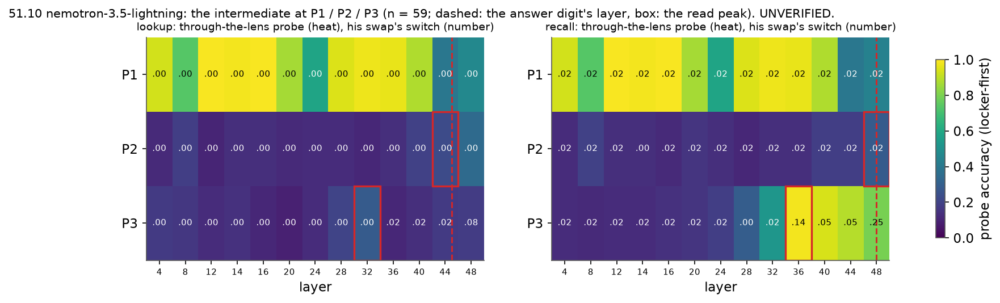

# 51.10: does the intermediate pass through J-space? Read / write per position, per reader

Batch 51, test 51.10 (jobs/c3/batch51.yaml addendum_2; batch 52 coverage, no prediction: coverage run on an already-scored rule; rules first scored in results/x51_jread/x51_10-20261028T190608Z). Main-test items, chat; read statistics on every item of the run, decided on 49.1's locker-first items (the write and remove arms' items); cluster bootstrap over the bridge items (10000, seed 0). UNVERIFIED.

Rules (fixed in advance):

- read: through-the-lens probe >= 0.8 and lens top-5 >= 0.5 at some layer before the answer digit's layer, while the full-residual probe >= 0.9 there.
- write: at the layer of the read peak, his swap or the J++ part of the change (gain <= 2) switches >= 0.5 of what the whole-state patch switches at that layer, with the random part <= 0.10.
- a: in J-space: read holds and write holds.
- b: readable, not used: read holds, write fails.
- c: routes around J-space: through-the-lens < 0.5 at every layer before the answer while the full residual >= 0.9 at some layer, and write fails.
- d: not represented: the full-residual probe < 0.5 at every layer before the answer.

As computed: the answer layer = per reader the lower median over the locker-first O prompts of the layer from which O's answer is the plain logit lens's top token at P3 through the last layer; 'before' = cached layers strictly below it; lens top-5 = the share of the locker-first O and S rows whose own bridge entity ranks <= 5 among the letter tokens by his lens logits; the probes' accuracy on the locker-first rows (O and S, out of fold, folds by scene); the read peak = the layer before the answer with the highest through-the-lens accuracy (ties: the earliest); write at the read peak (the best layer beside), the passing arm's own random twin <= 0.10; (d) before (a)-(c); P2 uses P3's answer layer. Point estimates decide (EPS 1e-9).

| model | reader | answer layer | P3 first readable | P3 peak: swap / whole | P3 label | P2 first readable | P2 peak: swap / whole | P2 label |
|---|---|---|---|---|---|---|---|---|
| nemotron-3.5-lightning | lookup | answer L45 | None | L32: 0.00 / 0.90 | **none of the four** | None | L44: 0.00 / 0.00 | **none of the four** |
| nemotron-3.5-lightning | recall | answer L49 | 36 | L36: 0.14 / 0.97 | **(b) readable, not used** | None | L48: 0.02 / 0.02 | **none of the four (writable, not readable)** |

## nemotron-3.5-lightning (nem35l_x52_jread, L14, n = 59 locker-first of 200 read)

### lookup: answer layer L45 (quartiles [39.0, 45.0, 49.0]; never settled 0 of 59; S's prompts L45)

- P3: **none of the four**; read False, write False (with his rotated control as the swap's twin: False), peak L32, first readable None (before the answer: None); at the peak {"whole": 0.8983050847457628, "arms": {"swap": {"switch": 0.0, "twin": 0.0, "ratio": 0.0, "ok": false}, "jpp1": {"switch": 0.0, "twin": 0.0, "ratio": 0.0, "ok": false}, "jpp2": {"switch": 0.0, "twin": 0.01694915254237288, "ratio": 0.0, "ok": false}}, "holds": false}; best layer L48 {"whole": 1.0, "arms": {"swap": {"switch": 0.0847457627118644, "twin": 0.0, "ratio": 0.0847457627118644, "ok": false}, "jpp1": {"switch": 0.4576271186440678, "twin": 0.03389830508474576, "ratio": 0.4576271186440678, "ok": false}, "jpp2": {"switch": 0.9661016949152542, "twin": 0.6779661016949152, "ratio": 0.9661016949152542, "ok": false}}, "holds": false}
- P2: **none of the four**; read False, write False (with his rotated control as the swap's twin: False), peak L44, first readable None (before the answer: None); at the peak {"whole": 0.0, "arms": {"swap": {"switch": 0.0, "twin": 0.0, "ratio": null, "ok": false}, "jpp1": {"switch": 0.0, "twin": 0.0, "ratio": null, "ok": false}, "jpp2": {"switch": 0.0, "twin": 0.0, "ratio": null, "ok": false}}, "holds": false}; best layer L4 {"whole": 0.0, "arms": {"swap": {"switch": 0.0, "twin": 0.0, "ratio": null, "ok": false}, "jpp1": {"switch": 0.0, "twin": 0.0, "ratio": null, "ok": false}, "jpp2": {"switch": 0.0, "twin": 0.0, "ratio": null, "ok": false}}, "holds": false}

| pos | layer | thru | full | out | chance | top1 | top5 | other top5 | swap | swap_rand | swap_rot | jpp1 | rand1 | jpp2 | rand2 | whole | loss swap / whole |
|---|---|---|---|---|---|---|---|---|---|---|---|---|---|---|---|---|---|
| P1 | 4 | 0.93 [0.88, 0.97] | 0.99 [0.97, 1.00] | 0.99 [0.97, 1.00] | 0.10 | 0.08 | 0.27 | 0.00 | 0.00 | 0.00 | 0.00 | 0.14 | 0.02 | 0.98 | 0.69 | 1.00 | 3.78 / 3.81 |
| P1 | 8 | 0.74 [0.63, 0.82] | 0.99 [0.97, 1.00] | 0.99 [0.97, 1.00] | 0.10 | 0.00 | 0.01 | 0.00 | 0.00 | 0.00 | 0.00 | 0.15 | 0.02 | 0.97 | 0.39 | 1.00 | 3.80 / 3.82 |
| P1 | 12 | 0.99 [0.97, 1.00] | 0.98 [0.95, 1.00] | 0.99 [0.97, 1.00] | 0.10 | 0.21 | 0.76 | 0.00 | 0.00 | 0.00 | 0.00 | 0.02 | 0.03 | 0.05 | 0.32 | 0.98 | 3.77 / 3.85 |
| P1 | 14 | 0.98 [0.95, 1.00] | 0.99 [0.97, 1.00] | 0.99 [0.97, 1.00] | 0.10 | 0.21 | 0.86 | 0.00 | 0.00 | 0.02 | 0.00 | 0.02 | 0.05 | 0.10 | 0.31 | 0.98 | 3.79 / 3.83 |
| P1 | 16 | 0.99 [0.97, 1.00] | 0.97 [0.94, 1.00] | 0.97 [0.94, 1.00] | 0.10 | 0.33 | 0.98 | 0.00 | 0.00 | 0.00 | 0.02 | 0.02 | 0.03 | 0.03 | 0.14 | 0.98 | 3.78 / 3.83 |
| P1 | 20 | 0.86 [0.80, 0.93] | 0.95 [0.89, 0.99] | 0.97 [0.93, 0.99] | 0.10 | 0.07 | 0.33 | 0.00 | 0.00 | 0.00 | 0.00 | 0.02 | 0.03 | 0.12 | 0.17 | 0.83 | 3.80 / 3.83 |
| P1 | 24 | 0.58 [0.48, 0.68] | 0.91 [0.83, 0.96] | 0.91 [0.84, 0.95] | 0.10 | 0.02 | 0.18 | 0.00 | 0.00 | 0.00 | 0.00 | 0.03 | 0.03 | 0.12 | 0.07 | 0.61 | 3.79 / 3.79 |
| P1 | 28 | 0.95 [0.90, 0.99] | 0.97 [0.94, 1.00] | 0.98 [0.95, 1.00] | 0.10 | 0.10 | 0.69 | 0.00 | 0.00 | 0.00 | 0.00 | 0.00 | 0.00 | 0.00 | 0.00 | 0.00 | 3.81 / 3.78 |
| P1 | 32 | 0.97 [0.94, 1.00] | 0.99 [0.97, 1.00] | 0.99 [0.97, 1.00] | 0.10 | 0.03 | 0.30 | 0.00 | 0.00 | 0.00 | 0.00 | 0.00 | 0.00 | 0.00 | 0.00 | 0.00 | 3.79 / 3.77 |
| P1 | 36 | 0.97 [0.93, 0.99] | 0.98 [0.95, 1.00] | 0.99 [0.97, 1.00] | 0.10 | 0.07 | 0.69 | 0.00 | 0.00 | 0.00 | 0.00 | 0.00 | 0.00 | 0.00 | 0.00 | 0.00 | 3.77 / 3.76 |
| P1 | 40 | 0.88 [0.80, 0.95] | 0.99 [0.97, 1.00] | 0.98 [0.95, 1.00] | 0.10 | 0.07 | 0.36 | 0.02 | 0.00 | 0.00 | 0.00 | 0.00 | 0.00 | 0.00 | 0.00 | 0.00 | 3.77 / 3.75 |
| P1 | 44 | 0.40 [0.31, 0.48] | 0.99 [0.97, 1.00] | 0.99 [0.97, 1.00] | 0.10 | 0.02 | 0.05 | 0.06 | 0.00 | 0.00 | 0.00 | 0.00 | 0.00 | 0.00 | 0.00 | 0.00 | 3.81 / 3.77 |
| P1 | 48 | 0.47 [0.37, 0.56] | 0.99 [0.97, 1.00] | 0.99 [0.97, 1.00] | 0.10 | 0.00 | 0.04 | 0.13 | 0.00 | 0.00 | 0.00 | 0.00 | 0.00 | 0.00 | 0.00 | 0.00 | 3.86 / 3.79 |
| P2 | 4 | 0.12 [0.06, 0.19] | 0.19 [0.11, 0.26] | 0.18 [0.11, 0.25] | 0.10 | 0.00 | 0.00 | 0.00 | 0.00 | 0.00 | 0.00 | 0.00 | 0.00 | 0.00 | 0.00 | 0.00 | 0.73 / 0.74 |
| P2 | 8 | 0.19 [0.11, 0.26] | 0.25 [0.15, 0.38] | 0.25 [0.15, 0.35] | 0.10 | 0.00 | 0.00 | 0.00 | 0.00 | 0.00 | 0.00 | 0.00 | 0.00 | 0.00 | 0.00 | 0.00 | 0.73 / 0.73 |
| P2 | 12 | 0.10 [0.04, 0.16] | 0.43 [0.34, 0.52] | 0.39 [0.29, 0.48] | 0.10 | 0.00 | 0.00 | 0.00 | 0.00 | 0.00 | 0.00 | 0.00 | 0.00 | 0.00 | 0.00 | 0.00 | 0.73 / 0.73 |
| P2 | 14 | 0.14 [0.06, 0.22] | 0.36 [0.27, 0.43] | 0.31 [0.24, 0.38] | 0.10 | 0.00 | 0.00 | 0.00 | 0.00 | 0.00 | 0.00 | 0.00 | 0.00 | 0.00 | 0.00 | 0.00 | 0.73 / 0.73 |
| P2 | 16 | 0.14 [0.07, 0.20] | 0.33 [0.23, 0.42] | 0.31 [0.21, 0.38] | 0.10 | 0.00 | 0.00 | 0.00 | 0.00 | 0.00 | 0.00 | 0.00 | 0.00 | 0.00 | 0.00 | 0.00 | 0.73 / 0.73 |
| P2 | 20 | 0.12 [0.05, 0.18] | 0.28 [0.18, 0.36] | 0.29 [0.20, 0.37] | 0.10 | 0.00 | 0.00 | 0.00 | 0.00 | 0.00 | 0.00 | 0.00 | 0.00 | 0.00 | 0.00 | 0.02 | 0.73 / 0.72 |
| P2 | 24 | 0.13 [0.07, 0.19] | 0.39 [0.29, 0.47] | 0.36 [0.26, 0.46] | 0.10 | 0.00 | 0.00 | 0.00 | 0.00 | 0.00 | 0.00 | 0.00 | 0.00 | 0.00 | 0.00 | 0.00 | 0.73 / 0.73 |
| P2 | 28 | 0.13 [0.06, 0.19] | 0.37 [0.27, 0.46] | 0.36 [0.26, 0.46] | 0.10 | 0.00 | 0.00 | 0.00 | 0.00 | 0.00 | 0.00 | 0.00 | 0.00 | 0.00 | 0.00 | 0.00 | 0.73 / 0.72 |
| P2 | 32 | 0.11 [0.05, 0.17] | 0.40 [0.27, 0.50] | 0.38 [0.26, 0.48] | 0.10 | 0.00 | 0.00 | 0.00 | 0.00 | 0.00 | 0.00 | 0.00 | 0.00 | 0.00 | 0.00 | 0.00 | 0.74 / 0.72 |
| P2 | 36 | 0.14 [0.08, 0.19] | 0.58 [0.47, 0.67] | 0.56 [0.44, 0.65] | 0.10 | 0.00 | 0.00 | 0.00 | 0.00 | 0.00 | 0.00 | 0.00 | 0.00 | 0.00 | 0.00 | 0.00 | 0.73 / 0.72 |
| P2 | 40 | 0.19 [0.13, 0.25] | 0.59 [0.46, 0.70] | 0.53 [0.42, 0.64] | 0.10 | 0.00 | 0.00 | 0.00 | 0.00 | 0.00 | 0.00 | 0.00 | 0.00 | 0.00 | 0.00 | 0.00 | 0.73 / 0.72 |
| P2 | 44 | 0.23 [0.12, 0.32] | 0.62 [0.51, 0.72] | 0.63 [0.52, 0.73] | 0.10 | 0.00 | 0.02 | 0.00 | 0.00 | 0.00 | 0.00 | 0.00 | 0.00 | 0.00 | 0.00 | 0.00 | 0.73 / 0.72 |
| P2 | 48 | 0.35 [0.25, 0.44] | 0.63 [0.52, 0.73] | 0.58 [0.47, 0.69] | 0.10 | 0.06 | 0.17 | 0.09 | 0.00 | 0.00 | 0.00 | 0.00 | 0.00 | 0.00 | 0.00 | 0.00 | 0.76 / 0.72 |
| P3 | 4 | 0.17 [0.09, 0.25] | 0.25 [0.18, 0.33] | 0.21 [0.15, 0.27] | 0.10 | 0.00 | 0.00 | 0.00 | 0.00 | 0.00 | 0.00 | 0.00 | 0.00 | 0.00 | 0.00 | 0.00 | - |
| P3 | 8 | 0.16 [0.10, 0.21] | 0.25 [0.19, 0.32] | 0.21 [0.14, 0.29] | 0.10 | 0.00 | 0.00 | 0.00 | 0.00 | 0.00 | 0.00 | 0.00 | 0.00 | 0.00 | 0.00 | 0.00 | - |
| P3 | 12 | 0.13 [0.06, 0.19] | 0.18 [0.11, 0.24] | 0.14 [0.08, 0.20] | 0.10 | 0.00 | 0.00 | 0.00 | 0.00 | 0.00 | 0.00 | 0.00 | 0.00 | 0.00 | 0.00 | 0.00 | - |
| P3 | 14 | 0.14 [0.07, 0.22] | 0.19 [0.14, 0.24] | 0.16 [0.10, 0.21] | 0.10 | 0.00 | 0.00 | 0.00 | 0.00 | 0.00 | 0.00 | 0.00 | 0.00 | 0.00 | 0.00 | 0.00 | - |
| P3 | 16 | 0.11 [0.03, 0.19] | 0.21 [0.14, 0.28] | 0.19 [0.12, 0.24] | 0.10 | 0.00 | 0.00 | 0.00 | 0.00 | 0.00 | 0.00 | 0.00 | 0.00 | 0.00 | 0.00 | 0.00 | - |
| P3 | 20 | 0.09 [0.03, 0.16] | 0.10 [0.05, 0.16] | 0.11 [0.06, 0.16] | 0.10 | 0.00 | 0.00 | 0.00 | 0.00 | 0.00 | 0.00 | 0.00 | 0.00 | 0.00 | 0.00 | 0.00 | - |
| P3 | 24 | 0.13 [0.06, 0.18] | 0.42 [0.32, 0.50] | 0.41 [0.31, 0.49] | 0.10 | 0.00 | 0.00 | 0.00 | 0.00 | 0.00 | 0.00 | 0.00 | 0.00 | 0.00 | 0.00 | 0.03 | - |
| P3 | 28 | 0.20 [0.10, 0.30] | 0.63 [0.48, 0.75] | 0.61 [0.46, 0.73] | 0.10 | 0.00 | 0.00 | 0.00 | 0.00 | 0.00 | 0.00 | 0.00 | 0.00 | 0.00 | 0.00 | 0.86 | - |
| P3 | 32 | 0.29 [0.18, 0.39] | 0.71 [0.62, 0.79] | 0.66 [0.56, 0.76] | 0.10 | 0.00 | 0.00 | 0.00 | 0.00 | 0.00 | 0.00 | 0.00 | 0.00 | 0.00 | 0.02 | 0.90 | - |
| P3 | 36 | 0.11 [0.06, 0.16] | 0.75 [0.62, 0.84] | 0.73 [0.59, 0.84] | 0.10 | 0.00 | 0.00 | 0.00 | 0.02 | 0.00 | 0.00 | 0.03 | 0.02 | 0.41 | 0.08 | 0.97 | - |
| P3 | 40 | 0.14 [0.09, 0.18] | 0.80 [0.69, 0.88] | 0.78 [0.68, 0.85] | 0.10 | 0.00 | 0.00 | 0.00 | 0.02 | 0.00 | 0.00 | 0.02 | 0.02 | 0.31 | 0.34 | 0.98 | - |
| P3 | 44 | 0.17 [0.11, 0.23] | 0.84 [0.74, 0.91] | 0.79 [0.67, 0.87] | 0.10 | 0.00 | 0.00 | 0.00 | 0.02 | 0.00 | 0.00 | 0.08 | 0.02 | 0.81 | 0.36 | 1.00 | - |
| P3 | 48 | 0.18 [0.11, 0.24] | 0.84 [0.74, 0.91] | 0.83 [0.73, 0.90] | 0.10 | 0.00 | 0.00 | 0.00 | 0.08 | 0.00 | 0.00 | 0.46 | 0.03 | 0.97 | 0.68 | 1.00 | - |
### recall: answer layer L49 (quartiles [48.0, 49.0, 49.0]; never settled 0 of 59; S's prompts L48)

- P3: **(b) readable, not used**; read True, write False (with his rotated control as the swap's twin: False), peak L36, first readable 36 (before the answer: 36); at the peak {"whole": 0.9661016949152542, "arms": {"swap": {"switch": 0.13559322033898305, "twin": 0.03389830508474576, "ratio": 0.14035087719298245, "ok": false}, "jpp1": {"switch": 0.15254237288135594, "twin": 0.03389830508474576, "ratio": 0.15789473684210528, "ok": false}, "jpp2": {"switch": 0.559322033898305, "twin": 0.1864406779661017, "ratio": 0.5789473684210525, "ok": false}}, "holds": false}; best layer L48 {"whole": 1.0, "arms": {"swap": {"switch": 0.2542372881355932, "twin": 0.01694915254237288, "ratio": 0.2542372881355932, "ok": false}, "jpp1": {"switch": 0.5254237288135594, "twin": 0.03389830508474576, "ratio": 0.5254237288135594, "ok": true}, "jpp2": {"switch": 0.8983050847457628, "twin": 0.2033898305084746, "ratio": 0.8983050847457628, "ok": false}}, "holds": true}
- P2: **none of the four (writable, not readable)**; read False, write True (with his rotated control as the swap's twin: True), peak L48, first readable None (before the answer: None); at the peak {"whole": 0.01694915254237288, "arms": {"swap": {"switch": 0.01694915254237288, "twin": 0.01694915254237288, "ratio": 1.0, "ok": true}, "jpp1": {"switch": 0.01694915254237288, "twin": 0.01694915254237288, "ratio": 1.0, "ok": true}, "jpp2": {"switch": 0.01694915254237288, "twin": 0.01694915254237288, "ratio": 1.0, "ok": true}}, "holds": true}; best layer L4 {"whole": 0.01694915254237288, "arms": {"swap": {"switch": 0.01694915254237288, "twin": 0.01694915254237288, "ratio": 1.0, "ok": true}, "jpp1": {"switch": 0.01694915254237288, "twin": 0.01694915254237288, "ratio": 1.0, "ok": true}, "jpp2": {"switch": 0.01694915254237288, "twin": 0.01694915254237288, "ratio": 1.0, "ok": true}}, "holds": true}

| pos | layer | thru | full | out | chance | top1 | top5 | other top5 | swap | swap_rand | swap_rot | jpp1 | rand1 | jpp2 | rand2 | whole | loss swap / whole |
|---|---|---|---|---|---|---|---|---|---|---|---|---|---|---|---|---|---|
| P1 | 4 | 0.93 [0.88, 0.97] | 0.99 [0.97, 1.00] | 0.99 [0.97, 1.00] | 0.10 | 0.08 | 0.27 | 0.00 | 0.02 | 0.02 | 0.02 | 0.20 | 0.03 | 0.97 | 0.69 | 1.00 | 3.78 / 3.81 |
| P1 | 8 | 0.74 [0.63, 0.82] | 0.99 [0.97, 1.00] | 0.99 [0.97, 1.00] | 0.10 | 0.00 | 0.01 | 0.00 | 0.02 | 0.02 | 0.02 | 0.29 | 0.02 | 1.00 | 0.44 | 1.00 | 3.80 / 3.82 |
| P1 | 12 | 0.99 [0.97, 1.00] | 0.98 [0.95, 1.00] | 0.99 [0.97, 1.00] | 0.10 | 0.21 | 0.76 | 0.00 | 0.02 | 0.02 | 0.02 | 0.14 | 0.03 | 0.63 | 0.31 | 1.00 | 3.77 / 3.85 |
| P1 | 14 | 0.98 [0.95, 1.00] | 0.99 [0.97, 1.00] | 0.99 [0.97, 1.00] | 0.10 | 0.21 | 0.86 | 0.00 | 0.02 | 0.02 | 0.02 | 0.10 | 0.05 | 0.63 | 0.42 | 1.00 | 3.79 / 3.83 |
| P1 | 16 | 0.99 [0.97, 1.00] | 0.97 [0.94, 1.00] | 0.97 [0.94, 1.00] | 0.10 | 0.33 | 0.98 | 0.00 | 0.02 | 0.02 | 0.02 | 0.15 | 0.02 | 0.41 | 0.15 | 1.00 | 3.78 / 3.83 |
| P1 | 20 | 0.86 [0.80, 0.93] | 0.95 [0.89, 0.99] | 0.97 [0.93, 0.99] | 0.10 | 0.07 | 0.33 | 0.00 | 0.02 | 0.02 | 0.02 | 0.19 | 0.02 | 0.54 | 0.14 | 0.75 | 3.80 / 3.83 |
| P1 | 24 | 0.58 [0.48, 0.68] | 0.91 [0.83, 0.96] | 0.91 [0.84, 0.95] | 0.10 | 0.02 | 0.18 | 0.00 | 0.02 | 0.02 | 0.02 | 0.08 | 0.02 | 0.39 | 0.05 | 0.51 | 3.79 / 3.79 |
| P1 | 28 | 0.95 [0.90, 0.99] | 0.97 [0.93, 0.99] | 0.98 [0.95, 1.00] | 0.10 | 0.10 | 0.69 | 0.00 | 0.02 | 0.02 | 0.02 | 0.03 | 0.03 | 0.10 | 0.03 | 0.07 | 3.81 / 3.78 |
| P1 | 32 | 0.97 [0.94, 1.00] | 0.99 [0.97, 1.00] | 0.99 [0.97, 1.00] | 0.10 | 0.03 | 0.30 | 0.00 | 0.02 | 0.03 | 0.02 | 0.03 | 0.03 | 0.05 | 0.05 | 0.05 | 3.79 / 3.77 |
| P1 | 36 | 0.97 [0.93, 0.99] | 0.98 [0.95, 1.00] | 0.99 [0.97, 1.00] | 0.10 | 0.07 | 0.69 | 0.00 | 0.02 | 0.02 | 0.02 | 0.02 | 0.02 | 0.02 | 0.02 | 0.02 | 3.77 / 3.76 |
| P1 | 40 | 0.88 [0.80, 0.95] | 0.99 [0.97, 1.00] | 0.98 [0.95, 1.00] | 0.10 | 0.07 | 0.36 | 0.02 | 0.02 | 0.02 | 0.02 | 0.02 | 0.02 | 0.02 | 0.02 | 0.02 | 3.77 / 3.75 |
| P1 | 44 | 0.40 [0.31, 0.48] | 0.99 [0.97, 1.00] | 0.99 [0.97, 1.00] | 0.10 | 0.02 | 0.05 | 0.06 | 0.02 | 0.02 | 0.02 | 0.02 | 0.02 | 0.02 | 0.02 | 0.02 | 3.81 / 3.77 |
| P1 | 48 | 0.44 [0.33, 0.54] | 0.99 [0.97, 1.00] | 0.99 [0.97, 1.00] | 0.10 | 0.00 | 0.04 | 0.13 | 0.02 | 0.02 | 0.02 | 0.02 | 0.02 | 0.02 | 0.02 | 0.02 | 3.86 / 3.79 |
| P2 | 4 | 0.13 [0.06, 0.20] | 0.17 [0.11, 0.23] | 0.19 [0.13, 0.24] | 0.10 | 0.00 | 0.00 | 0.00 | 0.02 | 0.02 | 0.02 | 0.02 | 0.02 | 0.02 | 0.02 | 0.02 | 0.55 / 0.54 |
| P2 | 8 | 0.19 [0.09, 0.30] | 0.25 [0.17, 0.34] | 0.26 [0.18, 0.35] | 0.10 | 0.00 | 0.00 | 0.00 | 0.02 | 0.02 | 0.02 | 0.02 | 0.02 | 0.02 | 0.02 | 0.02 | 0.55 / 0.53 |
| P2 | 12 | 0.14 [0.08, 0.19] | 0.28 [0.18, 0.36] | 0.34 [0.22, 0.45] | 0.10 | 0.00 | 0.00 | 0.00 | 0.02 | 0.02 | 0.02 | 0.02 | 0.00 | 0.00 | 0.02 | 0.02 | 0.55 / 0.54 |
| P2 | 14 | 0.14 [0.08, 0.20] | 0.32 [0.21, 0.44] | 0.28 [0.20, 0.36] | 0.10 | 0.00 | 0.00 | 0.00 | 0.00 | 0.02 | 0.00 | 0.02 | 0.02 | 0.02 | 0.02 | 0.02 | 0.55 / 0.54 |
| P2 | 16 | 0.12 [0.05, 0.19] | 0.36 [0.24, 0.49] | 0.28 [0.16, 0.41] | 0.10 | 0.00 | 0.00 | 0.00 | 0.02 | 0.02 | 0.02 | 0.02 | 0.02 | 0.00 | 0.02 | 0.02 | 0.54 / 0.54 |
| P2 | 20 | 0.15 [0.07, 0.23] | 0.25 [0.16, 0.34] | 0.27 [0.17, 0.36] | 0.10 | 0.00 | 0.00 | 0.00 | 0.02 | 0.02 | 0.02 | 0.02 | 0.02 | 0.02 | 0.02 | 0.02 | 0.55 / 0.54 |
| P2 | 24 | 0.14 [0.06, 0.21] | 0.31 [0.20, 0.40] | 0.35 [0.23, 0.44] | 0.10 | 0.00 | 0.00 | 0.00 | 0.02 | 0.02 | 0.02 | 0.02 | 0.02 | 0.02 | 0.02 | 0.02 | 0.55 / 0.53 |
| P2 | 28 | 0.11 [0.05, 0.18] | 0.34 [0.19, 0.46] | 0.36 [0.25, 0.45] | 0.10 | 0.00 | 0.00 | 0.00 | 0.02 | 0.02 | 0.02 | 0.02 | 0.02 | 0.02 | 0.02 | 0.02 | 0.54 / 0.53 |
| P2 | 32 | 0.14 [0.07, 0.20] | 0.38 [0.25, 0.51] | 0.37 [0.27, 0.47] | 0.10 | 0.00 | 0.00 | 0.00 | 0.02 | 0.02 | 0.02 | 0.02 | 0.02 | 0.02 | 0.02 | 0.02 | 0.54 / 0.52 |
| P2 | 36 | 0.14 [0.06, 0.21] | 0.53 [0.40, 0.64] | 0.51 [0.38, 0.63] | 0.10 | 0.00 | 0.00 | 0.00 | 0.02 | 0.02 | 0.02 | 0.02 | 0.02 | 0.02 | 0.02 | 0.02 | 0.54 / 0.52 |
| P2 | 40 | 0.19 [0.11, 0.26] | 0.61 [0.49, 0.72] | 0.60 [0.49, 0.71] | 0.10 | 0.00 | 0.00 | 0.00 | 0.02 | 0.02 | 0.02 | 0.02 | 0.02 | 0.02 | 0.02 | 0.02 | 0.55 / 0.52 |
| P2 | 44 | 0.19 [0.11, 0.27] | 0.63 [0.51, 0.74] | 0.59 [0.48, 0.70] | 0.10 | 0.00 | 0.01 | 0.00 | 0.02 | 0.02 | 0.02 | 0.02 | 0.02 | 0.02 | 0.02 | 0.02 | 0.56 / 0.51 |
| P2 | 48 | 0.29 [0.18, 0.39] | 0.72 [0.63, 0.81] | 0.67 [0.58, 0.75] | 0.10 | 0.00 | 0.03 | 0.01 | 0.02 | 0.02 | 0.02 | 0.02 | 0.02 | 0.02 | 0.02 | 0.02 | 0.56 / 0.51 |
| P3 | 4 | 0.13 [0.06, 0.20] | 0.21 [0.14, 0.28] | 0.18 [0.11, 0.24] | 0.10 | 0.00 | 0.00 | 0.00 | 0.02 | 0.02 | 0.02 | 0.02 | 0.02 | 0.02 | 0.02 | 0.02 | - |
| P3 | 8 | 0.12 [0.03, 0.21] | 0.31 [0.24, 0.37] | 0.27 [0.19, 0.35] | 0.10 | 0.00 | 0.00 | 0.00 | 0.02 | 0.02 | 0.02 | 0.02 | 0.02 | 0.02 | 0.02 | 0.02 | - |
| P3 | 12 | 0.13 [0.06, 0.19] | 0.30 [0.22, 0.38] | 0.29 [0.19, 0.39] | 0.10 | 0.00 | 0.00 | 0.00 | 0.02 | 0.02 | 0.02 | 0.02 | 0.02 | 0.02 | 0.02 | 0.02 | - |
| P3 | 14 | 0.13 [0.07, 0.18] | 0.31 [0.23, 0.40] | 0.27 [0.18, 0.37] | 0.10 | 0.00 | 0.00 | 0.00 | 0.02 | 0.02 | 0.02 | 0.02 | 0.02 | 0.02 | 0.02 | 0.02 | - |
| P3 | 16 | 0.14 [0.07, 0.21] | 0.31 [0.24, 0.39] | 0.28 [0.20, 0.36] | 0.10 | 0.00 | 0.00 | 0.00 | 0.02 | 0.02 | 0.02 | 0.02 | 0.02 | 0.02 | 0.02 | 0.02 | - |
| P3 | 20 | 0.15 [0.10, 0.21] | 0.33 [0.24, 0.43] | 0.32 [0.23, 0.41] | 0.10 | 0.00 | 0.00 | 0.00 | 0.02 | 0.02 | 0.02 | 0.02 | 0.02 | 0.02 | 0.02 | 0.02 | - |
| P3 | 24 | 0.19 [0.12, 0.26] | 0.53 [0.43, 0.62] | 0.53 [0.42, 0.61] | 0.10 | 0.00 | 0.00 | 0.00 | 0.02 | 0.02 | 0.02 | 0.02 | 0.02 | 0.02 | 0.02 | 0.02 | - |
| P3 | 28 | 0.30 [0.19, 0.41] | 0.75 [0.64, 0.83] | 0.74 [0.63, 0.83] | 0.10 | 0.00 | 0.00 | 0.00 | 0.00 | 0.02 | 0.00 | 0.02 | 0.02 | 0.02 | 0.03 | 0.71 | - |
| P3 | 32 | 0.53 [0.40, 0.66] | 0.96 [0.92, 0.99] | 0.93 [0.89, 0.97] | 0.10 | 0.01 | 0.03 | 0.00 | 0.02 | 0.02 | 0.00 | 0.02 | 0.03 | 0.15 | 0.07 | 0.85 | - |
| P3 | 36 | 0.98 [0.96, 1.00] | 0.99 [0.97, 1.00] | 0.99 [0.97, 1.00] | 0.10 | 0.26 | 0.82 | 0.01 | 0.14 | 0.03 | 0.02 | 0.15 | 0.03 | 0.56 | 0.19 | 0.97 | - |
| P3 | 40 | 0.94 [0.89, 0.98] | 0.99 [0.97, 1.00] | 0.99 [0.97, 1.00] | 0.10 | 0.15 | 0.58 | 0.00 | 0.05 | 0.00 | 0.02 | 0.15 | 0.02 | 0.47 | 0.24 | 1.00 | - |
| P3 | 44 | 0.89 [0.82, 0.94] | 0.99 [0.97, 1.00] | 0.99 [0.97, 1.00] | 0.10 | 0.03 | 0.52 | 0.01 | 0.05 | 0.02 | 0.02 | 0.10 | 0.02 | 0.46 | 0.20 | 1.00 | - |
| P3 | 48 | 0.80 [0.68, 0.88] | 0.99 [0.97, 1.00] | 0.99 [0.97, 1.00] | 0.10 | 0.00 | 0.06 | 0.00 | 0.25 | 0.02 | 0.02 | 0.53 | 0.03 | 0.90 | 0.20 | 1.00 | - |

Removal at P3 (O; kept = O's answer; cost = kept(random) - kept(removal)):

| reader | peak | band | none | ko | ko_rand | jrm | jrm_rand | cost ko | cost jrm |
|---|---|---|---|---|---|---|---|---|---|
| lookup | L32 | [30, 31, 32, 33, 34] | 1.00 [1.00, 1.00] | 1.00 [1.00, 1.00] | 1.00 [1.00, 1.00] | 1.00 [1.00, 1.00] | 1.00 [1.00, 1.00] | 0.00 [0.00, 0.00] | 0.00 [0.00, 0.00] |
| recall | L36 | [34, 35, 36, 37, 38] | 0.98 [0.95, 1.00] | 0.86 [0.77, 0.95] | 0.92 [0.82, 1.00] | 0.95 [0.88, 1.00] | 1.00 [1.00, 1.00] | 0.05 [-0.07, 0.17] | 0.05 [0.00, 0.12] |
- shares of ||Δ||^2 (median per position): {"P1": {"share_J": 0.186593, "share_J_rand": 0.186763, "share_swap": 0.058137, "share_swap_rand": 0.058188}, "P2": {"share_J": 0.108321, "share_J_rand": 0.10831199999999999, "share_swap": 0.08695449999999999, "share_swap_rand": 0.0871205}, "P3": {"share_J": 0.1001745, "share_J_rand": 0.1000415, "share_swap": 0.086314, "share_swap_rand": 0.085925}}; the swap's share capped at 1 for its random twin on 111 of 4602 rows; the read folder's P3 peaks {'lookup': 32, 'recall': 36} (match the run's: True)

Arms: swap = his J-part swap: h_O - J10(h_O) + J10(h_S), J10 the projection on the state's own top-10 lens directions (O's protected rows; jswap's swap); swap_rand = a random part of Δ = h_S - h_O at the swap's share of ||Δ||^2 (capped at 1; seed 888 + layer); swap_rot = his own control (jswap's swap_rot): h_O + (J10(h_S) - J10(h_O)) R^T, R the layer's random orthogonal matrix (seed 888 + layer): the swap's change at its own size in a random direction; jpp1 = h_O + P_J Δ, the change's 25-atom signed OMP J++ part (49.1's J(1,0)); rand1 = h_O + R Δ, X0's random part of Δ at P_J Δ's share (49.1's R(1,0)); jpp2 = h_O + 2 P_J Δ (49.1's J(2,0)); rand2 = h_O + 2 R Δ (49.1's R(2,0)); whole = h_O <- h_S (Δ added; the whole state patched); ko = his knock-out at P3: the top-10 lens span removed at every layer of the band (peak +- 2); ko_rand = a random subspace part of the share his removal takes, at P3, every band layer; jrm = at the peak layer, P3's state minus its projection on Δ's 25 OMP atoms there (47.5's zeroing); jrm_rand = a random subspace of the same share of ||h_O||^2 (47.5's random).
Probe inputs: thru = the projection on his top-10 span (through the lens); full = the full residual (readable at all); out = the residual minus that projection (outside the lens).
