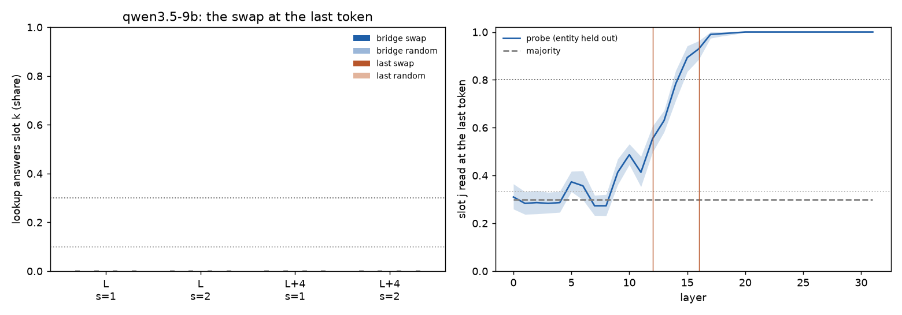
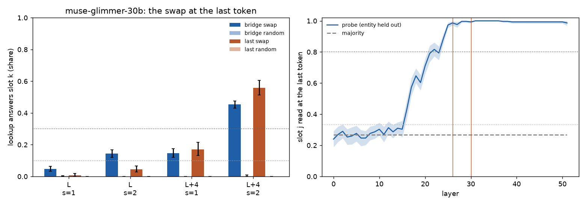
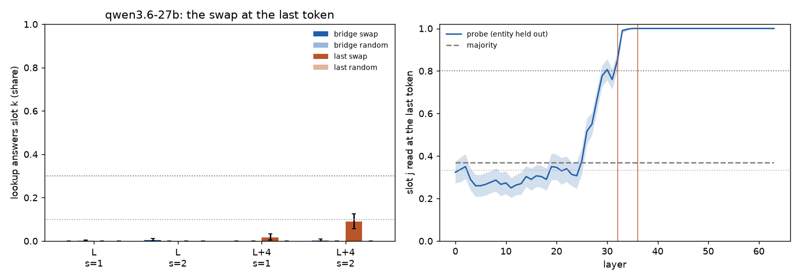

# 51.4: does the address travel? The swap at the last token

Batch 51, test 51.4 (jobs/c3/batch51.yaml; Q51.4, Dan: (b) · 35%; (d) · 35%; (c) · 20%; (a) · 10%). Routes C0 scenes, O; the pointer swap s (mu_k - mu_j) added at the last (read) token at L and L + 4, with x8's bridge-word means and with means refit on the last token (fit half), each against a random vector of its norm. Cluster bootstrap over the bridge items (10000, seed 0). UNVERIFIED.

Rule (fixed in advance): "The code travels": the bridge-fit swap sends >= 0.3 of lookups to slot k (random <= 0.05). "Re-encoded on copy": bridge-fit <= 0.10 while last-token-fit >= 0.3. "Not at the last token": both <= 0.10 while the probe reads the slot there >= 0.8. Otherwise in between.

As computed: over the four cells (layer L or L + 4, s = 1 or 2): travels if some cell has bridge_swap's target share >= 0.30 and its own bridge_random's <= 0.05; else re-encoded if every cell's bridge_swap <= 0.10 and some cell's last_swap >= 0.30; else not at the last token if every cell's bridge_swap and last_swap <= 0.10 and the probe's held-out accuracy at the last token at L or L + 4 >= 0.80; else in between. bridge_swap / bridge_random over every item, last_swap / last_random over the read half.

| model | run | n (read) | label | per layer (L / L+4) | probe at L / L+4 | none: lookup right |
|---|---|---|---|---|---|---|
| qwen3.5-9b | qwen35_9b_x51_4 | 300 (145) | **(c) not at the last token** | (d) in between / (c) not at the last token | 0.55 [0.50, 0.61] / 0.93 [0.89, 0.96] | 1.00 |
| muse-glimmer-30b | muse30_x51_4 | 300 (144) | **(a) the code travels** | (d) in between / (a) the code travels | 0.99 [0.97, 1.00] / 0.99 [0.98, 1.00] | 1.00 |
| qwen3.6-27b | x51_4_27b | 300 (150) | **(c) not at the last token** | (c) not at the last token / (c) not at the last token | 0.85 [0.80, 0.89] / 1.00 [1.00, 1.00] | 1.00 |

## qwen3.5-9b (qwen35_9b_x51_4; L = 12, L + 4 = 16; 300 items, 30 bridge items, read half 145)

Clauses: travels False; reencoded False; not_last True; travel cells []; last-fit cells >= 0.3 [].

| arm | layer | s | items | n | slot k (target) | original (clean answer kept) | third | other | recall changed | recall gives slot k's item |
|---|---|---|---|---|---|---|---|---|---|---|
| bridge_swap | L | 1 | all | 600 | 0.00 [0.00, 0.00] | 1.00 [1.00, 1.00] | 0.00 [0.00, 0.00] | 0.00 [0.00, 0.00] | 0.01 [0.00, 0.02] | 0.16 [0.12, 0.22] |
| bridge_swap | L | 1 | read | 290 | 0.00 [0.00, 0.00] | 1.00 [1.00, 1.00] | 0.00 [0.00, 0.00] | 0.00 [0.00, 0.00] | 0.01 [0.00, 0.02] | 0.17 [0.10, 0.25] |
| bridge_swap | L | 2 | all | 600 | 0.00 [0.00, 0.00] | 1.00 [1.00, 1.00] | 0.00 [0.00, 0.00] | 0.00 [0.00, 0.00] | 0.04 [0.02, 0.07] | 0.18 [0.13, 0.23] |
| bridge_swap | L | 2 | read | 290 | 0.00 [0.00, 0.00] | 1.00 [1.00, 1.00] | 0.00 [0.00, 0.00] | 0.00 [0.00, 0.00] | 0.07 [0.03, 0.11] | 0.18 [0.12, 0.26] |
| bridge_swap | L+4 | 1 | all | 600 | 0.00 [0.00, 0.00] | 1.00 [1.00, 1.00] | 0.00 [0.00, 0.00] | 0.00 [0.00, 0.00] | 0.01 [0.00, 0.02] | 0.17 [0.12, 0.22] |
| bridge_swap | L+4 | 1 | read | 290 | 0.00 [0.00, 0.00] | 1.00 [1.00, 1.00] | 0.00 [0.00, 0.00] | 0.00 [0.00, 0.00] | 0.02 [0.00, 0.04] | 0.17 [0.11, 0.25] |
| bridge_swap | L+4 | 2 | all | 600 | 0.00 [0.00, 0.00] | 1.00 [1.00, 1.00] | 0.00 [0.00, 0.00] | 0.00 [0.00, 0.00] | 0.02 [0.01, 0.04] | 0.17 [0.13, 0.23] |
| bridge_swap | L+4 | 2 | read | 290 | 0.00 [0.00, 0.00] | 1.00 [1.00, 1.00] | 0.00 [0.00, 0.00] | 0.00 [0.00, 0.00] | 0.03 [0.01, 0.06] | 0.18 [0.12, 0.26] |
| bridge_random | L | 1 | all | 600 | 0.00 [0.00, 0.00] | 1.00 [1.00, 1.00] | 0.00 [0.00, 0.00] | 0.00 [0.00, 0.00] | 0.01 [0.00, 0.01] | 0.16 [0.12, 0.22] |
| bridge_random | L | 1 | read | 290 | 0.00 [0.00, 0.00] | 1.00 [1.00, 1.00] | 0.00 [0.00, 0.00] | 0.00 [0.00, 0.00] | 0.00 [0.00, 0.01] | 0.16 [0.10, 0.24] |
| bridge_random | L | 2 | all | 600 | 0.00 [0.00, 0.00] | 1.00 [1.00, 1.00] | 0.00 [0.00, 0.00] | 0.00 [0.00, 0.00] | 0.03 [0.01, 0.05] | 0.16 [0.12, 0.21] |
| bridge_random | L | 2 | read | 290 | 0.00 [0.00, 0.00] | 1.00 [1.00, 1.00] | 0.00 [0.00, 0.00] | 0.00 [0.00, 0.00] | 0.04 [0.01, 0.09] | 0.17 [0.10, 0.24] |
| bridge_random | L+4 | 1 | all | 600 | 0.00 [0.00, 0.00] | 1.00 [1.00, 1.00] | 0.00 [0.00, 0.00] | 0.00 [0.00, 0.00] | 0.01 [0.00, 0.01] | 0.16 [0.12, 0.21] |
| bridge_random | L+4 | 1 | read | 290 | 0.00 [0.00, 0.00] | 1.00 [1.00, 1.00] | 0.00 [0.00, 0.00] | 0.00 [0.00, 0.00] | 0.00 [0.00, 0.01] | 0.16 [0.10, 0.24] |
| bridge_random | L+4 | 2 | all | 600 | 0.00 [0.00, 0.00] | 1.00 [1.00, 1.00] | 0.00 [0.00, 0.00] | 0.00 [0.00, 0.00] | 0.01 [0.00, 0.04] | 0.16 [0.12, 0.21] |
| bridge_random | L+4 | 2 | read | 290 | 0.00 [0.00, 0.00] | 1.00 [1.00, 1.00] | 0.00 [0.00, 0.00] | 0.00 [0.00, 0.00] | 0.01 [0.00, 0.02] | 0.17 [0.10, 0.24] |
| last_swap | L | 1 | read | 290 | 0.00 [0.00, 0.00] | 1.00 [1.00, 1.00] | 0.00 [0.00, 0.00] | 0.00 [0.00, 0.00] | 0.00 [0.00, 0.00] | 0.16 [0.10, 0.24] |
| last_swap | L | 2 | read | 290 | 0.00 [0.00, 0.00] | 1.00 [1.00, 1.00] | 0.00 [0.00, 0.00] | 0.00 [0.00, 0.00] | 0.01 [0.00, 0.02] | 0.17 [0.10, 0.25] |
| last_swap | L+4 | 1 | read | 290 | 0.00 [0.00, 0.00] | 1.00 [1.00, 1.00] | 0.00 [0.00, 0.00] | 0.00 [0.00, 0.00] | 0.01 [0.00, 0.03] | 0.17 [0.10, 0.25] |
| last_swap | L+4 | 2 | read | 290 | 0.00 [0.00, 0.00] | 1.00 [1.00, 1.00] | 0.00 [0.00, 0.00] | 0.00 [0.00, 0.00] | 0.02 [0.00, 0.05] | 0.17 [0.11, 0.25] |
| last_random | L | 1 | read | 290 | 0.00 [0.00, 0.00] | 1.00 [1.00, 1.00] | 0.00 [0.00, 0.00] | 0.00 [0.00, 0.00] | 0.00 [0.00, 0.00] | 0.16 [0.10, 0.24] |
| last_random | L | 2 | read | 290 | 0.00 [0.00, 0.00] | 1.00 [1.00, 1.00] | 0.00 [0.00, 0.00] | 0.00 [0.00, 0.00] | 0.00 [0.00, 0.00] | 0.16 [0.10, 0.24] |
| last_random | L+4 | 1 | read | 290 | 0.00 [0.00, 0.00] | 1.00 [1.00, 1.00] | 0.00 [0.00, 0.00] | 0.00 [0.00, 0.00] | 0.00 [0.00, 0.00] | 0.16 [0.10, 0.24] |
| last_random | L+4 | 2 | read | 290 | 0.00 [0.00, 0.00] | 1.00 [1.00, 1.00] | 0.00 [0.00, 0.00] | 0.00 [0.00, 0.00] | 0.00 [0.00, 0.01] | 0.16 [0.10, 0.24] |

Swap minus its random (target share, paired CI): bridge|all|L|s1 0.00 [0.00, 0.00]; bridge|all|L|s2 0.00 [0.00, 0.00]; bridge|all|L+4|s1 0.00 [0.00, 0.00]; bridge|all|L+4|s2 0.00 [0.00, 0.00]; bridge|read|L|s1 0.00 [0.00, 0.00]; bridge|read|L|s2 0.00 [0.00, 0.00]; bridge|read|L+4|s1 0.00 [0.00, 0.00]; bridge|read|L+4|s2 0.00 [0.00, 0.00]; last|read|L|s1 0.00 [0.00, 0.00]; last|read|L|s2 0.00 [0.00, 0.00]; last|read|L+4|s1 0.00 [0.00, 0.00]; last|read|L+4|s2 0.00 [0.00, 0.00].

Norms (median): the swap's norm / ||h_last|| at L12: bridge_swap|L|s1 0.161, bridge_swap|L|s2 0.323, bridge_swap|L+4|s1 0.161, bridge_swap|L+4|s2 0.323, last_swap|L|s1 0.023, last_swap|L|s2 0.046, last_swap|L+4|s1 0.071, last_swap|L+4|s2 0.142. Beside: x8's swap at the bridge word, s = 1, / ||h_bridge|| at L: 0.130; ||h_last|| / ||h_bridge|| at L: 0.81. ||mu_k - mu_j||: {'bridge_L12': {'0-1': 4.0998, '0-2': 4.8187, '1-2': 2.43}, 'bridge_L16': {'0-1': 4.0998, '0-2': 4.8187, '1-2': 2.43}, 'last_L12': {'0-1': 0.5802, '0-2': 0.6164, '1-2': 0.3709}, 'last_L16': {'0-1': 1.8068, '0-2': 1.8572, '1-2': 0.9734}}; cos(bridge-fit, last-fit step): {'L12': {'0-1': 0.192, '0-2': 0.0451, '1-2': 0.0066}, 'L16': {'0-1': 0.1281, '0-2': 0.1023, '1-2': 0.0704}}.

Unedited: the lookup reads O's answer on 1.00; the recall changed on 0.00. Items as the routes run's C0 items: False.

Probe (slot j at the last token; entity held out; chance 0.33): L0 0.31 (maj 0.30), L1 0.28 (maj 0.30), L2 0.29 (maj 0.30), L3 0.28 (maj 0.30), L4 0.29 (maj 0.30), L5 0.37 (maj 0.30), L6 0.36 (maj 0.30), L7 0.27 (maj 0.30), L8 0.27 (maj 0.30), L9 0.41 (maj 0.30), L10 0.49 (maj 0.30), L11 0.41 (maj 0.30), L12 0.55 (maj 0.30), L13 0.63 (maj 0.30), L14 0.78 (maj 0.30), L15 0.89 (maj 0.30), L16 0.93 (maj 0.30), L17 0.99 (maj 0.30), L18 0.99 (maj 0.30), L19 1.00 (maj 0.30), L20 1.00 (maj 0.30), L21 1.00 (maj 0.30), L22 1.00 (maj 0.30), L23 1.00 (maj 0.30), L24 1.00 (maj 0.30), L25 1.00 (maj 0.30), L26 1.00 (maj 0.30), L27 1.00 (maj 0.30), L28 1.00 (maj 0.30), L29 1.00 (maj 0.30), L30 1.00 (maj 0.30), L31 1.00 (maj 0.30).

## muse-glimmer-30b (muse30_x51_4; L = 26, L + 4 = 30; 300 items, 32 bridge items, read half 144)

Clauses: travels True; reencoded False; not_last False; travel cells ['L+4 s=2']; last-fit cells >= 0.3 ['L+4 s=2'].

| arm | layer | s | items | n | slot k (target) | original (clean answer kept) | third | other | recall changed | recall gives slot k's item |
|---|---|---|---|---|---|---|---|---|---|---|
| bridge_swap | L | 1 | all | 600 | 0.05 [0.03, 0.06] | 0.91 [0.88, 0.94] | 0.04 [0.03, 0.06] | 0.00 [0.00, 0.00] | 0.02 [0.00, 0.04] | 0.20 [0.15, 0.27] |
| bridge_swap | L | 1 | read | 288 | 0.06 [0.04, 0.08] | 0.90 [0.85, 0.93] | 0.05 [0.03, 0.07] | 0.00 [0.00, 0.00] | 0.00 [0.00, 0.01] | 0.24 [0.16, 0.33] |
| bridge_swap | L | 2 | all | 600 | 0.14 [0.12, 0.17] | 0.76 [0.73, 0.80] | 0.09 [0.07, 0.11] | 0.00 [0.00, 0.00] | 0.03 [0.01, 0.06] | 0.20 [0.15, 0.26] |
| bridge_swap | L | 2 | read | 288 | 0.16 [0.13, 0.19] | 0.75 [0.69, 0.80] | 0.10 [0.07, 0.13] | 0.00 [0.00, 0.00] | 0.02 [0.00, 0.04] | 0.24 [0.17, 0.33] |
| bridge_swap | L+4 | 1 | all | 600 | 0.15 [0.12, 0.17] | 0.80 [0.76, 0.83] | 0.06 [0.04, 0.08] | 0.00 [0.00, 0.00] | 0.02 [0.00, 0.05] | 0.20 [0.15, 0.27] |
| bridge_swap | L+4 | 1 | read | 288 | 0.16 [0.12, 0.21] | 0.78 [0.71, 0.84] | 0.06 [0.04, 0.09] | 0.00 [0.00, 0.00] | 0.01 [0.00, 0.03] | 0.24 [0.16, 0.34] |
| bridge_swap | L+4 | 2 | all | 600 | 0.45 [0.43, 0.48] | 0.47 [0.43, 0.50] | 0.08 [0.06, 0.11] | 0.00 [0.00, 0.00] | 0.06 [0.03, 0.09] | 0.23 [0.17, 0.29] |
| bridge_swap | L+4 | 2 | read | 288 | 0.46 [0.43, 0.49] | 0.45 [0.40, 0.49] | 0.09 [0.05, 0.13] | 0.00 [0.00, 0.00] | 0.07 [0.04, 0.12] | 0.27 [0.19, 0.38] |
| bridge_random | L | 1 | all | 600 | 0.00 [0.00, 0.01] | 1.00 [0.99, 1.00] | 0.00 [0.00, 0.01] | 0.00 [0.00, 0.00] | 0.01 [0.00, 0.02] | 0.20 [0.15, 0.26] |
| bridge_random | L | 1 | read | 288 | 0.00 [0.00, 0.01] | 0.99 [0.98, 1.00] | 0.00 [0.00, 0.01] | 0.00 [0.00, 0.00] | 0.00 [0.00, 0.00] | 0.24 [0.16, 0.33] |
| bridge_random | L | 2 | all | 600 | 0.00 [0.00, 0.00] | 1.00 [1.00, 1.00] | 0.00 [0.00, 0.00] | 0.00 [0.00, 0.00] | 0.02 [0.01, 0.03] | 0.20 [0.15, 0.26] |
| bridge_random | L | 2 | read | 288 | 0.00 [0.00, 0.00] | 1.00 [1.00, 1.00] | 0.00 [0.00, 0.00] | 0.00 [0.00, 0.00] | 0.01 [0.00, 0.03] | 0.24 [0.17, 0.32] |
| bridge_random | L+4 | 1 | all | 600 | 0.00 [0.00, 0.00] | 1.00 [1.00, 1.00] | 0.00 [0.00, 0.00] | 0.00 [0.00, 0.00] | 0.01 [0.00, 0.01] | 0.20 [0.15, 0.26] |
| bridge_random | L+4 | 1 | read | 288 | 0.00 [0.00, 0.00] | 1.00 [1.00, 1.00] | 0.00 [0.00, 0.00] | 0.00 [0.00, 0.00] | 0.00 [0.00, 0.00] | 0.24 [0.16, 0.33] |
| bridge_random | L+4 | 2 | all | 600 | 0.00 [0.00, 0.01] | 0.99 [0.98, 1.00] | 0.01 [0.00, 0.01] | 0.00 [0.00, 0.00] | 0.03 [0.01, 0.05] | 0.20 [0.15, 0.27] |
| bridge_random | L+4 | 2 | read | 288 | 0.00 [0.00, 0.01] | 0.99 [0.98, 1.00] | 0.01 [0.00, 0.02] | 0.00 [0.00, 0.00] | 0.01 [0.00, 0.03] | 0.24 [0.17, 0.33] |
| last_swap | L | 1 | read | 288 | 0.01 [0.00, 0.02] | 0.99 [0.96, 1.00] | 0.01 [0.00, 0.02] | 0.00 [0.00, 0.00] | 0.00 [0.00, 0.01] | 0.24 [0.16, 0.33] |
| last_swap | L | 2 | read | 288 | 0.05 [0.03, 0.07] | 0.94 [0.91, 0.96] | 0.02 [0.00, 0.03] | 0.00 [0.00, 0.00] | 0.00 [0.00, 0.01] | 0.24 [0.16, 0.33] |
| last_swap | L+4 | 1 | read | 288 | 0.17 [0.13, 0.21] | 0.79 [0.73, 0.84] | 0.04 [0.02, 0.07] | 0.00 [0.00, 0.00] | 0.03 [0.01, 0.06] | 0.25 [0.17, 0.36] |
| last_swap | L+4 | 2 | read | 288 | 0.56 [0.51, 0.61] | 0.38 [0.32, 0.42] | 0.07 [0.04, 0.10] | 0.00 [0.00, 0.00] | 0.17 [0.11, 0.25] | 0.34 [0.23, 0.46] |
| last_random | L | 1 | read | 288 | 0.00 [0.00, 0.00] | 1.00 [1.00, 1.00] | 0.00 [0.00, 0.00] | 0.00 [0.00, 0.00] | 0.00 [0.00, 0.00] | 0.24 [0.16, 0.33] |
| last_random | L | 2 | read | 288 | 0.00 [0.00, 0.00] | 1.00 [1.00, 1.00] | 0.00 [0.00, 0.00] | 0.00 [0.00, 0.00] | 0.00 [0.00, 0.01] | 0.24 [0.16, 0.33] |
| last_random | L+4 | 1 | read | 288 | 0.00 [0.00, 0.00] | 1.00 [1.00, 1.00] | 0.00 [0.00, 0.00] | 0.00 [0.00, 0.00] | 0.01 [0.00, 0.03] | 0.24 [0.16, 0.33] |
| last_random | L+4 | 2 | read | 288 | 0.00 [0.00, 0.00] | 1.00 [1.00, 1.00] | 0.00 [0.00, 0.00] | 0.00 [0.00, 0.00] | 0.02 [0.01, 0.04] | 0.23 [0.16, 0.32] |

Swap minus its random (target share, paired CI): bridge|all|L|s1 0.05 [0.03, 0.06]; bridge|all|L|s2 0.14 [0.12, 0.17]; bridge|all|L+4|s1 0.15 [0.12, 0.17]; bridge|all|L+4|s2 0.45 [0.43, 0.47]; bridge|read|L|s1 0.06 [0.03, 0.08]; bridge|read|L|s2 0.16 [0.13, 0.19]; bridge|read|L+4|s1 0.16 [0.12, 0.21]; bridge|read|L+4|s2 0.46 [0.43, 0.49]; last|read|L|s1 0.01 [0.00, 0.02]; last|read|L|s2 0.05 [0.03, 0.07]; last|read|L+4|s1 0.17 [0.13, 0.21]; last|read|L+4|s2 0.56 [0.51, 0.61].

Norms (median): the swap's norm / ||h_last|| at L26: bridge_swap|L|s1 0.128, bridge_swap|L|s2 0.257, bridge_swap|L+4|s1 0.128, bridge_swap|L+4|s2 0.257, last_swap|L|s1 0.052, last_swap|L|s2 0.104, last_swap|L+4|s1 0.125, last_swap|L+4|s2 0.249. Beside: x8's swap at the bridge word, s = 1, / ||h_bridge|| at L: 0.116; ||h_last|| / ||h_bridge|| at L: 0.90. ||mu_k - mu_j||: {'bridge_L26': {'0-1': 41.3812, '0-2': 50.8449, '1-2': 24.8681}, 'bridge_L30': {'0-1': 41.3812, '0-2': 50.8449, '1-2': 24.8681}, 'last_L26': {'0-1': 19.3176, '0-2': 16.7164, '1-2': 16.1311}, 'last_L30': {'0-1': 40.1688, '0-2': 43.494, '1-2': 24.6568}}; cos(bridge-fit, last-fit step): {'L26': {'0-1': 0.1363, '0-2': 0.0748, '1-2': 0.0356}, 'L30': {'0-1': 0.2267, '0-2': 0.1718, '1-2': 0.1318}}.

Unedited: the lookup reads O's answer on 1.00; the recall changed on 0.00. Items as the routes run's C0 items: False.

Probe (slot j at the last token; entity held out; chance 0.33): L0 0.24 (maj 0.27), L1 0.27 (maj 0.27), L2 0.29 (maj 0.27), L3 0.25 (maj 0.27), L4 0.26 (maj 0.27), L5 0.28 (maj 0.27), L6 0.25 (maj 0.27), L7 0.25 (maj 0.27), L8 0.28 (maj 0.27), L9 0.29 (maj 0.27), L10 0.30 (maj 0.27), L11 0.27 (maj 0.27), L12 0.31 (maj 0.27), L13 0.29 (maj 0.27), L14 0.31 (maj 0.27), L15 0.30 (maj 0.27), L16 0.43 (maj 0.27), L17 0.57 (maj 0.27), L18 0.65 (maj 0.27), L19 0.60 (maj 0.27), L20 0.71 (maj 0.27), L21 0.79 (maj 0.27), L22 0.82 (maj 0.27), L23 0.79 (maj 0.27), L24 0.89 (maj 0.27), L25 0.97 (maj 0.27), L26 0.99 (maj 0.27), L27 0.98 (maj 0.27), L28 1.00 (maj 0.27), L29 1.00 (maj 0.27), L30 0.99 (maj 0.27), L31 1.00 (maj 0.27), L32 1.00 (maj 0.27), L33 1.00 (maj 0.27), L34 1.00 (maj 0.27), L35 1.00 (maj 0.27), L36 1.00 (maj 0.27), L37 1.00 (maj 0.27), L38 1.00 (maj 0.27), L39 0.99 (maj 0.27), L40 0.99 (maj 0.27), L41 0.99 (maj 0.27), L42 0.99 (maj 0.27), L43 0.99 (maj 0.27), L44 0.99 (maj 0.27), L45 0.99 (maj 0.27), L46 0.99 (maj 0.27), L47 0.99 (maj 0.27), L48 0.99 (maj 0.27), L49 0.99 (maj 0.27), L50 0.99 (maj 0.27), L51 0.99 (maj 0.27).

## qwen3.6-27b (x51_4_27b; L = 32, L + 4 = 36; 300 items, 32 bridge items, read half 150)

Clauses: travels False; reencoded False; not_last True; travel cells []; last-fit cells >= 0.3 [].

| arm | layer | s | items | n | slot k (target) | original (clean answer kept) | third | other | recall changed | recall gives slot k's item |
|---|---|---|---|---|---|---|---|---|---|---|
| bridge_swap | L | 1 | all | 600 | 0.00 [0.00, 0.00] | 1.00 [1.00, 1.00] | 0.00 [0.00, 0.00] | 0.00 [0.00, 0.00] | 0.00 [0.00, 0.01] | 0.16 [0.12, 0.21] |
| bridge_swap | L | 1 | read | 300 | 0.00 [0.00, 0.00] | 1.00 [1.00, 1.00] | 0.00 [0.00, 0.00] | 0.00 [0.00, 0.00] | 0.00 [0.00, 0.01] | 0.17 [0.12, 0.23] |
| bridge_swap | L | 2 | all | 600 | 0.01 [0.00, 0.01] | 0.99 [0.99, 1.00] | 0.00 [0.00, 0.00] | 0.00 [0.00, 0.00] | 0.01 [0.00, 0.04] | 0.17 [0.13, 0.22] |
| bridge_swap | L | 2 | read | 300 | 0.01 [0.00, 0.02] | 0.99 [0.98, 1.00] | 0.00 [0.00, 0.00] | 0.00 [0.00, 0.00] | 0.01 [0.00, 0.02] | 0.17 [0.12, 0.24] |
| bridge_swap | L+4 | 1 | all | 600 | 0.00 [0.00, 0.00] | 1.00 [1.00, 1.00] | 0.00 [0.00, 0.00] | 0.00 [0.00, 0.00] | 0.01 [0.00, 0.02] | 0.17 [0.12, 0.21] |
| bridge_swap | L+4 | 1 | read | 300 | 0.00 [0.00, 0.00] | 1.00 [1.00, 1.00] | 0.00 [0.00, 0.00] | 0.00 [0.00, 0.00] | 0.00 [0.00, 0.01] | 0.17 [0.12, 0.23] |
| bridge_swap | L+4 | 2 | all | 600 | 0.00 [0.00, 0.01] | 0.99 [0.99, 1.00] | 0.00 [0.00, 0.01] | 0.00 [0.00, 0.00] | 0.04 [0.01, 0.09] | 0.19 [0.14, 0.24] |
| bridge_swap | L+4 | 2 | read | 300 | 0.01 [0.00, 0.02] | 0.99 [0.98, 1.00] | 0.00 [0.00, 0.01] | 0.00 [0.00, 0.00] | 0.05 [0.01, 0.12] | 0.20 [0.15, 0.27] |
| bridge_random | L | 1 | all | 600 | 0.00 [0.00, 0.01] | 1.00 [0.99, 1.00] | 0.00 [0.00, 0.00] | 0.00 [0.00, 0.00] | 0.00 [0.00, 0.01] | 0.16 [0.12, 0.21] |
| bridge_random | L | 1 | read | 300 | 0.00 [0.00, 0.00] | 1.00 [1.00, 1.00] | 0.00 [0.00, 0.00] | 0.00 [0.00, 0.00] | 0.00 [0.00, 0.01] | 0.17 [0.12, 0.23] |
| bridge_random | L | 2 | all | 600 | 0.00 [0.00, 0.00] | 1.00 [0.99, 1.00] | 0.00 [0.00, 0.01] | 0.00 [0.00, 0.00] | 0.01 [0.00, 0.01] | 0.16 [0.12, 0.21] |
| bridge_random | L | 2 | read | 300 | 0.00 [0.00, 0.00] | 1.00 [1.00, 1.00] | 0.00 [0.00, 0.00] | 0.00 [0.00, 0.00] | 0.00 [0.00, 0.01] | 0.17 [0.12, 0.23] |
| bridge_random | L+4 | 1 | all | 600 | 0.00 [0.00, 0.00] | 1.00 [0.99, 1.00] | 0.00 [0.00, 0.01] | 0.00 [0.00, 0.00] | 0.00 [0.00, 0.01] | 0.16 [0.12, 0.21] |
| bridge_random | L+4 | 1 | read | 300 | 0.00 [0.00, 0.00] | 1.00 [1.00, 1.00] | 0.00 [0.00, 0.00] | 0.00 [0.00, 0.00] | 0.00 [0.00, 0.00] | 0.17 [0.12, 0.23] |
| bridge_random | L+4 | 2 | all | 600 | 0.00 [0.00, 0.00] | 1.00 [1.00, 1.00] | 0.00 [0.00, 0.00] | 0.00 [0.00, 0.00] | 0.01 [0.00, 0.02] | 0.16 [0.12, 0.20] |
| bridge_random | L+4 | 2 | read | 300 | 0.00 [0.00, 0.00] | 1.00 [1.00, 1.00] | 0.00 [0.00, 0.00] | 0.00 [0.00, 0.00] | 0.01 [0.00, 0.02] | 0.17 [0.11, 0.23] |
| last_swap | L | 1 | read | 300 | 0.00 [0.00, 0.00] | 1.00 [1.00, 1.00] | 0.00 [0.00, 0.00] | 0.00 [0.00, 0.00] | 0.00 [0.00, 0.00] | 0.17 [0.12, 0.23] |
| last_swap | L | 2 | read | 300 | 0.00 [0.00, 0.00] | 1.00 [1.00, 1.00] | 0.00 [0.00, 0.00] | 0.00 [0.00, 0.00] | 0.00 [0.00, 0.00] | 0.17 [0.12, 0.23] |
| last_swap | L+4 | 1 | read | 300 | 0.02 [0.00, 0.03] | 0.98 [0.97, 1.00] | 0.00 [0.00, 0.00] | 0.00 [0.00, 0.00] | 0.02 [0.00, 0.04] | 0.18 [0.12, 0.24] |
| last_swap | L+4 | 2 | read | 300 | 0.09 [0.06, 0.13] | 0.90 [0.85, 0.94] | 0.01 [0.00, 0.03] | 0.00 [0.00, 0.00] | 0.14 [0.08, 0.23] | 0.28 [0.21, 0.36] |
| last_random | L | 1 | read | 300 | 0.00 [0.00, 0.00] | 1.00 [1.00, 1.00] | 0.00 [0.00, 0.00] | 0.00 [0.00, 0.00] | 0.00 [0.00, 0.00] | 0.17 [0.12, 0.23] |
| last_random | L | 2 | read | 300 | 0.00 [0.00, 0.00] | 1.00 [1.00, 1.00] | 0.00 [0.00, 0.00] | 0.00 [0.00, 0.00] | 0.00 [0.00, 0.00] | 0.17 [0.12, 0.23] |
| last_random | L+4 | 1 | read | 300 | 0.00 [0.00, 0.00] | 1.00 [1.00, 1.00] | 0.00 [0.00, 0.00] | 0.00 [0.00, 0.00] | 0.00 [0.00, 0.01] | 0.17 [0.12, 0.23] |
| last_random | L+4 | 2 | read | 300 | 0.00 [0.00, 0.00] | 1.00 [1.00, 1.00] | 0.00 [0.00, 0.00] | 0.00 [0.00, 0.00] | 0.00 [0.00, 0.01] | 0.17 [0.11, 0.23] |

Swap minus its random (target share, paired CI): bridge|all|L|s1 -0.00 [-0.01, 0.00]; bridge|all|L|s2 0.01 [0.00, 0.01]; bridge|all|L+4|s1 0.00 [0.00, 0.00]; bridge|all|L+4|s2 0.00 [0.00, 0.01]; bridge|read|L|s1 0.00 [0.00, 0.00]; bridge|read|L|s2 0.01 [0.00, 0.02]; bridge|read|L+4|s1 0.00 [0.00, 0.00]; bridge|read|L+4|s2 0.01 [0.00, 0.02]; last|read|L|s1 0.00 [0.00, 0.00]; last|read|L|s2 0.00 [0.00, 0.00]; last|read|L+4|s1 0.02 [0.00, 0.03]; last|read|L+4|s2 0.09 [0.06, 0.13].

Norms (median): the swap's norm / ||h_last|| at L32: bridge_swap|L|s1 0.220, bridge_swap|L|s2 0.440, bridge_swap|L+4|s1 0.220, bridge_swap|L+4|s2 0.440, last_swap|L|s1 0.036, last_swap|L|s2 0.071, last_swap|L+4|s1 0.235, last_swap|L+4|s2 0.470. Beside: x8's swap at the bridge word, s = 1, / ||h_bridge|| at L: 0.156; ||h_last|| / ||h_bridge|| at L: 0.72. ||mu_k - mu_j||: {'bridge_L32': {'0-1': 13.5685, '0-2': 16.787, '1-2': 8.394}, 'bridge_L36': {'0-1': 13.5685, '0-2': 16.787, '1-2': 8.394}, 'last_L32': {'0-1': 2.1946, '0-2': 2.7336, '1-2': 1.9445}, 'last_L36': {'0-1': 14.5407, '0-2': 14.7862, '1-2': 9.5801}}; cos(bridge-fit, last-fit step): {'L32': {'0-1': 0.0354, '0-2': 0.0679, '1-2': 0.063}, 'L36': {'0-1': 0.353, '0-2': 0.2947, '1-2': 0.2514}}.

Unedited: the lookup reads O's answer on 1.00; the recall changed on 0.00. Items as the routes run's C0 items: True.

Probe (slot j at the last token; entity held out; chance 0.33): L0 0.32 (maj 0.37), L1 0.34 (maj 0.37), L2 0.35 (maj 0.37), L3 0.29 (maj 0.37), L4 0.26 (maj 0.37), L5 0.26 (maj 0.37), L6 0.27 (maj 0.37), L7 0.28 (maj 0.37), L8 0.29 (maj 0.37), L9 0.27 (maj 0.37), L10 0.27 (maj 0.37), L11 0.25 (maj 0.37), L12 0.26 (maj 0.37), L13 0.27 (maj 0.37), L14 0.30 (maj 0.37), L15 0.29 (maj 0.37), L16 0.31 (maj 0.37), L17 0.30 (maj 0.37), L18 0.29 (maj 0.37), L19 0.35 (maj 0.37), L20 0.35 (maj 0.37), L21 0.33 (maj 0.37), L22 0.34 (maj 0.37), L23 0.31 (maj 0.37), L24 0.31 (maj 0.37), L25 0.38 (maj 0.37), L26 0.52 (maj 0.37), L27 0.55 (maj 0.37), L28 0.67 (maj 0.37), L29 0.78 (maj 0.37), L30 0.81 (maj 0.37), L31 0.76 (maj 0.37), L32 0.85 (maj 0.37), L33 0.99 (maj 0.37), L34 1.00 (maj 0.37), L35 1.00 (maj 0.37), L36 1.00 (maj 0.37), L37 1.00 (maj 0.37), L38 1.00 (maj 0.37), L39 1.00 (maj 0.37), L40 1.00 (maj 0.37), L41 1.00 (maj 0.37), L42 1.00 (maj 0.37), L43 1.00 (maj 0.37), L44 1.00 (maj 0.37), L45 1.00 (maj 0.37), L46 1.00 (maj 0.37), L47 1.00 (maj 0.37), L48 1.00 (maj 0.37), L49 1.00 (maj 0.37), L50 1.00 (maj 0.37), L51 1.00 (maj 0.37), L52 1.00 (maj 0.37), L53 1.00 (maj 0.37), L54 1.00 (maj 0.37), L55 1.00 (maj 0.37), L56 1.00 (maj 0.37), L57 1.00 (maj 0.37), L58 1.00 (maj 0.37), L59 1.00 (maj 0.37), L60 1.00 (maj 0.37), L61 1.00 (maj 0.37), L62 1.00 (maj 0.37), L63 1.00 (maj 0.37).

