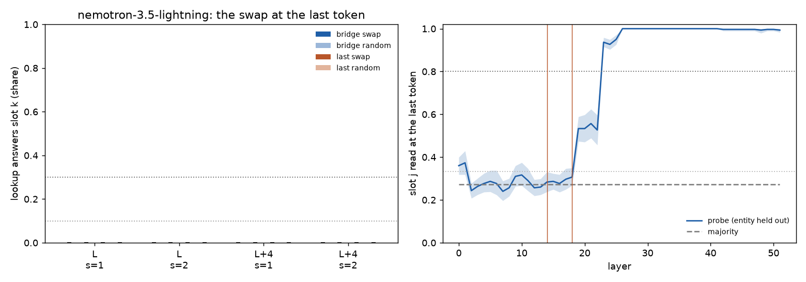

# 51.4: does the address travel? The swap at the last token

Batch 51, test 51.4 (jobs/c3/batch51.yaml; batch 52 coverage, no prediction: coverage run on an already-scored rule; rules first scored in results/x51_travel/x51_4-20261028T173333Z). Routes C0 scenes, O; the pointer swap s (mu_k - mu_j) added at the last (read) token at L and L + 4, with x8's bridge-word means and with means refit on the last token (fit half), each against a random vector of its norm. Cluster bootstrap over the bridge items (10000, seed 0). UNVERIFIED.

Rule (fixed in advance): "The code travels": the bridge-fit swap sends >= 0.3 of lookups to slot k (random <= 0.05). "Re-encoded on copy": bridge-fit <= 0.10 while last-token-fit >= 0.3. "Not at the last token": both <= 0.10 while the probe reads the slot there >= 0.8. Otherwise in between.

As computed: over the four cells (layer L or L + 4, s = 1 or 2): travels if some cell has bridge_swap's target share >= 0.30 and its own bridge_random's <= 0.05; else re-encoded if every cell's bridge_swap <= 0.10 and some cell's last_swap >= 0.30; else not at the last token if every cell's bridge_swap and last_swap <= 0.10 and the probe's held-out accuracy at the last token at L or L + 4 >= 0.80; else in between. bridge_swap / bridge_random over every item, last_swap / last_random over the read half.

| model | run | n (read) | label | per layer (L / L+4) | probe at L / L+4 | none: lookup right |
|---|---|---|---|---|---|---|
| nemotron-3.5-lightning | nem35l_x52_travel | 300 (132) | **(d) in between** | (d) in between / (d) in between | 0.28 [0.24, 0.33] / 0.31 [0.27, 0.35] | 1.00 |

## nemotron-3.5-lightning (nem35l_x52_travel; L = 14, L + 4 = 18; 300 items, 30 bridge items, read half 132)

Clauses: travels False; reencoded False; not_last False; travel cells []; last-fit cells >= 0.3 [].

| arm | layer | s | items | n | slot k (target) | original (clean answer kept) | third | other | recall changed | recall gives slot k's item |
|---|---|---|---|---|---|---|---|---|---|---|
| bridge_swap | L | 1 | all | 600 | 0.00 [0.00, 0.00] | 1.00 [1.00, 1.00] | 0.00 [0.00, 0.00] | 0.00 [0.00, 0.00] | 0.01 [0.00, 0.03] | 0.17 [0.13, 0.23] |
| bridge_swap | L | 1 | read | 264 | 0.00 [0.00, 0.00] | 1.00 [1.00, 1.00] | 0.00 [0.00, 0.00] | 0.00 [0.00, 0.00] | 0.01 [0.00, 0.03] | 0.21 [0.15, 0.29] |
| bridge_swap | L | 2 | all | 600 | 0.00 [0.00, 0.00] | 1.00 [1.00, 1.00] | 0.00 [0.00, 0.00] | 0.00 [0.00, 0.00] | 0.03 [0.02, 0.04] | 0.17 [0.13, 0.23] |
| bridge_swap | L | 2 | read | 264 | 0.00 [0.00, 0.00] | 1.00 [1.00, 1.00] | 0.00 [0.00, 0.00] | 0.00 [0.00, 0.00] | 0.03 [0.01, 0.06] | 0.22 [0.16, 0.30] |
| bridge_swap | L+4 | 1 | all | 600 | 0.00 [0.00, 0.00] | 1.00 [1.00, 1.00] | 0.00 [0.00, 0.00] | 0.00 [0.00, 0.00] | 0.02 [0.00, 0.03] | 0.18 [0.13, 0.23] |
| bridge_swap | L+4 | 1 | read | 264 | 0.00 [0.00, 0.00] | 1.00 [1.00, 1.00] | 0.00 [0.00, 0.00] | 0.00 [0.00, 0.00] | 0.02 [0.00, 0.06] | 0.23 [0.17, 0.30] |
| bridge_swap | L+4 | 2 | all | 600 | 0.00 [0.00, 0.00] | 1.00 [1.00, 1.00] | 0.00 [0.00, 0.00] | 0.00 [0.00, 0.00] | 0.03 [0.02, 0.05] | 0.17 [0.12, 0.23] |
| bridge_swap | L+4 | 2 | read | 264 | 0.00 [0.00, 0.00] | 1.00 [1.00, 1.00] | 0.00 [0.00, 0.00] | 0.00 [0.00, 0.00] | 0.03 [0.01, 0.05] | 0.22 [0.16, 0.30] |
| bridge_random | L | 1 | all | 600 | 0.00 [0.00, 0.00] | 1.00 [1.00, 1.00] | 0.00 [0.00, 0.00] | 0.00 [0.00, 0.00] | 0.01 [0.00, 0.02] | 0.17 [0.13, 0.23] |
| bridge_random | L | 1 | read | 264 | 0.00 [0.00, 0.00] | 1.00 [1.00, 1.00] | 0.00 [0.00, 0.00] | 0.00 [0.00, 0.00] | 0.01 [0.00, 0.03] | 0.22 [0.16, 0.29] |
| bridge_random | L | 2 | all | 600 | 0.00 [0.00, 0.00] | 1.00 [1.00, 1.00] | 0.00 [0.00, 0.00] | 0.00 [0.00, 0.00] | 0.02 [0.01, 0.03] | 0.17 [0.13, 0.23] |
| bridge_random | L | 2 | read | 264 | 0.00 [0.00, 0.00] | 1.00 [1.00, 1.00] | 0.00 [0.00, 0.00] | 0.00 [0.00, 0.00] | 0.02 [0.01, 0.03] | 0.22 [0.16, 0.29] |
| bridge_random | L+4 | 1 | all | 600 | 0.00 [0.00, 0.00] | 1.00 [1.00, 1.00] | 0.00 [0.00, 0.00] | 0.00 [0.00, 0.00] | 0.01 [0.00, 0.02] | 0.18 [0.13, 0.23] |
| bridge_random | L+4 | 1 | read | 264 | 0.00 [0.00, 0.00] | 1.00 [1.00, 1.00] | 0.00 [0.00, 0.00] | 0.00 [0.00, 0.00] | 0.02 [0.00, 0.04] | 0.22 [0.16, 0.30] |
| bridge_random | L+4 | 2 | all | 600 | 0.00 [0.00, 0.00] | 1.00 [1.00, 1.00] | 0.00 [0.00, 0.00] | 0.00 [0.00, 0.00] | 0.00 [0.00, 0.01] | 0.17 [0.13, 0.23] |
| bridge_random | L+4 | 2 | read | 264 | 0.00 [0.00, 0.00] | 1.00 [1.00, 1.00] | 0.00 [0.00, 0.00] | 0.00 [0.00, 0.00] | 0.00 [0.00, 0.00] | 0.21 [0.15, 0.29] |
| last_swap | L | 1 | read | 264 | 0.00 [0.00, 0.00] | 1.00 [1.00, 1.00] | 0.00 [0.00, 0.00] | 0.00 [0.00, 0.00] | 0.00 [0.00, 0.01] | 0.22 [0.16, 0.29] |
| last_swap | L | 2 | read | 264 | 0.00 [0.00, 0.00] | 1.00 [1.00, 1.00] | 0.00 [0.00, 0.00] | 0.00 [0.00, 0.00] | 0.01 [0.00, 0.03] | 0.22 [0.16, 0.29] |
| last_swap | L+4 | 1 | read | 264 | 0.00 [0.00, 0.00] | 1.00 [1.00, 1.00] | 0.00 [0.00, 0.00] | 0.00 [0.00, 0.00] | 0.01 [0.00, 0.02] | 0.22 [0.16, 0.29] |
| last_swap | L+4 | 2 | read | 264 | 0.00 [0.00, 0.00] | 1.00 [1.00, 1.00] | 0.00 [0.00, 0.00] | 0.00 [0.00, 0.00] | 0.02 [0.00, 0.04] | 0.22 [0.16, 0.30] |
| last_random | L | 1 | read | 264 | 0.00 [0.00, 0.00] | 1.00 [1.00, 1.00] | 0.00 [0.00, 0.00] | 0.00 [0.00, 0.00] | 0.01 [0.00, 0.03] | 0.22 [0.16, 0.29] |
| last_random | L | 2 | read | 264 | 0.00 [0.00, 0.00] | 1.00 [1.00, 1.00] | 0.00 [0.00, 0.00] | 0.00 [0.00, 0.00] | 0.01 [0.00, 0.02] | 0.22 [0.16, 0.29] |
| last_random | L+4 | 1 | read | 264 | 0.00 [0.00, 0.00] | 1.00 [1.00, 1.00] | 0.00 [0.00, 0.00] | 0.00 [0.00, 0.00] | 0.00 [0.00, 0.01] | 0.22 [0.16, 0.29] |
| last_random | L+4 | 2 | read | 264 | 0.00 [0.00, 0.00] | 1.00 [1.00, 1.00] | 0.00 [0.00, 0.00] | 0.00 [0.00, 0.00] | 0.00 [0.00, 0.00] | 0.21 [0.15, 0.29] |

Swap minus its random (target share, paired CI): bridge|all|L|s1 0.00 [0.00, 0.00]; bridge|all|L|s2 0.00 [0.00, 0.00]; bridge|all|L+4|s1 0.00 [0.00, 0.00]; bridge|all|L+4|s2 0.00 [0.00, 0.00]; bridge|read|L|s1 0.00 [0.00, 0.00]; bridge|read|L|s2 0.00 [0.00, 0.00]; bridge|read|L+4|s1 0.00 [0.00, 0.00]; bridge|read|L+4|s2 0.00 [0.00, 0.00]; last|read|L|s1 0.00 [0.00, 0.00]; last|read|L|s2 0.00 [0.00, 0.00]; last|read|L+4|s1 0.00 [0.00, 0.00]; last|read|L+4|s2 0.00 [0.00, 0.00].

Norms (median): the swap's norm / ||h_last|| at L14: bridge_swap|L|s1 0.204, bridge_swap|L|s2 0.408, bridge_swap|L+4|s1 0.204, bridge_swap|L+4|s2 0.408, last_swap|L|s1 0.022, last_swap|L|s2 0.044, last_swap|L+4|s1 0.036, last_swap|L+4|s2 0.071. Beside: x8's swap at the bridge word, s = 1, / ||h_bridge|| at L: 0.169; ||h_last|| / ||h_bridge|| at L: 0.82. ||mu_k - mu_j||: {'bridge_L14': {'0-1': 3.3432, '0-2': 4.0213, '1-2': 1.7801}, 'bridge_L18': {'0-1': 3.3432, '0-2': 4.0213, '1-2': 1.7801}, 'last_L14': {'0-1': 0.3847, '0-2': 0.3593, '1-2': 0.3459}, 'last_L18': {'0-1': 0.6385, '0-2': 0.5836, '1-2': 0.5606}}; cos(bridge-fit, last-fit step): {'L14': {'0-1': -0.0604, '0-2': -0.0856, '1-2': -0.0496}, 'L18': {'0-1': 0.0357, '0-2': 0.0065, '1-2': -0.0529}}.

Unedited: the lookup reads O's answer on 1.00; the recall changed on 0.01. Items as the routes run's C0 items: True.

Probe (slot j at the last token; entity held out; chance 0.33): L0 0.36 (maj 0.27), L1 0.37 (maj 0.27), L2 0.24 (maj 0.27), L3 0.26 (maj 0.27), L4 0.28 (maj 0.27), L5 0.29 (maj 0.27), L6 0.28 (maj 0.27), L7 0.24 (maj 0.27), L8 0.26 (maj 0.27), L9 0.31 (maj 0.27), L10 0.32 (maj 0.27), L11 0.29 (maj 0.27), L12 0.26 (maj 0.27), L13 0.26 (maj 0.27), L14 0.28 (maj 0.27), L15 0.29 (maj 0.27), L16 0.28 (maj 0.27), L17 0.30 (maj 0.27), L18 0.31 (maj 0.27), L19 0.53 (maj 0.27), L20 0.53 (maj 0.27), L21 0.56 (maj 0.27), L22 0.53 (maj 0.27), L23 0.94 (maj 0.27), L24 0.93 (maj 0.27), L25 0.95 (maj 0.27), L26 1.00 (maj 0.27), L27 1.00 (maj 0.27), L28 1.00 (maj 0.27), L29 1.00 (maj 0.27), L30 1.00 (maj 0.27), L31 1.00 (maj 0.27), L32 1.00 (maj 0.27), L33 1.00 (maj 0.27), L34 1.00 (maj 0.27), L35 1.00 (maj 0.27), L36 1.00 (maj 0.27), L37 1.00 (maj 0.27), L38 1.00 (maj 0.27), L39 1.00 (maj 0.27), L40 1.00 (maj 0.27), L41 1.00 (maj 0.27), L42 1.00 (maj 0.27), L43 1.00 (maj 0.27), L44 1.00 (maj 0.27), L45 1.00 (maj 0.27), L46 1.00 (maj 0.27), L47 1.00 (maj 0.27), L48 0.99 (maj 0.27), L49 1.00 (maj 0.27), L50 1.00 (maj 0.27), L51 0.99 (maj 0.27).

