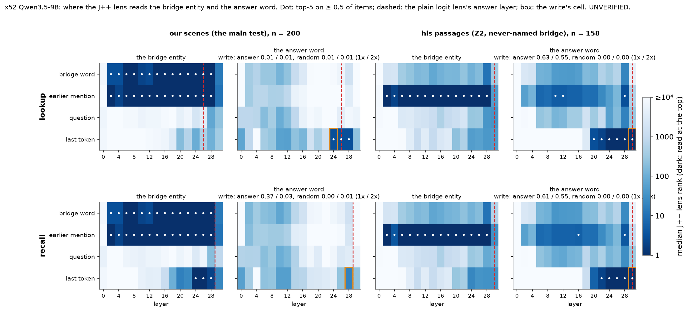
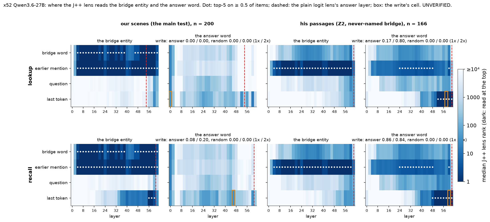
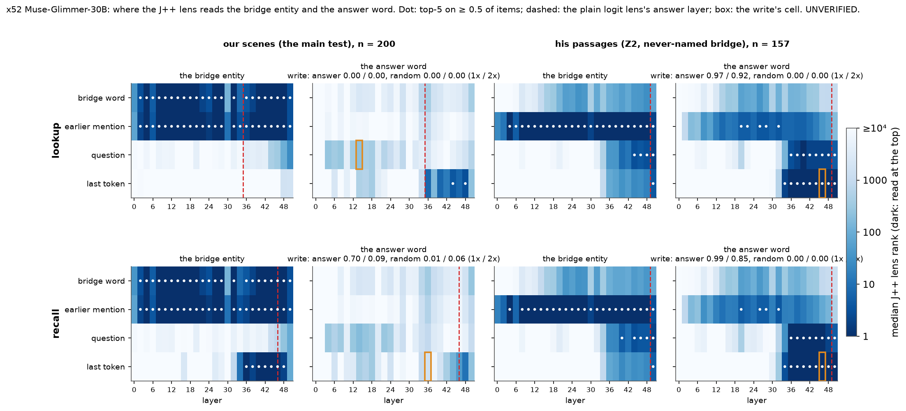

# x52 (batch 52 B): where can the lens read the answer, and can it write it? (UNVERIFIED)

Prediction: rule fixed in advance in jobs/c3/batch52.yaml (B); no prediction. Cluster bootstrap over the bridge entities (10000, seed 0).

Rules (Dan, jobs/c3/batch52.yaml brief B, verbatim):

- “Readable”: the answer word in the lens top-5 on ≥ 0.5 of items at some layer before the answer layer.
- “Usable”: writing its directions changes the answer on ≥ 0.3 of items with the random control ≤ 0.10.
- Report the four combinations per reader, per dataset.

As computed: the answer word = 51.12's (x51_answer: main the number word's one-letter-token variants, z2 the first token of the answer word's variants), its rank = 1 + tokens with a strictly higher J++ lens logit over the full vocabulary (best variant), on O; the answer layer = per item the first layer at which the plain logit lens's top token at the last token is the answer as read, the reader's lower median; 'before' = cached layers strictly below it; any token group counts; the write at the readable-most cell before the answer layer, 'changes the answer' = the top token becomes S's answer (the written word), at gain 1 or 2 with that gain's random control <= 0.10; point estimates decide (EPS 1e-9).

| model | dataset | reader | n | answer layer | readable (first cell; best before) | write cell | ans1 / ans2 | rand1 / rand2 | freq1 / freq2 | whole | usable | combination |
|---|---|---|---|---|---|---|---|---|---|---|---|---|
| qwen3.5-9b | main | lookup | 200 | L26 (never 0) | **True** (['T', 24]; best T L24 0.69) | ['T', 24] | 0.01 [0.00, 0.02] / 0.01 [0.00, 0.02] | 0.01 [0.00, 0.02] / 0.01 [0.00, 0.02] | 0.00 [0.00, 0.00] / 0.01 [0.00, 0.02] | 0.55 [0.48, 0.63] | **False** | **readable, not usable** |
| qwen3.5-9b | main | recall | 200 | L29 (never 0) | **False** (None; best T L28 0.32) | ['T', 28] | 0.37 [0.25, 0.51] / 0.03 [0.01, 0.06] | 0.00 [0.00, 0.00] / 0.01 [0.00, 0.02] | 0.00 [0.00, 0.00] / 0.00 [0.00, 0.00] | 0.92 [0.87, 0.97] | **True** | **usable, not readable** |
| qwen3.5-9b | z2 | lookup | 158 | L31 (never 0) | **True** (['E', 10]; best T L30 1.00) | ['T', 30] | 0.63 [0.55, 0.72] / 0.55 [0.46, 0.64] | 0.00 [0.00, 0.00] / 0.00 [0.00, 0.00] | 0.00 [0.00, 0.00] / 0.00 [0.00, 0.00] | 1.00 [1.00, 1.00] | **True** | **readable and usable** |
| qwen3.5-9b | z2 | recall | 158 | L31 (never 0) | **True** (['E', 16]; best T L30 1.00) | ['T', 30] | 0.61 [0.53, 0.69] / 0.55 [0.46, 0.64] | 0.00 [0.00, 0.00] / 0.00 [0.00, 0.00] | 0.00 [0.00, 0.00] / 0.00 [0.00, 0.00] | 0.98 [0.96, 1.00] | **True** | **readable and usable** |
| qwen3.6-27b | main | lookup | 200 | L54 (never 0) | **False** (None; best T L0 0.10) | ['T', 0] | 0.00 [0.00, 0.00] / 0.00 [0.00, 0.00] | 0.00 [0.00, 0.00] / 0.00 [0.00, 0.00] | 0.00 [0.00, 0.00] / 0.00 [0.00, 0.00] | 0.00 [0.00, 0.00] | **False** | **neither** |
| qwen3.6-27b | main | recall | 200 | L61 (never 0) | **False** (None; best T L46 0.15) | ['T', 46] | 0.08 [0.04, 0.14] / 0.20 [0.12, 0.31] | 0.00 [0.00, 0.00] / 0.00 [0.00, 0.00] | 0.01 [0.00, 0.02] / 0.01 [0.00, 0.03] | 0.34 [0.25, 0.46] | **False** | **neither** |
| qwen3.6-27b | z2 | lookup | 166 | L63 (never 0) | **True** (['E', 24]; best T L62 1.00) | ['T', 58] | 0.17 [0.11, 0.23] / 0.80 [0.73, 0.86] | 0.00 [0.00, 0.00] / 0.00 [0.00, 0.00] | 0.00 [0.00, 0.00] / 0.00 [0.00, 0.00] | 0.98 [0.96, 1.00] | **True** | **readable and usable** |
| qwen3.6-27b | z2 | recall | 166 | L63 (never 0) | **True** (['E', 24]; best T L60 1.00) | ['T', 60] | 0.86 [0.79, 0.91] / 0.84 [0.78, 0.90] | 0.00 [0.00, 0.00] / 0.00 [0.00, 0.00] | 0.00 [0.00, 0.00] / 0.00 [0.00, 0.00] | 0.87 [0.82, 0.92] | **True** | **readable and usable** |
| muse-glimmer-30b | main | lookup | 200 | L35 (never 0) | **False** (None; best T L34 0.00) | ['Q', 14] | 0.00 [0.00, 0.00] / 0.00 [0.00, 0.00] | 0.00 [0.00, 0.00] / 0.00 [0.00, 0.00] | 0.00 [0.00, 0.00] / 0.00 [0.00, 0.00] | 0.00 [0.00, 0.00] | **False** | **neither** |
| muse-glimmer-30b | main | recall | 200 | L46 (never 0) | **False** (None; best T L36 0.05) | ['T', 36] | 0.70 [0.59, 0.84] / 0.09 [0.03, 0.15] | 0.01 [0.00, 0.04] / 0.06 [0.02, 0.11] | 0.01 [0.00, 0.02] / 0.02 [0.01, 0.04] | 0.98 [0.96, 1.00] | **True** | **usable, not readable** |
| muse-glimmer-30b | z2 | lookup | 157 | L49 (never 0) | **True** (['E', 20]; best T L48 1.00) | ['T', 46] | 0.97 [0.94, 0.99] / 0.92 [0.87, 0.96] | 0.00 [0.00, 0.00] / 0.00 [0.00, 0.00] | 0.00 [0.00, 0.00] / 0.00 [0.00, 0.00] | 0.98 [0.96, 1.00] | **True** | **readable and usable** |
| muse-glimmer-30b | z2 | recall | 157 | L49 (never 0) | **True** (['E', 20]; best T L48 0.99) | ['T', 46] | 0.99 [0.97, 1.00] / 0.85 [0.79, 0.91] | 0.00 [0.00, 0.00] / 0.00 [0.00, 0.00] | 0.00 [0.00, 0.00] / 0.00 [0.00, 0.00] | 0.92 [0.88, 0.97] | **True** | **readable and usable** |

## qwen3.5-9b, our scenes (the main test): answer word in the J++ top-5 (share of items)

Read run qwen35_9b_x52_read_main; groups: B = the bridge word (X0's position, 51.10's P1); E = the bridge entity's last mention before the bridge word (its locker sentence), where there is one; Q = the question's 'pick' token (51.10's P2); T = the appended space token (51.10's P3).

### lookup: answer layer L26 (quartiles [23.0, 26.0, 29.0]; never 0 of 200; 51.10's settle layer L29)

| group | n | L0 | L2 | L4 | L6 | L8 | L10 | L12 | L14 | L16 | L18 | L20 | L22 | L24 | L26 | L28 | L30 |
|---|---|---|---|---|---|---|---|---|---|---|---|---|---|---|---|---|---|
| bridge word | n 200 | 0.00 | 0.00 | 0.00 | 0.00 | 0.00 | 0.00 | 0.00 | 0.00 | 0.00 | 0.00 | 0.00 | 0.00 | 0.00 | 0.00 | 0.00 | 0.00 |
| earlier mention | n 100 | 0.00 | 0.00 | 0.00 | 0.00 | 0.00 | 0.00 | 0.00 | 0.00 | 0.00 | 0.00 | 0.00 | 0.00 | 0.00 | 0.00 | 0.00 | 0.00 |
| question | n 200 | 0.00 | 0.00 | 0.00 | 0.00 | 0.00 | 0.00 | 0.00 | 0.00 | 0.00 | 0.00 | 0.00 | 0.00 | 0.00 | 0.00 | 0.00 | 0.00 |
| last token | n 200 | 0.00 | 0.00 | 0.00 | 0.00 | 0.00 | 0.00 | 0.00 | 0.00 | 0.00 | 0.00 | 0.09 | 0.00 | 0.69 | 0.79 | 0.66 | 0.01 |

Bridge entity in the top-5:

| group | n | L0 | L2 | L4 | L6 | L8 | L10 | L12 | L14 | L16 | L18 | L20 | L22 | L24 | L26 | L28 | L30 |
|---|---|---|---|---|---|---|---|---|---|---|---|---|---|---|---|---|---|
| bridge word | n 200 | 0.01 | 0.63 | 0.73 | 0.96 | 0.82 | 0.67 | 0.57 | 0.91 | 0.94 | 0.99 | 0.99 | 1.00 | 1.00 | 1.00 | 0.94 | 0.34 |
| earlier mention | n 100 | 0.00 | 0.83 | 0.86 | 0.97 | 0.93 | 0.93 | 0.94 | 0.97 | 0.99 | 0.99 | 0.98 | 1.00 | 1.00 | 1.00 | 0.93 | 0.38 |
| question | n 200 | 0.00 | 0.00 | 0.00 | 0.00 | 0.00 | 0.00 | 0.00 | 0.00 | 0.00 | 0.00 | 0.00 | 0.00 | 0.00 | 0.00 | 0.11 | 0.08 |
| last token | n 200 | 0.00 | 0.00 | 0.00 | 0.00 | 0.00 | 0.00 | 0.00 | 0.00 | 0.00 | 0.00 | 0.11 | 0.05 | 0.25 | 0.16 | 0.18 | 0.00 |

S's answer word on O in the top-5 (a same-type distractor; baseline):

| group | n | L0 | L2 | L4 | L6 | L8 | L10 | L12 | L14 | L16 | L18 | L20 | L22 | L24 | L26 | L28 | L30 |
|---|---|---|---|---|---|---|---|---|---|---|---|---|---|---|---|---|---|
| bridge word | n 200 | 0.00 | 0.00 | 0.00 | 0.00 | 0.00 | 0.00 | 0.00 | 0.00 | 0.00 | 0.00 | 0.00 | 0.00 | 0.00 | 0.00 | 0.00 | 0.00 |
| earlier mention | n 100 | 0.00 | 0.00 | 0.00 | 0.00 | 0.00 | 0.00 | 0.00 | 0.00 | 0.00 | 0.00 | 0.00 | 0.00 | 0.00 | 0.00 | 0.00 | 0.00 |
| question | n 200 | 0.00 | 0.00 | 0.00 | 0.00 | 0.00 | 0.00 | 0.00 | 0.00 | 0.00 | 0.00 | 0.00 | 0.00 | 0.00 | 0.00 | 0.00 | 0.00 |
| last token | n 200 | 0.00 | 0.00 | 0.00 | 0.00 | 0.00 | 0.00 | 0.00 | 0.00 | 0.00 | 0.00 | 0.08 | 0.00 | 0.01 | 0.01 | 0.02 | 0.00 |

The answer word, whole-word variants only, in the top-5:

| group | n | L0 | L2 | L4 | L6 | L8 | L10 | L12 | L14 | L16 | L18 | L20 | L22 | L24 | L26 | L28 | L30 |
|---|---|---|---|---|---|---|---|---|---|---|---|---|---|---|---|---|---|
| bridge word | n 200 | 0.00 | 0.00 | 0.00 | 0.00 | 0.00 | 0.00 | 0.00 | 0.00 | 0.00 | 0.00 | 0.00 | 0.00 | 0.00 | 0.00 | 0.00 | 0.00 |
| earlier mention | n 100 | 0.00 | 0.00 | 0.00 | 0.00 | 0.00 | 0.00 | 0.00 | 0.00 | 0.00 | 0.00 | 0.00 | 0.00 | 0.00 | 0.00 | 0.00 | 0.00 |
| question | n 200 | 0.00 | 0.00 | 0.00 | 0.00 | 0.00 | 0.00 | 0.00 | 0.00 | 0.00 | 0.00 | 0.00 | 0.00 | 0.00 | 0.00 | 0.00 | 0.00 |
| last token | n 200 | 0.00 | 0.00 | 0.00 | 0.00 | 0.00 | 0.00 | 0.00 | 0.00 | 0.00 | 0.00 | 0.09 | 0.00 | 0.69 | 0.79 | 0.66 | 0.01 |

- the rule on the whole-word variants alone: True (first ['T', 24]); on S's answer word (the distractor, not the answer): False (first None)

### recall: answer layer L29 (quartiles [29.0, 29.0, 29.0]; never 0 of 200; 51.10's settle layer L29)

| group | n | L0 | L2 | L4 | L6 | L8 | L10 | L12 | L14 | L16 | L18 | L20 | L22 | L24 | L26 | L28 | L30 |
|---|---|---|---|---|---|---|---|---|---|---|---|---|---|---|---|---|---|
| bridge word | n 200 | 0.00 | 0.00 | 0.00 | 0.00 | 0.00 | 0.00 | 0.00 | 0.01 | 0.00 | 0.00 | 0.00 | 0.00 | 0.00 | 0.00 | 0.00 | 0.00 |
| earlier mention | n 100 | 0.00 | 0.00 | 0.00 | 0.00 | 0.00 | 0.00 | 0.00 | 0.00 | 0.00 | 0.00 | 0.00 | 0.00 | 0.00 | 0.00 | 0.00 | 0.00 |
| question | n 200 | 0.00 | 0.00 | 0.00 | 0.00 | 0.00 | 0.00 | 0.00 | 0.00 | 0.00 | 0.00 | 0.00 | 0.00 | 0.00 | 0.00 | 0.00 | 0.00 |
| last token | n 200 | 0.00 | 0.00 | 0.00 | 0.00 | 0.00 | 0.00 | 0.00 | 0.00 | 0.00 | 0.00 | 0.00 | 0.00 | 0.00 | 0.00 | 0.32 | 0.00 |

Bridge entity in the top-5:

| group | n | L0 | L2 | L4 | L6 | L8 | L10 | L12 | L14 | L16 | L18 | L20 | L22 | L24 | L26 | L28 | L30 |
|---|---|---|---|---|---|---|---|---|---|---|---|---|---|---|---|---|---|
| bridge word | n 200 | 0.01 | 0.63 | 0.73 | 0.96 | 0.82 | 0.67 | 0.57 | 0.91 | 0.94 | 0.99 | 0.99 | 1.00 | 1.00 | 1.00 | 0.94 | 0.34 |
| earlier mention | n 100 | 0.00 | 0.83 | 0.86 | 0.97 | 0.93 | 0.93 | 0.94 | 0.97 | 0.99 | 0.99 | 0.98 | 1.00 | 1.00 | 1.00 | 0.93 | 0.38 |
| question | n 200 | 0.00 | 0.00 | 0.00 | 0.00 | 0.00 | 0.00 | 0.00 | 0.00 | 0.00 | 0.00 | 0.00 | 0.00 | 0.00 | 0.00 | 0.00 | 0.00 |
| last token | n 200 | 0.00 | 0.00 | 0.00 | 0.00 | 0.00 | 0.00 | 0.00 | 0.00 | 0.00 | 0.07 | 0.33 | 0.20 | 0.94 | 0.74 | 0.72 | 0.03 |

S's answer word on O in the top-5 (a same-type distractor; baseline):

| group | n | L0 | L2 | L4 | L6 | L8 | L10 | L12 | L14 | L16 | L18 | L20 | L22 | L24 | L26 | L28 | L30 |
|---|---|---|---|---|---|---|---|---|---|---|---|---|---|---|---|---|---|
| bridge word | n 200 | 0.00 | 0.00 | 0.00 | 0.00 | 0.00 | 0.00 | 0.00 | 0.00 | 0.00 | 0.00 | 0.00 | 0.00 | 0.00 | 0.00 | 0.00 | 0.00 |
| earlier mention | n 100 | 0.00 | 0.00 | 0.00 | 0.00 | 0.00 | 0.00 | 0.00 | 0.00 | 0.00 | 0.00 | 0.00 | 0.00 | 0.00 | 0.00 | 0.00 | 0.00 |
| question | n 200 | 0.00 | 0.00 | 0.00 | 0.00 | 0.00 | 0.00 | 0.00 | 0.00 | 0.00 | 0.00 | 0.00 | 0.00 | 0.00 | 0.00 | 0.00 | 0.00 |
| last token | n 200 | 0.00 | 0.00 | 0.00 | 0.00 | 0.00 | 0.00 | 0.00 | 0.00 | 0.00 | 0.00 | 0.00 | 0.00 | 0.00 | 0.00 | 0.00 | 0.00 |

The answer word, whole-word variants only, in the top-5:

| group | n | L0 | L2 | L4 | L6 | L8 | L10 | L12 | L14 | L16 | L18 | L20 | L22 | L24 | L26 | L28 | L30 |
|---|---|---|---|---|---|---|---|---|---|---|---|---|---|---|---|---|---|
| bridge word | n 200 | 0.00 | 0.00 | 0.00 | 0.00 | 0.00 | 0.00 | 0.00 | 0.01 | 0.00 | 0.00 | 0.00 | 0.00 | 0.00 | 0.00 | 0.00 | 0.00 |
| earlier mention | n 100 | 0.00 | 0.00 | 0.00 | 0.00 | 0.00 | 0.00 | 0.00 | 0.00 | 0.00 | 0.00 | 0.00 | 0.00 | 0.00 | 0.00 | 0.00 | 0.00 |
| question | n 200 | 0.00 | 0.00 | 0.00 | 0.00 | 0.00 | 0.00 | 0.00 | 0.00 | 0.00 | 0.00 | 0.00 | 0.00 | 0.00 | 0.00 | 0.00 | 0.00 |
| last token | n 200 | 0.00 | 0.00 | 0.00 | 0.00 | 0.00 | 0.00 | 0.00 | 0.00 | 0.00 | 0.00 | 0.00 | 0.00 | 0.00 | 0.00 | 0.32 | 0.00 |

- the rule on the whole-word variants alone: False (first None); on S's answer word (the distractor, not the answer): False (first None)

Check against 51.12 at the bridge word, L12 (qwen35_9b_x51_12_e1_r2): lookup: top-50 ours 0.14 vs 51.12 0.14, median rank 238.00 vs 238.00 (n 200 / 200); recall: top-50 ours 0.28 vs 51.12 0.28, median rank 143.50 vs 143.50 (n 200 / 200)

Write (switch to the written answer; changed away from O's answer):

| reader | cell | n | none | whole | ans1 | ans2 | rand1 | rand2 | freq1 | freq2 | s median | size from B |
|---|---|---|---|---|---|---|---|---|---|---|---|---|
| lookup | ['T', 24] | 200 | 0.01 [0.00, 0.02]; 0.01 | 0.55 [0.48, 0.63]; 0.57 | 0.01 [0.00, 0.02]; 0.02 | 0.01 [0.00, 0.02]; 0.04 | 0.01 [0.00, 0.02]; 0.01 | 0.01 [0.00, 0.02]; 0.02 | 0.00 [0.00, 0.00]; 0.01 | 0.01 [0.00, 0.02]; 0.03 | 41.99 | 0 |
| recall | ['T', 28] | 200 | 0.00 [0.00, 0.00]; 0.00 | 0.92 [0.87, 0.97]; 0.95 | 0.37 [0.25, 0.51]; 0.40 | 0.03 [0.01, 0.06]; 0.95 | 0.00 [0.00, 0.00]; 0.01 | 0.01 [0.00, 0.02]; 0.02 | 0.00 [0.00, 0.00]; 0.00 | 0.00 [0.00, 0.00]; 0.99 | 123.10 | 0 |

## qwen3.5-9b, his passages (Z2, never-named bridge): answer word in the J++ top-5 (share of items)

Read run qwen35_9b_x52_read_z2; groups: B = the description's last token in the question (his edit site); E = the bridge entity's last mention in the passage before the question; Q = the question's closing '?'; T = the prompt's last token (no prefill).

### lookup: answer layer L31 (quartiles [31.0, 31.0, 31.0]; never 0 of 158; 51.10's settle layer L31)

| group | n | L0 | L2 | L4 | L6 | L8 | L10 | L12 | L14 | L16 | L18 | L20 | L22 | L24 | L26 | L28 | L30 |
|---|---|---|---|---|---|---|---|---|---|---|---|---|---|---|---|---|---|
| bridge word | n 158 | 0.00 | 0.01 | 0.00 | 0.13 | 0.10 | 0.16 | 0.16 | 0.20 | 0.16 | 0.14 | 0.16 | 0.12 | 0.16 | 0.09 | 0.30 | 0.01 |
| earlier mention | n 158 | 0.00 | 0.08 | 0.04 | 0.44 | 0.41 | 0.54 | 0.53 | 0.49 | 0.47 | 0.33 | 0.38 | 0.25 | 0.20 | 0.14 | 0.58 | 0.03 |
| question | n 158 | 0.00 | 0.00 | 0.00 | 0.10 | 0.10 | 0.08 | 0.02 | 0.04 | 0.01 | 0.01 | 0.05 | 0.03 | 0.27 | 0.16 | 0.34 | 0.08 |
| last token | n 158 | 0.00 | 0.00 | 0.00 | 0.00 | 0.00 | 0.00 | 0.00 | 0.00 | 0.00 | 0.01 | 0.57 | 0.70 | 0.94 | 0.99 | 0.99 | 1.00 |

Bridge entity in the top-5:

| group | n | L0 | L2 | L4 | L6 | L8 | L10 | L12 | L14 | L16 | L18 | L20 | L22 | L24 | L26 | L28 | L30 |
|---|---|---|---|---|---|---|---|---|---|---|---|---|---|---|---|---|---|
| bridge word | n 158 | 0.00 | 0.01 | 0.01 | 0.16 | 0.16 | 0.25 | 0.22 | 0.30 | 0.23 | 0.21 | 0.20 | 0.12 | 0.18 | 0.14 | 0.41 | 0.10 |
| earlier mention | n 158 | 0.00 | 0.67 | 0.63 | 0.68 | 0.67 | 0.67 | 0.66 | 0.68 | 0.70 | 0.70 | 0.70 | 0.76 | 0.83 | 0.84 | 0.67 | 0.15 |
| question | n 158 | 0.00 | 0.01 | 0.00 | 0.00 | 0.00 | 0.01 | 0.03 | 0.02 | 0.04 | 0.03 | 0.06 | 0.06 | 0.13 | 0.16 | 0.27 | 0.27 |
| last token | n 158 | 0.00 | 0.00 | 0.00 | 0.00 | 0.00 | 0.00 | 0.00 | 0.00 | 0.00 | 0.00 | 0.10 | 0.05 | 0.13 | 0.04 | 0.12 | 0.11 |

S's answer word on O in the top-5 (a same-type distractor; baseline):

| group | n | L0 | L2 | L4 | L6 | L8 | L10 | L12 | L14 | L16 | L18 | L20 | L22 | L24 | L26 | L28 | L30 |
|---|---|---|---|---|---|---|---|---|---|---|---|---|---|---|---|---|---|
| bridge word | n 158 | 0.00 | 0.00 | 0.00 | 0.00 | 0.00 | 0.00 | 0.00 | 0.00 | 0.00 | 0.00 | 0.00 | 0.00 | 0.00 | 0.00 | 0.00 | 0.01 |
| earlier mention | n 158 | 0.00 | 0.00 | 0.00 | 0.00 | 0.00 | 0.00 | 0.00 | 0.00 | 0.00 | 0.00 | 0.00 | 0.00 | 0.00 | 0.00 | 0.00 | 0.00 |
| question | n 158 | 0.00 | 0.00 | 0.00 | 0.05 | 0.04 | 0.03 | 0.01 | 0.01 | 0.00 | 0.00 | 0.00 | 0.00 | 0.01 | 0.00 | 0.01 | 0.01 |
| last token | n 158 | 0.00 | 0.00 | 0.00 | 0.00 | 0.00 | 0.00 | 0.00 | 0.00 | 0.00 | 0.00 | 0.06 | 0.18 | 0.04 | 0.03 | 0.04 | 0.15 |

The answer word, whole-word variants only, in the top-5:

| group | n | L0 | L2 | L4 | L6 | L8 | L10 | L12 | L14 | L16 | L18 | L20 | L22 | L24 | L26 | L28 | L30 |
|---|---|---|---|---|---|---|---|---|---|---|---|---|---|---|---|---|---|
| bridge word | n 149 | 0.00 | 0.01 | 0.00 | 0.13 | 0.10 | 0.17 | 0.17 | 0.20 | 0.16 | 0.15 | 0.17 | 0.13 | 0.17 | 0.09 | 0.31 | 0.01 |
| earlier mention | n 149 | 0.00 | 0.09 | 0.04 | 0.46 | 0.44 | 0.57 | 0.56 | 0.52 | 0.50 | 0.35 | 0.40 | 0.27 | 0.21 | 0.15 | 0.61 | 0.02 |
| question | n 149 | 0.00 | 0.00 | 0.00 | 0.11 | 0.11 | 0.09 | 0.02 | 0.04 | 0.01 | 0.01 | 0.05 | 0.03 | 0.28 | 0.17 | 0.34 | 0.07 |
| last token | n 149 | 0.00 | 0.00 | 0.00 | 0.00 | 0.00 | 0.00 | 0.00 | 0.00 | 0.00 | 0.01 | 0.60 | 0.73 | 0.99 | 1.00 | 0.99 | 1.00 |

- the rule on the whole-word variants alone: True (first ['E', 10]); on S's answer word (the distractor, not the answer): False (first None)

### recall: answer layer L31 (quartiles [30.0, 31.0, 31.0]; never 0 of 158; 51.10's settle layer L31)

| group | n | L0 | L2 | L4 | L6 | L8 | L10 | L12 | L14 | L16 | L18 | L20 | L22 | L24 | L26 | L28 | L30 |
|---|---|---|---|---|---|---|---|---|---|---|---|---|---|---|---|---|---|
| bridge word | n 158 | 0.00 | 0.01 | 0.00 | 0.13 | 0.10 | 0.18 | 0.18 | 0.18 | 0.16 | 0.13 | 0.16 | 0.11 | 0.18 | 0.09 | 0.32 | 0.01 |
| earlier mention | n 158 | 0.00 | 0.11 | 0.02 | 0.41 | 0.40 | 0.49 | 0.48 | 0.49 | 0.50 | 0.35 | 0.38 | 0.24 | 0.17 | 0.09 | 0.58 | 0.02 |
| question | n 158 | 0.00 | 0.00 | 0.00 | 0.09 | 0.11 | 0.10 | 0.05 | 0.06 | 0.03 | 0.01 | 0.13 | 0.08 | 0.21 | 0.16 | 0.29 | 0.04 |
| last token | n 158 | 0.00 | 0.00 | 0.00 | 0.00 | 0.00 | 0.00 | 0.00 | 0.00 | 0.00 | 0.04 | 0.46 | 0.65 | 0.92 | 0.96 | 0.99 | 1.00 |

Bridge entity in the top-5:

| group | n | L0 | L2 | L4 | L6 | L8 | L10 | L12 | L14 | L16 | L18 | L20 | L22 | L24 | L26 | L28 | L30 |
|---|---|---|---|---|---|---|---|---|---|---|---|---|---|---|---|---|---|
| bridge word | n 158 | 0.00 | 0.01 | 0.01 | 0.16 | 0.16 | 0.25 | 0.23 | 0.30 | 0.25 | 0.23 | 0.22 | 0.16 | 0.17 | 0.15 | 0.40 | 0.11 |
| earlier mention | n 158 | 0.00 | 0.66 | 0.56 | 0.67 | 0.67 | 0.66 | 0.66 | 0.68 | 0.69 | 0.70 | 0.70 | 0.78 | 0.81 | 0.84 | 0.71 | 0.23 |
| question | n 158 | 0.00 | 0.00 | 0.00 | 0.00 | 0.00 | 0.01 | 0.02 | 0.03 | 0.04 | 0.03 | 0.06 | 0.06 | 0.17 | 0.17 | 0.22 | 0.20 |
| last token | n 158 | 0.00 | 0.00 | 0.00 | 0.00 | 0.00 | 0.00 | 0.00 | 0.00 | 0.00 | 0.00 | 0.10 | 0.04 | 0.20 | 0.11 | 0.18 | 0.15 |

S's answer word on O in the top-5 (a same-type distractor; baseline):

| group | n | L0 | L2 | L4 | L6 | L8 | L10 | L12 | L14 | L16 | L18 | L20 | L22 | L24 | L26 | L28 | L30 |
|---|---|---|---|---|---|---|---|---|---|---|---|---|---|---|---|---|---|
| bridge word | n 158 | 0.00 | 0.00 | 0.00 | 0.00 | 0.00 | 0.00 | 0.00 | 0.00 | 0.00 | 0.00 | 0.00 | 0.00 | 0.00 | 0.00 | 0.00 | 0.01 |
| earlier mention | n 158 | 0.00 | 0.00 | 0.00 | 0.00 | 0.00 | 0.00 | 0.00 | 0.00 | 0.00 | 0.00 | 0.00 | 0.00 | 0.00 | 0.00 | 0.00 | 0.00 |
| question | n 158 | 0.00 | 0.00 | 0.00 | 0.06 | 0.04 | 0.04 | 0.02 | 0.01 | 0.00 | 0.00 | 0.00 | 0.01 | 0.01 | 0.00 | 0.01 | 0.00 |
| last token | n 158 | 0.00 | 0.00 | 0.00 | 0.00 | 0.00 | 0.00 | 0.00 | 0.00 | 0.00 | 0.01 | 0.07 | 0.25 | 0.06 | 0.03 | 0.04 | 0.16 |

The answer word, whole-word variants only, in the top-5:

| group | n | L0 | L2 | L4 | L6 | L8 | L10 | L12 | L14 | L16 | L18 | L20 | L22 | L24 | L26 | L28 | L30 |
|---|---|---|---|---|---|---|---|---|---|---|---|---|---|---|---|---|---|
| bridge word | n 149 | 0.00 | 0.01 | 0.00 | 0.13 | 0.10 | 0.19 | 0.18 | 0.18 | 0.17 | 0.14 | 0.17 | 0.11 | 0.19 | 0.09 | 0.33 | 0.01 |
| earlier mention | n 149 | 0.00 | 0.11 | 0.02 | 0.43 | 0.42 | 0.52 | 0.51 | 0.52 | 0.53 | 0.37 | 0.40 | 0.26 | 0.18 | 0.09 | 0.61 | 0.01 |
| question | n 149 | 0.00 | 0.00 | 0.00 | 0.10 | 0.11 | 0.11 | 0.05 | 0.07 | 0.03 | 0.01 | 0.13 | 0.08 | 0.22 | 0.17 | 0.30 | 0.05 |
| last token | n 149 | 0.00 | 0.00 | 0.00 | 0.00 | 0.00 | 0.00 | 0.00 | 0.00 | 0.00 | 0.04 | 0.49 | 0.69 | 0.97 | 1.00 | 0.99 | 1.00 |

- the rule on the whole-word variants alone: True (first ['E', 10]); on S's answer word (the distractor, not the answer): False (first None)

Check against 51.12 at the bridge word, L12 (qwen35_9b_x51_12_z2_r2): lookup: top-50 ours 0.52 vs 51.12 0.53, median rank 46.50 vs 46.50 (n 158 / 158); recall: top-50 ours 0.53 vs 51.12 0.53, median rank 43.50 vs 43.50 (n 158 / 158)

Write (switch to the written answer; changed away from O's answer):

| reader | cell | n | none | whole | ans1 | ans2 | rand1 | rand2 | freq1 | freq2 | s median | size from B |
|---|---|---|---|---|---|---|---|---|---|---|---|---|
| lookup | ['T', 30] | 158 | 0.00 [0.00, 0.00]; 0.00 | 1.00 [1.00, 1.00]; 1.00 | 0.63 [0.55, 0.72]; 0.73 | 0.55 [0.46, 0.64]; 0.86 | 0.00 [0.00, 0.00]; 0.00 | 0.00 [0.00, 0.00]; 0.06 | 0.00 [0.00, 0.00]; 0.99 | 0.00 [0.00, 0.00]; 1.00 | 117.57 | 0 |
| recall | ['T', 30] | 158 | 0.00 [0.00, 0.00]; 0.00 | 0.98 [0.96, 1.00]; 0.99 | 0.61 [0.53, 0.69]; 0.73 | 0.55 [0.46, 0.64]; 0.91 | 0.00 [0.00, 0.00]; 0.01 | 0.00 [0.00, 0.00]; 0.16 | 0.00 [0.00, 0.00]; 1.00 | 0.00 [0.00, 0.00]; 1.00 | 117.60 | 0 |

## qwen3.6-27b, our scenes (the main test): answer word in the J++ top-5 (share of items)

Read run x52_read_main_27b; groups: B = the bridge word (X0's position, 51.10's P1); E = the bridge entity's last mention before the bridge word (its locker sentence), where there is one; Q = the question's 'pick' token (51.10's P2); T = the appended space token (51.10's P3).

### lookup: answer layer L54 (quartiles [51.0, 54.0, 55.0]; never 0 of 200; 51.10's settle layer L61)

| group | n | L0 | L2 | L4 | L6 | L8 | L10 | L12 | L14 | L16 | L18 | L20 | L22 | L24 | L26 | L28 | L30 | L32 | L34 | L36 | L38 | L40 | L42 | L44 | L46 | L48 | L50 | L52 | L54 | L56 | L58 | L60 | L62 |
|---|---|---|---|---|---|---|---|---|---|---|---|---|---|---|---|---|---|---|---|---|---|---|---|---|---|---|---|---|---|---|---|---|---|
| bridge word | n 200 | 0.04 | 0.00 | 0.00 | 0.00 | 0.00 | 0.00 | 0.00 | 0.00 | 0.00 | 0.00 | 0.00 | 0.00 | 0.00 | 0.00 | 0.00 | 0.00 | 0.00 | 0.00 | 0.01 | 0.01 | 0.00 | 0.01 | 0.01 | 0.01 | 0.00 | 0.00 | 0.00 | 0.00 | 0.00 | 0.00 | 0.00 | 0.00 |
| earlier mention | n 101 | 0.03 | 0.00 | 0.00 | 0.00 | 0.00 | 0.00 | 0.00 | 0.00 | 0.00 | 0.00 | 0.00 | 0.00 | 0.00 | 0.00 | 0.00 | 0.00 | 0.00 | 0.00 | 0.00 | 0.00 | 0.00 | 0.00 | 0.00 | 0.00 | 0.00 | 0.00 | 0.00 | 0.00 | 0.00 | 0.00 | 0.00 | 0.00 |
| question | n 200 | 0.00 | 0.00 | 0.00 | 0.00 | 0.00 | 0.00 | 0.00 | 0.00 | 0.00 | 0.00 | 0.00 | 0.00 | 0.00 | 0.00 | 0.00 | 0.00 | 0.00 | 0.00 | 0.00 | 0.00 | 0.00 | 0.00 | 0.00 | 0.00 | 0.00 | 0.00 | 0.00 | 0.00 | 0.00 | 0.00 | 0.00 | 0.00 |
| last token | n 200 | 0.10 | 0.00 | 0.00 | 0.00 | 0.00 | 0.00 | 0.00 | 0.00 | 0.00 | 0.00 | 0.00 | 0.00 | 0.00 | 0.00 | 0.00 | 0.00 | 0.00 | 0.00 | 0.00 | 0.00 | 0.00 | 0.00 | 0.00 | 0.01 | 0.00 | 0.00 | 0.09 | 0.02 | 0.10 | 0.11 | 0.30 | 0.01 |

Bridge entity in the top-5:

| group | n | L0 | L2 | L4 | L6 | L8 | L10 | L12 | L14 | L16 | L18 | L20 | L22 | L24 | L26 | L28 | L30 | L32 | L34 | L36 | L38 | L40 | L42 | L44 | L46 | L48 | L50 | L52 | L54 | L56 | L58 | L60 | L62 |
|---|---|---|---|---|---|---|---|---|---|---|---|---|---|---|---|---|---|---|---|---|---|---|---|---|---|---|---|---|---|---|---|---|---|
| bridge word | n 200 | 0.00 | 0.03 | 0.68 | 0.90 | 0.87 | 1.00 | 1.00 | 1.00 | 1.00 | 1.00 | 0.62 | 0.86 | 0.45 | 0.73 | 0.92 | 0.85 | 0.68 | 0.93 | 0.69 | 0.82 | 0.46 | 0.38 | 0.46 | 0.69 | 0.67 | 0.93 | 1.00 | 1.00 | 1.00 | 0.99 | 0.95 | 0.78 |
| earlier mention | n 101 | 0.00 | 0.23 | 0.80 | 0.89 | 0.86 | 1.00 | 1.00 | 1.00 | 1.00 | 1.00 | 0.87 | 0.97 | 0.72 | 0.98 | 0.99 | 1.00 | 0.99 | 0.99 | 0.90 | 0.91 | 0.66 | 0.71 | 0.77 | 0.92 | 0.85 | 0.96 | 0.98 | 1.00 | 0.98 | 0.97 | 0.96 | 0.59 |
| question | n 200 | 0.00 | 0.00 | 0.00 | 0.00 | 0.00 | 0.00 | 0.00 | 0.00 | 0.00 | 0.00 | 0.00 | 0.00 | 0.00 | 0.00 | 0.00 | 0.00 | 0.00 | 0.00 | 0.00 | 0.00 | 0.00 | 0.00 | 0.00 | 0.00 | 0.00 | 0.00 | 0.00 | 0.00 | 0.00 | 0.00 | 0.15 | 0.01 |
| last token | n 200 | 0.00 | 0.00 | 0.00 | 0.00 | 0.00 | 0.00 | 0.00 | 0.00 | 0.00 | 0.00 | 0.00 | 0.00 | 0.00 | 0.00 | 0.00 | 0.00 | 0.00 | 0.00 | 0.00 | 0.00 | 0.00 | 0.00 | 0.00 | 0.00 | 0.00 | 0.00 | 0.00 | 0.00 | 0.03 | 0.07 | 0.22 | 0.01 |

S's answer word on O in the top-5 (a same-type distractor; baseline):

| group | n | L0 | L2 | L4 | L6 | L8 | L10 | L12 | L14 | L16 | L18 | L20 | L22 | L24 | L26 | L28 | L30 | L32 | L34 | L36 | L38 | L40 | L42 | L44 | L46 | L48 | L50 | L52 | L54 | L56 | L58 | L60 | L62 |
|---|---|---|---|---|---|---|---|---|---|---|---|---|---|---|---|---|---|---|---|---|---|---|---|---|---|---|---|---|---|---|---|---|---|
| bridge word | n 200 | 0.07 | 0.00 | 0.00 | 0.00 | 0.00 | 0.00 | 0.00 | 0.00 | 0.00 | 0.00 | 0.00 | 0.00 | 0.00 | 0.00 | 0.00 | 0.00 | 0.00 | 0.01 | 0.01 | 0.01 | 0.00 | 0.00 | 0.01 | 0.01 | 0.00 | 0.00 | 0.00 | 0.00 | 0.00 | 0.00 | 0.00 | 0.00 |
| earlier mention | n 101 | 0.04 | 0.00 | 0.00 | 0.00 | 0.00 | 0.00 | 0.00 | 0.00 | 0.00 | 0.00 | 0.00 | 0.00 | 0.00 | 0.00 | 0.00 | 0.00 | 0.00 | 0.00 | 0.00 | 0.00 | 0.00 | 0.00 | 0.00 | 0.00 | 0.00 | 0.00 | 0.00 | 0.00 | 0.00 | 0.00 | 0.00 | 0.00 |
| question | n 200 | 0.00 | 0.00 | 0.00 | 0.00 | 0.00 | 0.00 | 0.00 | 0.00 | 0.00 | 0.00 | 0.00 | 0.00 | 0.00 | 0.00 | 0.00 | 0.00 | 0.00 | 0.00 | 0.00 | 0.00 | 0.00 | 0.00 | 0.00 | 0.00 | 0.00 | 0.00 | 0.00 | 0.00 | 0.00 | 0.00 | 0.00 | 0.00 |
| last token | n 200 | 0.10 | 0.00 | 0.00 | 0.00 | 0.00 | 0.00 | 0.00 | 0.00 | 0.00 | 0.00 | 0.00 | 0.00 | 0.00 | 0.00 | 0.00 | 0.00 | 0.00 | 0.00 | 0.00 | 0.00 | 0.00 | 0.00 | 0.00 | 0.00 | 0.00 | 0.00 | 0.00 | 0.00 | 0.00 | 0.00 | 0.00 | 0.00 |

The answer word, whole-word variants only, in the top-5:

| group | n | L0 | L2 | L4 | L6 | L8 | L10 | L12 | L14 | L16 | L18 | L20 | L22 | L24 | L26 | L28 | L30 | L32 | L34 | L36 | L38 | L40 | L42 | L44 | L46 | L48 | L50 | L52 | L54 | L56 | L58 | L60 | L62 |
|---|---|---|---|---|---|---|---|---|---|---|---|---|---|---|---|---|---|---|---|---|---|---|---|---|---|---|---|---|---|---|---|---|---|
| bridge word | n 200 | 0.04 | 0.00 | 0.00 | 0.00 | 0.00 | 0.00 | 0.00 | 0.00 | 0.00 | 0.00 | 0.00 | 0.00 | 0.00 | 0.00 | 0.00 | 0.00 | 0.00 | 0.00 | 0.01 | 0.01 | 0.00 | 0.01 | 0.01 | 0.01 | 0.00 | 0.00 | 0.00 | 0.00 | 0.00 | 0.00 | 0.00 | 0.00 |
| earlier mention | n 101 | 0.03 | 0.00 | 0.00 | 0.00 | 0.00 | 0.00 | 0.00 | 0.00 | 0.00 | 0.00 | 0.00 | 0.00 | 0.00 | 0.00 | 0.00 | 0.00 | 0.00 | 0.00 | 0.00 | 0.00 | 0.00 | 0.00 | 0.00 | 0.00 | 0.00 | 0.00 | 0.00 | 0.00 | 0.00 | 0.00 | 0.00 | 0.00 |
| question | n 200 | 0.00 | 0.00 | 0.00 | 0.00 | 0.00 | 0.00 | 0.00 | 0.00 | 0.00 | 0.00 | 0.00 | 0.00 | 0.00 | 0.00 | 0.00 | 0.00 | 0.00 | 0.00 | 0.00 | 0.00 | 0.00 | 0.00 | 0.00 | 0.00 | 0.00 | 0.00 | 0.00 | 0.00 | 0.00 | 0.00 | 0.00 | 0.00 |
| last token | n 200 | 0.10 | 0.00 | 0.00 | 0.00 | 0.00 | 0.00 | 0.00 | 0.00 | 0.00 | 0.00 | 0.00 | 0.00 | 0.00 | 0.00 | 0.00 | 0.00 | 0.00 | 0.00 | 0.00 | 0.00 | 0.00 | 0.00 | 0.00 | 0.01 | 0.00 | 0.00 | 0.09 | 0.02 | 0.10 | 0.11 | 0.30 | 0.01 |

- the rule on the whole-word variants alone: False (first None); on S's answer word (the distractor, not the answer): False (first None)

### recall: answer layer L61 (quartiles [60.0, 61.0, 61.0]; never 0 of 200; 51.10's settle layer L61)

| group | n | L0 | L2 | L4 | L6 | L8 | L10 | L12 | L14 | L16 | L18 | L20 | L22 | L24 | L26 | L28 | L30 | L32 | L34 | L36 | L38 | L40 | L42 | L44 | L46 | L48 | L50 | L52 | L54 | L56 | L58 | L60 | L62 |
|---|---|---|---|---|---|---|---|---|---|---|---|---|---|---|---|---|---|---|---|---|---|---|---|---|---|---|---|---|---|---|---|---|---|
| bridge word | n 200 | 0.07 | 0.00 | 0.00 | 0.00 | 0.00 | 0.00 | 0.00 | 0.00 | 0.00 | 0.00 | 0.00 | 0.00 | 0.00 | 0.00 | 0.00 | 0.01 | 0.01 | 0.00 | 0.00 | 0.00 | 0.00 | 0.00 | 0.01 | 0.01 | 0.00 | 0.00 | 0.00 | 0.00 | 0.00 | 0.00 | 0.00 | 0.00 |
| earlier mention | n 101 | 0.09 | 0.00 | 0.00 | 0.00 | 0.00 | 0.00 | 0.00 | 0.00 | 0.00 | 0.00 | 0.00 | 0.00 | 0.00 | 0.00 | 0.00 | 0.00 | 0.00 | 0.00 | 0.00 | 0.00 | 0.00 | 0.00 | 0.00 | 0.00 | 0.00 | 0.00 | 0.00 | 0.00 | 0.00 | 0.00 | 0.00 | 0.00 |
| question | n 200 | 0.01 | 0.00 | 0.00 | 0.00 | 0.00 | 0.00 | 0.00 | 0.00 | 0.00 | 0.00 | 0.00 | 0.00 | 0.00 | 0.00 | 0.00 | 0.00 | 0.00 | 0.00 | 0.00 | 0.00 | 0.00 | 0.00 | 0.00 | 0.00 | 0.00 | 0.00 | 0.00 | 0.00 | 0.00 | 0.00 | 0.00 | 0.00 |
| last token | n 200 | 0.12 | 0.00 | 0.00 | 0.00 | 0.00 | 0.00 | 0.00 | 0.00 | 0.00 | 0.00 | 0.00 | 0.00 | 0.01 | 0.00 | 0.00 | 0.00 | 0.00 | 0.00 | 0.00 | 0.00 | 0.00 | 0.02 | 0.03 | 0.15 | 0.00 | 0.00 | 0.00 | 0.00 | 0.00 | 0.00 | 0.01 | 0.00 |

Bridge entity in the top-5:

| group | n | L0 | L2 | L4 | L6 | L8 | L10 | L12 | L14 | L16 | L18 | L20 | L22 | L24 | L26 | L28 | L30 | L32 | L34 | L36 | L38 | L40 | L42 | L44 | L46 | L48 | L50 | L52 | L54 | L56 | L58 | L60 | L62 |
|---|---|---|---|---|---|---|---|---|---|---|---|---|---|---|---|---|---|---|---|---|---|---|---|---|---|---|---|---|---|---|---|---|---|
| bridge word | n 200 | 0.00 | 0.03 | 0.68 | 0.90 | 0.87 | 1.00 | 1.00 | 1.00 | 1.00 | 1.00 | 0.62 | 0.86 | 0.45 | 0.73 | 0.92 | 0.85 | 0.69 | 0.93 | 0.69 | 0.82 | 0.46 | 0.38 | 0.46 | 0.69 | 0.67 | 0.93 | 1.00 | 1.00 | 1.00 | 0.99 | 0.95 | 0.78 |
| earlier mention | n 101 | 0.00 | 0.23 | 0.80 | 0.89 | 0.86 | 1.00 | 1.00 | 1.00 | 1.00 | 1.00 | 0.87 | 0.97 | 0.72 | 0.98 | 0.99 | 0.99 | 0.99 | 0.99 | 0.90 | 0.91 | 0.66 | 0.71 | 0.77 | 0.92 | 0.85 | 0.96 | 0.98 | 1.00 | 0.98 | 0.97 | 0.96 | 0.59 |
| question | n 200 | 0.00 | 0.00 | 0.00 | 0.00 | 0.00 | 0.00 | 0.00 | 0.00 | 0.00 | 0.00 | 0.00 | 0.00 | 0.00 | 0.00 | 0.00 | 0.00 | 0.00 | 0.00 | 0.00 | 0.00 | 0.00 | 0.00 | 0.00 | 0.00 | 0.00 | 0.00 | 0.00 | 0.00 | 0.00 | 0.00 | 0.04 | 0.00 |
| last token | n 200 | 0.00 | 0.00 | 0.00 | 0.00 | 0.00 | 0.00 | 0.00 | 0.00 | 0.00 | 0.00 | 0.00 | 0.00 | 0.01 | 0.01 | 0.01 | 0.01 | 0.00 | 0.07 | 0.30 | 0.19 | 0.46 | 0.41 | 0.38 | 0.40 | 0.42 | 0.33 | 0.40 | 0.27 | 0.91 | 0.73 | 0.69 | 0.10 |

S's answer word on O in the top-5 (a same-type distractor; baseline):

| group | n | L0 | L2 | L4 | L6 | L8 | L10 | L12 | L14 | L16 | L18 | L20 | L22 | L24 | L26 | L28 | L30 | L32 | L34 | L36 | L38 | L40 | L42 | L44 | L46 | L48 | L50 | L52 | L54 | L56 | L58 | L60 | L62 |
|---|---|---|---|---|---|---|---|---|---|---|---|---|---|---|---|---|---|---|---|---|---|---|---|---|---|---|---|---|---|---|---|---|---|
| bridge word | n 200 | 0.04 | 0.00 | 0.00 | 0.00 | 0.00 | 0.00 | 0.00 | 0.00 | 0.00 | 0.00 | 0.00 | 0.00 | 0.00 | 0.00 | 0.00 | 0.00 | 0.00 | 0.00 | 0.01 | 0.00 | 0.00 | 0.00 | 0.00 | 0.01 | 0.00 | 0.00 | 0.00 | 0.00 | 0.00 | 0.00 | 0.00 | 0.00 |
| earlier mention | n 101 | 0.03 | 0.00 | 0.00 | 0.00 | 0.00 | 0.00 | 0.00 | 0.00 | 0.00 | 0.00 | 0.00 | 0.00 | 0.00 | 0.00 | 0.00 | 0.00 | 0.00 | 0.00 | 0.00 | 0.00 | 0.00 | 0.00 | 0.00 | 0.00 | 0.00 | 0.00 | 0.00 | 0.00 | 0.00 | 0.00 | 0.00 | 0.00 |
| question | n 200 | 0.01 | 0.00 | 0.00 | 0.00 | 0.00 | 0.00 | 0.00 | 0.00 | 0.00 | 0.00 | 0.00 | 0.00 | 0.00 | 0.00 | 0.00 | 0.00 | 0.00 | 0.00 | 0.00 | 0.00 | 0.00 | 0.00 | 0.00 | 0.00 | 0.00 | 0.00 | 0.00 | 0.00 | 0.00 | 0.00 | 0.00 | 0.00 |
| last token | n 200 | 0.06 | 0.00 | 0.00 | 0.00 | 0.00 | 0.00 | 0.00 | 0.00 | 0.00 | 0.00 | 0.00 | 0.00 | 0.03 | 0.01 | 0.00 | 0.00 | 0.00 | 0.00 | 0.00 | 0.00 | 0.00 | 0.00 | 0.00 | 0.01 | 0.00 | 0.00 | 0.00 | 0.00 | 0.00 | 0.00 | 0.00 | 0.00 |

The answer word, whole-word variants only, in the top-5:

| group | n | L0 | L2 | L4 | L6 | L8 | L10 | L12 | L14 | L16 | L18 | L20 | L22 | L24 | L26 | L28 | L30 | L32 | L34 | L36 | L38 | L40 | L42 | L44 | L46 | L48 | L50 | L52 | L54 | L56 | L58 | L60 | L62 |
|---|---|---|---|---|---|---|---|---|---|---|---|---|---|---|---|---|---|---|---|---|---|---|---|---|---|---|---|---|---|---|---|---|---|
| bridge word | n 200 | 0.07 | 0.00 | 0.00 | 0.00 | 0.00 | 0.00 | 0.00 | 0.00 | 0.00 | 0.00 | 0.00 | 0.00 | 0.00 | 0.00 | 0.00 | 0.01 | 0.01 | 0.00 | 0.00 | 0.00 | 0.00 | 0.00 | 0.01 | 0.01 | 0.00 | 0.00 | 0.00 | 0.00 | 0.00 | 0.00 | 0.00 | 0.00 |
| earlier mention | n 101 | 0.09 | 0.00 | 0.00 | 0.00 | 0.00 | 0.00 | 0.00 | 0.00 | 0.00 | 0.00 | 0.00 | 0.00 | 0.00 | 0.00 | 0.00 | 0.00 | 0.00 | 0.00 | 0.00 | 0.00 | 0.00 | 0.00 | 0.00 | 0.00 | 0.00 | 0.00 | 0.00 | 0.00 | 0.00 | 0.00 | 0.00 | 0.00 |
| question | n 200 | 0.01 | 0.00 | 0.00 | 0.00 | 0.00 | 0.00 | 0.00 | 0.00 | 0.00 | 0.00 | 0.00 | 0.00 | 0.00 | 0.00 | 0.00 | 0.00 | 0.00 | 0.00 | 0.00 | 0.00 | 0.00 | 0.00 | 0.00 | 0.00 | 0.00 | 0.00 | 0.00 | 0.00 | 0.00 | 0.00 | 0.00 | 0.00 |
| last token | n 200 | 0.12 | 0.00 | 0.00 | 0.00 | 0.00 | 0.00 | 0.00 | 0.00 | 0.00 | 0.00 | 0.00 | 0.00 | 0.01 | 0.00 | 0.00 | 0.00 | 0.00 | 0.00 | 0.00 | 0.00 | 0.00 | 0.02 | 0.03 | 0.15 | 0.00 | 0.00 | 0.00 | 0.00 | 0.00 | 0.00 | 0.01 | 0.00 |

- the rule on the whole-word variants alone: False (first None); on S's answer word (the distractor, not the answer): False (first None)

Check against 51.12 at the bridge word, L32 (x51_12_e1_27b_r2): lookup: top-50 ours 0.07 vs 51.12 0.07, median rank 863.50 vs 864.50 (n 200 / 200); recall: top-50 ours 0.12 vs 51.12 0.12, median rank 603.00 vs 613.50 (n 200 / 200)

Write (switch to the written answer; changed away from O's answer):

| reader | cell | n | none | whole | ans1 | ans2 | rand1 | rand2 | freq1 | freq2 | s median | size from B |
|---|---|---|---|---|---|---|---|---|---|---|---|---|
| lookup | ['T', 0] | 200 | 0.00 [0.00, 0.00]; 0.00 | 0.00 [0.00, 0.00]; 0.00 | 0.00 [0.00, 0.00]; 0.02 | 0.00 [0.00, 0.00]; 0.70 | 0.00 [0.00, 0.00]; 0.00 | 0.00 [0.00, 0.00]; 0.08 | 0.00 [0.00, 0.00]; 0.03 | 0.00 [0.00, 0.00]; 0.51 | 3.25 | 175 |
| recall | ['T', 46] | 200 | 0.00 [0.00, 0.00]; 0.00 | 0.34 [0.25, 0.46]; 0.38 | 0.08 [0.04, 0.14]; 0.11 | 0.20 [0.12, 0.31]; 0.26 | 0.00 [0.00, 0.00]; 0.01 | 0.00 [0.00, 0.00]; 0.02 | 0.01 [0.00, 0.02]; 0.01 | 0.01 [0.00, 0.03]; 0.06 | 31.24 | 0 |

## qwen3.6-27b, his passages (Z2, never-named bridge): answer word in the J++ top-5 (share of items)

Read run x52_read_z2_27b; groups: B = the description's last token in the question (his edit site); E = the bridge entity's last mention in the passage before the question; Q = the question's closing '?'; T = the prompt's last token (no prefill).

### lookup: answer layer L63 (quartiles [63.0, 63.0, 63.0]; never 0 of 166; 51.10's settle layer L63)

| group | n | L0 | L2 | L4 | L6 | L8 | L10 | L12 | L14 | L16 | L18 | L20 | L22 | L24 | L26 | L28 | L30 | L32 | L34 | L36 | L38 | L40 | L42 | L44 | L46 | L48 | L50 | L52 | L54 | L56 | L58 | L60 | L62 |
|---|---|---|---|---|---|---|---|---|---|---|---|---|---|---|---|---|---|---|---|---|---|---|---|---|---|---|---|---|---|---|---|---|---|
| bridge word | n 166 | 0.00 | 0.00 | 0.05 | 0.08 | 0.15 | 0.14 | 0.14 | 0.15 | 0.16 | 0.16 | 0.22 | 0.22 | 0.23 | 0.25 | 0.27 | 0.24 | 0.25 | 0.25 | 0.28 | 0.26 | 0.19 | 0.17 | 0.19 | 0.10 | 0.17 | 0.13 | 0.19 | 0.13 | 0.20 | 0.19 | 0.27 | 0.01 |
| earlier mention | n 166 | 0.00 | 0.01 | 0.31 | 0.25 | 0.34 | 0.39 | 0.37 | 0.40 | 0.37 | 0.37 | 0.41 | 0.49 | 0.52 | 0.60 | 0.61 | 0.59 | 0.61 | 0.58 | 0.64 | 0.61 | 0.57 | 0.55 | 0.58 | 0.57 | 0.55 | 0.45 | 0.43 | 0.33 | 0.42 | 0.30 | 0.58 | 0.05 |
| question | n 166 | 0.00 | 0.00 | 0.00 | 0.00 | 0.00 | 0.04 | 0.05 | 0.02 | 0.03 | 0.02 | 0.02 | 0.01 | 0.19 | 0.16 | 0.19 | 0.14 | 0.14 | 0.13 | 0.13 | 0.08 | 0.13 | 0.10 | 0.10 | 0.04 | 0.07 | 0.05 | 0.20 | 0.13 | 0.22 | 0.23 | 0.28 | 0.06 |
| last token | n 166 | 0.00 | 0.00 | 0.00 | 0.00 | 0.00 | 0.00 | 0.00 | 0.01 | 0.00 | 0.00 | 0.00 | 0.00 | 0.00 | 0.00 | 0.00 | 0.00 | 0.00 | 0.00 | 0.03 | 0.02 | 0.17 | 0.11 | 0.06 | 0.05 | 0.23 | 0.37 | 0.78 | 0.85 | 0.99 | 1.00 | 1.00 | 1.00 |

Bridge entity in the top-5:

| group | n | L0 | L2 | L4 | L6 | L8 | L10 | L12 | L14 | L16 | L18 | L20 | L22 | L24 | L26 | L28 | L30 | L32 | L34 | L36 | L38 | L40 | L42 | L44 | L46 | L48 | L50 | L52 | L54 | L56 | L58 | L60 | L62 |
|---|---|---|---|---|---|---|---|---|---|---|---|---|---|---|---|---|---|---|---|---|---|---|---|---|---|---|---|---|---|---|---|---|---|
| bridge word | n 166 | 0.01 | 0.00 | 0.06 | 0.19 | 0.28 | 0.27 | 0.28 | 0.26 | 0.27 | 0.25 | 0.30 | 0.27 | 0.33 | 0.34 | 0.38 | 0.35 | 0.34 | 0.33 | 0.35 | 0.32 | 0.28 | 0.21 | 0.19 | 0.16 | 0.20 | 0.23 | 0.23 | 0.22 | 0.27 | 0.25 | 0.39 | 0.04 |
| earlier mention | n 166 | 0.02 | 0.09 | 0.51 | 0.63 | 0.61 | 0.69 | 0.70 | 0.70 | 0.70 | 0.70 | 0.61 | 0.67 | 0.58 | 0.68 | 0.68 | 0.68 | 0.68 | 0.69 | 0.68 | 0.68 | 0.61 | 0.58 | 0.65 | 0.67 | 0.67 | 0.69 | 0.70 | 0.77 | 0.75 | 0.80 | 0.75 | 0.37 |
| question | n 166 | 0.00 | 0.00 | 0.00 | 0.00 | 0.00 | 0.01 | 0.01 | 0.01 | 0.04 | 0.04 | 0.03 | 0.02 | 0.05 | 0.07 | 0.09 | 0.09 | 0.10 | 0.07 | 0.05 | 0.04 | 0.07 | 0.06 | 0.03 | 0.02 | 0.04 | 0.05 | 0.20 | 0.21 | 0.23 | 0.23 | 0.29 | 0.27 |
| last token | n 166 | 0.00 | 0.00 | 0.00 | 0.00 | 0.00 | 0.00 | 0.00 | 0.00 | 0.00 | 0.00 | 0.00 | 0.00 | 0.00 | 0.02 | 0.02 | 0.02 | 0.02 | 0.00 | 0.00 | 0.01 | 0.00 | 0.00 | 0.00 | 0.02 | 0.02 | 0.02 | 0.00 | 0.00 | 0.03 | 0.04 | 0.02 | 0.14 |

S's answer word on O in the top-5 (a same-type distractor; baseline):

| group | n | L0 | L2 | L4 | L6 | L8 | L10 | L12 | L14 | L16 | L18 | L20 | L22 | L24 | L26 | L28 | L30 | L32 | L34 | L36 | L38 | L40 | L42 | L44 | L46 | L48 | L50 | L52 | L54 | L56 | L58 | L60 | L62 |
|---|---|---|---|---|---|---|---|---|---|---|---|---|---|---|---|---|---|---|---|---|---|---|---|---|---|---|---|---|---|---|---|---|---|
| bridge word | n 166 | 0.00 | 0.00 | 0.00 | 0.00 | 0.00 | 0.00 | 0.00 | 0.00 | 0.00 | 0.00 | 0.00 | 0.00 | 0.00 | 0.00 | 0.00 | 0.00 | 0.00 | 0.00 | 0.00 | 0.00 | 0.00 | 0.00 | 0.00 | 0.00 | 0.00 | 0.00 | 0.00 | 0.00 | 0.00 | 0.00 | 0.00 | 0.00 |
| earlier mention | n 166 | 0.00 | 0.00 | 0.01 | 0.00 | 0.00 | 0.00 | 0.00 | 0.00 | 0.00 | 0.00 | 0.00 | 0.00 | 0.00 | 0.00 | 0.00 | 0.00 | 0.01 | 0.01 | 0.01 | 0.00 | 0.00 | 0.00 | 0.00 | 0.00 | 0.01 | 0.01 | 0.01 | 0.01 | 0.00 | 0.00 | 0.00 | 0.00 |
| question | n 166 | 0.00 | 0.00 | 0.00 | 0.00 | 0.00 | 0.02 | 0.03 | 0.00 | 0.02 | 0.01 | 0.01 | 0.02 | 0.01 | 0.00 | 0.01 | 0.00 | 0.00 | 0.01 | 0.01 | 0.01 | 0.01 | 0.01 | 0.01 | 0.01 | 0.00 | 0.00 | 0.00 | 0.01 | 0.01 | 0.00 | 0.00 | 0.00 |
| last token | n 166 | 0.00 | 0.00 | 0.00 | 0.00 | 0.00 | 0.00 | 0.00 | 0.01 | 0.00 | 0.00 | 0.00 | 0.00 | 0.00 | 0.00 | 0.00 | 0.00 | 0.00 | 0.00 | 0.01 | 0.01 | 0.06 | 0.05 | 0.08 | 0.03 | 0.05 | 0.11 | 0.23 | 0.27 | 0.06 | 0.03 | 0.01 | 0.31 |

The answer word, whole-word variants only, in the top-5:

| group | n | L0 | L2 | L4 | L6 | L8 | L10 | L12 | L14 | L16 | L18 | L20 | L22 | L24 | L26 | L28 | L30 | L32 | L34 | L36 | L38 | L40 | L42 | L44 | L46 | L48 | L50 | L52 | L54 | L56 | L58 | L60 | L62 |
|---|---|---|---|---|---|---|---|---|---|---|---|---|---|---|---|---|---|---|---|---|---|---|---|---|---|---|---|---|---|---|---|---|---|
| bridge word | n 155 | 0.00 | 0.00 | 0.06 | 0.09 | 0.16 | 0.15 | 0.15 | 0.15 | 0.16 | 0.16 | 0.24 | 0.23 | 0.25 | 0.26 | 0.28 | 0.26 | 0.27 | 0.26 | 0.30 | 0.28 | 0.21 | 0.18 | 0.19 | 0.11 | 0.19 | 0.14 | 0.20 | 0.14 | 0.21 | 0.21 | 0.28 | 0.00 |
| earlier mention | n 155 | 0.00 | 0.01 | 0.33 | 0.27 | 0.36 | 0.41 | 0.39 | 0.43 | 0.40 | 0.39 | 0.43 | 0.53 | 0.55 | 0.65 | 0.65 | 0.63 | 0.65 | 0.63 | 0.69 | 0.66 | 0.61 | 0.59 | 0.63 | 0.61 | 0.59 | 0.48 | 0.46 | 0.35 | 0.44 | 0.32 | 0.62 | 0.04 |
| question | n 155 | 0.00 | 0.00 | 0.00 | 0.00 | 0.00 | 0.05 | 0.05 | 0.02 | 0.03 | 0.03 | 0.02 | 0.01 | 0.21 | 0.17 | 0.21 | 0.15 | 0.15 | 0.14 | 0.14 | 0.09 | 0.14 | 0.11 | 0.10 | 0.05 | 0.07 | 0.06 | 0.21 | 0.14 | 0.24 | 0.25 | 0.29 | 0.05 |
| last token | n 155 | 0.00 | 0.00 | 0.00 | 0.00 | 0.00 | 0.00 | 0.00 | 0.01 | 0.00 | 0.00 | 0.00 | 0.00 | 0.00 | 0.00 | 0.00 | 0.00 | 0.00 | 0.00 | 0.03 | 0.02 | 0.17 | 0.11 | 0.06 | 0.04 | 0.23 | 0.39 | 0.81 | 0.90 | 1.00 | 1.00 | 1.00 | 0.99 |

- the rule on the whole-word variants alone: True (first ['E', 22]); on S's answer word (the distractor, not the answer): False (first None)

### recall: answer layer L63 (quartiles [63.0, 63.0, 63.0]; never 0 of 166; 51.10's settle layer L63)

| group | n | L0 | L2 | L4 | L6 | L8 | L10 | L12 | L14 | L16 | L18 | L20 | L22 | L24 | L26 | L28 | L30 | L32 | L34 | L36 | L38 | L40 | L42 | L44 | L46 | L48 | L50 | L52 | L54 | L56 | L58 | L60 | L62 |
|---|---|---|---|---|---|---|---|---|---|---|---|---|---|---|---|---|---|---|---|---|---|---|---|---|---|---|---|---|---|---|---|---|---|
| bridge word | n 166 | 0.00 | 0.00 | 0.05 | 0.08 | 0.15 | 0.14 | 0.14 | 0.14 | 0.17 | 0.17 | 0.22 | 0.21 | 0.25 | 0.26 | 0.28 | 0.25 | 0.26 | 0.29 | 0.28 | 0.23 | 0.20 | 0.17 | 0.20 | 0.10 | 0.18 | 0.16 | 0.22 | 0.15 | 0.25 | 0.21 | 0.33 | 0.00 |
| earlier mention | n 166 | 0.00 | 0.01 | 0.30 | 0.25 | 0.35 | 0.39 | 0.39 | 0.39 | 0.42 | 0.37 | 0.46 | 0.48 | 0.51 | 0.55 | 0.58 | 0.57 | 0.58 | 0.58 | 0.61 | 0.56 | 0.52 | 0.51 | 0.54 | 0.56 | 0.55 | 0.46 | 0.43 | 0.34 | 0.39 | 0.28 | 0.54 | 0.02 |
| question | n 166 | 0.00 | 0.00 | 0.00 | 0.00 | 0.00 | 0.05 | 0.06 | 0.02 | 0.02 | 0.02 | 0.02 | 0.02 | 0.17 | 0.17 | 0.19 | 0.13 | 0.11 | 0.11 | 0.14 | 0.10 | 0.17 | 0.13 | 0.12 | 0.10 | 0.16 | 0.13 | 0.31 | 0.27 | 0.33 | 0.36 | 0.36 | 0.10 |
| last token | n 166 | 0.00 | 0.00 | 0.00 | 0.00 | 0.00 | 0.00 | 0.00 | 0.01 | 0.00 | 0.00 | 0.00 | 0.00 | 0.00 | 0.01 | 0.00 | 0.00 | 0.00 | 0.00 | 0.04 | 0.05 | 0.30 | 0.25 | 0.28 | 0.25 | 0.53 | 0.87 | 0.87 | 0.92 | 0.94 | 0.96 | 1.00 | 0.99 |

Bridge entity in the top-5:

| group | n | L0 | L2 | L4 | L6 | L8 | L10 | L12 | L14 | L16 | L18 | L20 | L22 | L24 | L26 | L28 | L30 | L32 | L34 | L36 | L38 | L40 | L42 | L44 | L46 | L48 | L50 | L52 | L54 | L56 | L58 | L60 | L62 |
|---|---|---|---|---|---|---|---|---|---|---|---|---|---|---|---|---|---|---|---|---|---|---|---|---|---|---|---|---|---|---|---|---|---|
| bridge word | n 166 | 0.01 | 0.00 | 0.06 | 0.20 | 0.27 | 0.27 | 0.28 | 0.27 | 0.26 | 0.25 | 0.28 | 0.28 | 0.33 | 0.36 | 0.39 | 0.36 | 0.35 | 0.35 | 0.38 | 0.36 | 0.32 | 0.27 | 0.25 | 0.16 | 0.25 | 0.28 | 0.27 | 0.27 | 0.31 | 0.28 | 0.42 | 0.07 |
| earlier mention | n 166 | 0.02 | 0.09 | 0.54 | 0.64 | 0.62 | 0.69 | 0.70 | 0.70 | 0.70 | 0.70 | 0.61 | 0.68 | 0.58 | 0.68 | 0.67 | 0.68 | 0.67 | 0.69 | 0.67 | 0.67 | 0.58 | 0.58 | 0.63 | 0.66 | 0.65 | 0.67 | 0.70 | 0.78 | 0.78 | 0.81 | 0.77 | 0.39 |
| question | n 166 | 0.00 | 0.00 | 0.00 | 0.00 | 0.00 | 0.01 | 0.01 | 0.00 | 0.02 | 0.05 | 0.02 | 0.02 | 0.05 | 0.07 | 0.11 | 0.10 | 0.07 | 0.07 | 0.07 | 0.06 | 0.12 | 0.10 | 0.06 | 0.04 | 0.08 | 0.11 | 0.23 | 0.24 | 0.27 | 0.26 | 0.28 | 0.19 |
| last token | n 166 | 0.00 | 0.00 | 0.00 | 0.00 | 0.00 | 0.01 | 0.00 | 0.00 | 0.00 | 0.00 | 0.00 | 0.00 | 0.00 | 0.02 | 0.02 | 0.02 | 0.02 | 0.00 | 0.00 | 0.00 | 0.00 | 0.00 | 0.00 | 0.02 | 0.01 | 0.12 | 0.04 | 0.03 | 0.08 | 0.08 | 0.07 | 0.10 |

S's answer word on O in the top-5 (a same-type distractor; baseline):

| group | n | L0 | L2 | L4 | L6 | L8 | L10 | L12 | L14 | L16 | L18 | L20 | L22 | L24 | L26 | L28 | L30 | L32 | L34 | L36 | L38 | L40 | L42 | L44 | L46 | L48 | L50 | L52 | L54 | L56 | L58 | L60 | L62 |
|---|---|---|---|---|---|---|---|---|---|---|---|---|---|---|---|---|---|---|---|---|---|---|---|---|---|---|---|---|---|---|---|---|---|
| bridge word | n 166 | 0.00 | 0.00 | 0.00 | 0.00 | 0.00 | 0.00 | 0.00 | 0.00 | 0.00 | 0.00 | 0.00 | 0.00 | 0.00 | 0.00 | 0.00 | 0.00 | 0.00 | 0.00 | 0.00 | 0.00 | 0.00 | 0.00 | 0.00 | 0.00 | 0.00 | 0.00 | 0.00 | 0.00 | 0.00 | 0.00 | 0.00 | 0.00 |
| earlier mention | n 166 | 0.00 | 0.00 | 0.01 | 0.00 | 0.00 | 0.00 | 0.00 | 0.00 | 0.00 | 0.00 | 0.00 | 0.00 | 0.00 | 0.00 | 0.00 | 0.00 | 0.00 | 0.00 | 0.00 | 0.00 | 0.00 | 0.00 | 0.00 | 0.00 | 0.00 | 0.00 | 0.00 | 0.00 | 0.00 | 0.00 | 0.00 | 0.00 |
| question | n 166 | 0.00 | 0.00 | 0.00 | 0.00 | 0.00 | 0.02 | 0.03 | 0.00 | 0.02 | 0.01 | 0.01 | 0.01 | 0.02 | 0.01 | 0.01 | 0.01 | 0.01 | 0.01 | 0.01 | 0.01 | 0.01 | 0.02 | 0.01 | 0.01 | 0.00 | 0.00 | 0.01 | 0.01 | 0.01 | 0.00 | 0.00 | 0.01 |
| last token | n 166 | 0.00 | 0.00 | 0.00 | 0.00 | 0.00 | 0.00 | 0.00 | 0.01 | 0.00 | 0.00 | 0.00 | 0.00 | 0.00 | 0.01 | 0.00 | 0.00 | 0.00 | 0.00 | 0.01 | 0.02 | 0.14 | 0.11 | 0.16 | 0.15 | 0.12 | 0.13 | 0.16 | 0.23 | 0.07 | 0.01 | 0.01 | 0.32 |

The answer word, whole-word variants only, in the top-5:

| group | n | L0 | L2 | L4 | L6 | L8 | L10 | L12 | L14 | L16 | L18 | L20 | L22 | L24 | L26 | L28 | L30 | L32 | L34 | L36 | L38 | L40 | L42 | L44 | L46 | L48 | L50 | L52 | L54 | L56 | L58 | L60 | L62 |
|---|---|---|---|---|---|---|---|---|---|---|---|---|---|---|---|---|---|---|---|---|---|---|---|---|---|---|---|---|---|---|---|---|---|
| bridge word | n 155 | 0.00 | 0.00 | 0.06 | 0.08 | 0.16 | 0.15 | 0.15 | 0.15 | 0.17 | 0.17 | 0.23 | 0.22 | 0.26 | 0.28 | 0.30 | 0.26 | 0.27 | 0.31 | 0.30 | 0.25 | 0.21 | 0.19 | 0.21 | 0.10 | 0.19 | 0.17 | 0.23 | 0.16 | 0.26 | 0.22 | 0.35 | 0.00 |
| earlier mention | n 155 | 0.00 | 0.01 | 0.32 | 0.26 | 0.37 | 0.42 | 0.42 | 0.42 | 0.45 | 0.40 | 0.48 | 0.50 | 0.55 | 0.59 | 0.62 | 0.61 | 0.62 | 0.63 | 0.65 | 0.60 | 0.55 | 0.54 | 0.57 | 0.60 | 0.59 | 0.49 | 0.46 | 0.36 | 0.41 | 0.30 | 0.57 | 0.01 |
| question | n 155 | 0.00 | 0.00 | 0.00 | 0.00 | 0.00 | 0.06 | 0.06 | 0.02 | 0.03 | 0.02 | 0.02 | 0.03 | 0.18 | 0.18 | 0.20 | 0.14 | 0.12 | 0.12 | 0.15 | 0.11 | 0.19 | 0.14 | 0.13 | 0.11 | 0.17 | 0.14 | 0.34 | 0.28 | 0.35 | 0.39 | 0.37 | 0.09 |
| last token | n 155 | 0.00 | 0.00 | 0.00 | 0.00 | 0.00 | 0.00 | 0.00 | 0.01 | 0.00 | 0.00 | 0.00 | 0.00 | 0.00 | 0.00 | 0.00 | 0.00 | 0.00 | 0.00 | 0.05 | 0.05 | 0.30 | 0.26 | 0.26 | 0.25 | 0.54 | 0.91 | 0.93 | 0.98 | 1.00 | 1.00 | 1.00 | 0.93 |

- the rule on the whole-word variants alone: True (first ['E', 22]); on S's answer word (the distractor, not the answer): False (first None)

Check against 51.12 at the bridge word, L32 (x51_12_z2_27b_r2): lookup: top-50 ours 0.58 vs 51.12 0.58, median rank 32.00 vs 32.00 (n 166 / 166); recall: top-50 ours 0.57 vs 51.12 0.57, median rank 28.50 vs 28.50 (n 166 / 166)

Write (switch to the written answer; changed away from O's answer):

| reader | cell | n | none | whole | ans1 | ans2 | rand1 | rand2 | freq1 | freq2 | s median | size from B |
|---|---|---|---|---|---|---|---|---|---|---|---|---|
| lookup | ['T', 58] | 166 | 0.00 [0.00, 0.00]; 0.00 | 0.98 [0.96, 1.00]; 0.98 | 0.17 [0.11, 0.23]; 0.17 | 0.80 [0.73, 0.86]; 0.80 | 0.00 [0.00, 0.00]; 0.00 | 0.00 [0.00, 0.00]; 0.01 | 0.00 [0.00, 0.00]; 0.02 | 0.00 [0.00, 0.00]; 0.57 | 78.23 | 0 |
| recall | ['T', 60] | 166 | 0.00 [0.00, 0.00]; 0.00 | 0.87 [0.82, 0.92]; 0.92 | 0.86 [0.79, 0.91]; 0.87 | 0.84 [0.78, 0.90]; 0.95 | 0.00 [0.00, 0.00]; 0.01 | 0.00 [0.00, 0.00]; 0.07 | 0.00 [0.00, 0.00]; 0.57 | 0.00 [0.00, 0.00]; 0.96 | 142.36 | 0 |

## muse-glimmer-30b, our scenes (the main test): answer word in the J++ top-5 (share of items)

Read run muse30_x52_read_main; groups: B = the bridge word (X0's position, 51.10's P1); E = the bridge entity's last mention before the bridge word (its locker sentence), where there is one; Q = the question's 'pick' token (51.10's P2); T = the appended space token (51.10's P3).

### lookup: answer layer L35 (quartiles [35.0, 35.0, 36.0]; never 0 of 200; 51.10's settle layer L35)

| group | n | L0 | L2 | L4 | L6 | L8 | L10 | L12 | L14 | L16 | L18 | L20 | L22 | L24 | L26 | L28 | L30 | L32 | L34 | L36 | L38 | L40 | L42 | L44 | L46 | L48 | L50 |
|---|---|---|---|---|---|---|---|---|---|---|---|---|---|---|---|---|---|---|---|---|---|---|---|---|---|---|---|
| bridge word | n 200 | 0.00 | 0.00 | 0.00 | 0.00 | 0.00 | 0.00 | 0.00 | 0.00 | 0.00 | 0.00 | 0.00 | 0.00 | 0.00 | 0.00 | 0.00 | 0.00 | 0.00 | 0.00 | 0.01 | 0.00 | 0.00 | 0.00 | 0.00 | 0.01 | 0.01 | 0.02 |
| earlier mention | n 92 | 0.00 | 0.00 | 0.00 | 0.00 | 0.00 | 0.00 | 0.00 | 0.00 | 0.00 | 0.00 | 0.00 | 0.00 | 0.00 | 0.00 | 0.00 | 0.00 | 0.00 | 0.00 | 0.00 | 0.00 | 0.00 | 0.00 | 0.00 | 0.00 | 0.00 | 0.00 |
| question | n 200 | 0.00 | 0.00 | 0.00 | 0.00 | 0.00 | 0.00 | 0.00 | 0.00 | 0.00 | 0.00 | 0.00 | 0.00 | 0.00 | 0.00 | 0.00 | 0.00 | 0.00 | 0.00 | 0.00 | 0.00 | 0.00 | 0.00 | 0.00 | 0.00 | 0.00 | 0.00 |
| last token | n 200 | 0.00 | 0.00 | 0.00 | 0.00 | 0.00 | 0.00 | 0.00 | 0.00 | 0.00 | 0.00 | 0.00 | 0.00 | 0.00 | 0.00 | 0.00 | 0.00 | 0.00 | 0.00 | 0.44 | 0.04 | 0.43 | 0.20 | 0.60 | 0.43 | 0.65 | 0.00 |

Bridge entity in the top-5:

| group | n | L0 | L2 | L4 | L6 | L8 | L10 | L12 | L14 | L16 | L18 | L20 | L22 | L24 | L26 | L28 | L30 | L32 | L34 | L36 | L38 | L40 | L42 | L44 | L46 | L48 | L50 |
|---|---|---|---|---|---|---|---|---|---|---|---|---|---|---|---|---|---|---|---|---|---|---|---|---|---|---|---|
| bridge word | n 200 | 0.23 | 0.68 | 0.97 | 0.51 | 1.00 | 1.00 | 1.00 | 0.94 | 0.85 | 0.86 | 0.98 | 0.66 | 0.59 | 0.99 | 0.99 | 0.21 | 0.98 | 0.41 | 0.56 | 0.76 | 0.95 | 0.96 | 1.00 | 0.98 | 0.89 | 0.68 |
| earlier mention | n 92 | 0.26 | 0.63 | 1.00 | 0.55 | 1.00 | 1.00 | 1.00 | 0.99 | 0.90 | 0.91 | 0.99 | 0.84 | 0.78 | 1.00 | 1.00 | 0.40 | 0.97 | 0.73 | 0.80 | 0.97 | 0.99 | 1.00 | 1.00 | 1.00 | 0.91 | 0.63 |
| question | n 200 | 0.00 | 0.00 | 0.00 | 0.00 | 0.00 | 0.00 | 0.00 | 0.00 | 0.00 | 0.00 | 0.00 | 0.00 | 0.00 | 0.00 | 0.00 | 0.00 | 0.00 | 0.00 | 0.00 | 0.00 | 0.00 | 0.00 | 0.00 | 0.01 | 0.05 | 0.13 |
| last token | n 200 | 0.00 | 0.00 | 0.00 | 0.00 | 0.00 | 0.00 | 0.00 | 0.00 | 0.00 | 0.00 | 0.00 | 0.00 | 0.00 | 0.00 | 0.00 | 0.00 | 0.00 | 0.00 | 0.00 | 0.00 | 0.00 | 0.00 | 0.01 | 0.01 | 0.07 | 0.00 |

S's answer word on O in the top-5 (a same-type distractor; baseline):

| group | n | L0 | L2 | L4 | L6 | L8 | L10 | L12 | L14 | L16 | L18 | L20 | L22 | L24 | L26 | L28 | L30 | L32 | L34 | L36 | L38 | L40 | L42 | L44 | L46 | L48 | L50 |
|---|---|---|---|---|---|---|---|---|---|---|---|---|---|---|---|---|---|---|---|---|---|---|---|---|---|---|---|
| bridge word | n 200 | 0.00 | 0.00 | 0.00 | 0.00 | 0.00 | 0.00 | 0.00 | 0.00 | 0.00 | 0.00 | 0.00 | 0.00 | 0.00 | 0.00 | 0.00 | 0.00 | 0.00 | 0.00 | 0.00 | 0.00 | 0.00 | 0.00 | 0.00 | 0.00 | 0.00 | 0.01 |
| earlier mention | n 92 | 0.00 | 0.00 | 0.00 | 0.00 | 0.00 | 0.00 | 0.00 | 0.00 | 0.00 | 0.00 | 0.00 | 0.00 | 0.00 | 0.00 | 0.00 | 0.00 | 0.00 | 0.00 | 0.00 | 0.00 | 0.00 | 0.00 | 0.00 | 0.00 | 0.00 | 0.00 |
| question | n 200 | 0.00 | 0.00 | 0.00 | 0.00 | 0.00 | 0.00 | 0.00 | 0.00 | 0.00 | 0.00 | 0.00 | 0.00 | 0.00 | 0.00 | 0.00 | 0.00 | 0.00 | 0.00 | 0.00 | 0.00 | 0.00 | 0.00 | 0.00 | 0.00 | 0.00 | 0.00 |
| last token | n 200 | 0.00 | 0.00 | 0.00 | 0.00 | 0.00 | 0.00 | 0.00 | 0.00 | 0.00 | 0.00 | 0.00 | 0.00 | 0.00 | 0.00 | 0.00 | 0.00 | 0.00 | 0.00 | 0.00 | 0.00 | 0.00 | 0.00 | 0.02 | 0.01 | 0.03 | 0.00 |

The answer word, whole-word variants only, in the top-5:

| group | n | L0 | L2 | L4 | L6 | L8 | L10 | L12 | L14 | L16 | L18 | L20 | L22 | L24 | L26 | L28 | L30 | L32 | L34 | L36 | L38 | L40 | L42 | L44 | L46 | L48 | L50 |
|---|---|---|---|---|---|---|---|---|---|---|---|---|---|---|---|---|---|---|---|---|---|---|---|---|---|---|---|
| bridge word | n 200 | 0.00 | 0.00 | 0.00 | 0.00 | 0.00 | 0.00 | 0.00 | 0.00 | 0.00 | 0.00 | 0.00 | 0.00 | 0.00 | 0.00 | 0.00 | 0.00 | 0.00 | 0.00 | 0.01 | 0.00 | 0.00 | 0.00 | 0.00 | 0.01 | 0.01 | 0.02 |
| earlier mention | n 92 | 0.00 | 0.00 | 0.00 | 0.00 | 0.00 | 0.00 | 0.00 | 0.00 | 0.00 | 0.00 | 0.00 | 0.00 | 0.00 | 0.00 | 0.00 | 0.00 | 0.00 | 0.00 | 0.00 | 0.00 | 0.00 | 0.00 | 0.00 | 0.00 | 0.00 | 0.00 |
| question | n 200 | 0.00 | 0.00 | 0.00 | 0.00 | 0.00 | 0.00 | 0.00 | 0.00 | 0.00 | 0.00 | 0.00 | 0.00 | 0.00 | 0.00 | 0.00 | 0.00 | 0.00 | 0.00 | 0.00 | 0.00 | 0.00 | 0.00 | 0.00 | 0.00 | 0.00 | 0.00 |
| last token | n 200 | 0.00 | 0.00 | 0.00 | 0.00 | 0.00 | 0.00 | 0.00 | 0.00 | 0.00 | 0.00 | 0.00 | 0.00 | 0.00 | 0.00 | 0.00 | 0.00 | 0.00 | 0.00 | 0.44 | 0.04 | 0.43 | 0.20 | 0.60 | 0.43 | 0.65 | 0.00 |

- the rule on the whole-word variants alone: False (first None); on S's answer word (the distractor, not the answer): False (first None)

### recall: answer layer L46 (quartiles [46.0, 46.0, 47.0]; never 0 of 200; 51.10's settle layer L46)

| group | n | L0 | L2 | L4 | L6 | L8 | L10 | L12 | L14 | L16 | L18 | L20 | L22 | L24 | L26 | L28 | L30 | L32 | L34 | L36 | L38 | L40 | L42 | L44 | L46 | L48 | L50 |
|---|---|---|---|---|---|---|---|---|---|---|---|---|---|---|---|---|---|---|---|---|---|---|---|---|---|---|---|
| bridge word | n 200 | 0.00 | 0.00 | 0.00 | 0.00 | 0.00 | 0.00 | 0.00 | 0.00 | 0.00 | 0.01 | 0.00 | 0.01 | 0.03 | 0.00 | 0.00 | 0.00 | 0.00 | 0.01 | 0.01 | 0.00 | 0.00 | 0.00 | 0.00 | 0.00 | 0.01 | 0.01 |
| earlier mention | n 92 | 0.00 | 0.00 | 0.00 | 0.00 | 0.00 | 0.00 | 0.00 | 0.00 | 0.00 | 0.00 | 0.00 | 0.00 | 0.00 | 0.00 | 0.00 | 0.00 | 0.00 | 0.00 | 0.00 | 0.00 | 0.00 | 0.00 | 0.00 | 0.00 | 0.00 | 0.00 |
| question | n 200 | 0.00 | 0.00 | 0.00 | 0.00 | 0.00 | 0.00 | 0.00 | 0.00 | 0.00 | 0.00 | 0.00 | 0.00 | 0.00 | 0.00 | 0.00 | 0.00 | 0.00 | 0.00 | 0.00 | 0.00 | 0.00 | 0.00 | 0.00 | 0.00 | 0.00 | 0.00 |
| last token | n 200 | 0.00 | 0.00 | 0.00 | 0.00 | 0.00 | 0.00 | 0.00 | 0.00 | 0.00 | 0.00 | 0.00 | 0.00 | 0.00 | 0.00 | 0.00 | 0.00 | 0.00 | 0.00 | 0.05 | 0.00 | 0.03 | 0.04 | 0.03 | 0.09 | 0.42 | 0.04 |

Bridge entity in the top-5:

| group | n | L0 | L2 | L4 | L6 | L8 | L10 | L12 | L14 | L16 | L18 | L20 | L22 | L24 | L26 | L28 | L30 | L32 | L34 | L36 | L38 | L40 | L42 | L44 | L46 | L48 | L50 |
|---|---|---|---|---|---|---|---|---|---|---|---|---|---|---|---|---|---|---|---|---|---|---|---|---|---|---|---|
| bridge word | n 200 | 0.23 | 0.68 | 0.97 | 0.51 | 1.00 | 1.00 | 1.00 | 0.94 | 0.85 | 0.86 | 0.98 | 0.66 | 0.59 | 0.99 | 0.99 | 0.21 | 0.98 | 0.41 | 0.56 | 0.76 | 0.95 | 0.96 | 1.00 | 0.98 | 0.89 | 0.68 |
| earlier mention | n 92 | 0.26 | 0.63 | 1.00 | 0.55 | 1.00 | 1.00 | 1.00 | 0.99 | 0.90 | 0.91 | 0.99 | 0.84 | 0.78 | 1.00 | 1.00 | 0.40 | 0.97 | 0.73 | 0.80 | 0.97 | 0.99 | 1.00 | 1.00 | 1.00 | 0.91 | 0.63 |
| question | n 200 | 0.00 | 0.00 | 0.00 | 0.00 | 0.00 | 0.00 | 0.00 | 0.00 | 0.00 | 0.00 | 0.00 | 0.00 | 0.00 | 0.00 | 0.00 | 0.00 | 0.00 | 0.00 | 0.00 | 0.00 | 0.00 | 0.00 | 0.00 | 0.00 | 0.01 | 0.01 |
| last token | n 200 | 0.00 | 0.00 | 0.00 | 0.00 | 0.00 | 0.00 | 0.00 | 0.00 | 0.00 | 0.00 | 0.00 | 0.00 | 0.00 | 0.01 | 0.00 | 0.00 | 0.01 | 0.35 | 0.68 | 0.74 | 0.83 | 0.82 | 0.83 | 0.75 | 0.66 | 0.01 |

S's answer word on O in the top-5 (a same-type distractor; baseline):

| group | n | L0 | L2 | L4 | L6 | L8 | L10 | L12 | L14 | L16 | L18 | L20 | L22 | L24 | L26 | L28 | L30 | L32 | L34 | L36 | L38 | L40 | L42 | L44 | L46 | L48 | L50 |
|---|---|---|---|---|---|---|---|---|---|---|---|---|---|---|---|---|---|---|---|---|---|---|---|---|---|---|---|
| bridge word | n 200 | 0.00 | 0.00 | 0.00 | 0.00 | 0.00 | 0.00 | 0.00 | 0.00 | 0.00 | 0.00 | 0.00 | 0.00 | 0.00 | 0.00 | 0.00 | 0.00 | 0.00 | 0.00 | 0.01 | 0.00 | 0.00 | 0.00 | 0.00 | 0.00 | 0.00 | 0.01 |
| earlier mention | n 92 | 0.00 | 0.00 | 0.00 | 0.00 | 0.00 | 0.00 | 0.00 | 0.00 | 0.00 | 0.00 | 0.00 | 0.00 | 0.00 | 0.00 | 0.00 | 0.00 | 0.00 | 0.00 | 0.00 | 0.00 | 0.00 | 0.00 | 0.00 | 0.00 | 0.00 | 0.00 |
| question | n 200 | 0.00 | 0.00 | 0.00 | 0.00 | 0.00 | 0.00 | 0.00 | 0.00 | 0.00 | 0.00 | 0.00 | 0.00 | 0.00 | 0.00 | 0.00 | 0.00 | 0.00 | 0.00 | 0.00 | 0.00 | 0.00 | 0.00 | 0.00 | 0.00 | 0.00 | 0.00 |
| last token | n 200 | 0.00 | 0.00 | 0.00 | 0.00 | 0.00 | 0.00 | 0.00 | 0.00 | 0.00 | 0.00 | 0.00 | 0.00 | 0.00 | 0.00 | 0.00 | 0.00 | 0.00 | 0.01 | 0.00 | 0.00 | 0.00 | 0.00 | 0.00 | 0.00 | 0.00 | 0.00 |

The answer word, whole-word variants only, in the top-5:

| group | n | L0 | L2 | L4 | L6 | L8 | L10 | L12 | L14 | L16 | L18 | L20 | L22 | L24 | L26 | L28 | L30 | L32 | L34 | L36 | L38 | L40 | L42 | L44 | L46 | L48 | L50 |
|---|---|---|---|---|---|---|---|---|---|---|---|---|---|---|---|---|---|---|---|---|---|---|---|---|---|---|---|
| bridge word | n 200 | 0.00 | 0.00 | 0.00 | 0.00 | 0.00 | 0.00 | 0.00 | 0.00 | 0.00 | 0.01 | 0.00 | 0.01 | 0.03 | 0.00 | 0.00 | 0.00 | 0.00 | 0.01 | 0.01 | 0.00 | 0.00 | 0.00 | 0.00 | 0.00 | 0.01 | 0.01 |
| earlier mention | n 92 | 0.00 | 0.00 | 0.00 | 0.00 | 0.00 | 0.00 | 0.00 | 0.00 | 0.00 | 0.00 | 0.00 | 0.00 | 0.00 | 0.00 | 0.00 | 0.00 | 0.00 | 0.00 | 0.00 | 0.00 | 0.00 | 0.00 | 0.00 | 0.00 | 0.00 | 0.00 |
| question | n 200 | 0.00 | 0.00 | 0.00 | 0.00 | 0.00 | 0.00 | 0.00 | 0.00 | 0.00 | 0.00 | 0.00 | 0.00 | 0.00 | 0.00 | 0.00 | 0.00 | 0.00 | 0.00 | 0.00 | 0.00 | 0.00 | 0.00 | 0.00 | 0.00 | 0.00 | 0.00 |
| last token | n 200 | 0.00 | 0.00 | 0.00 | 0.00 | 0.00 | 0.00 | 0.00 | 0.00 | 0.00 | 0.00 | 0.00 | 0.00 | 0.00 | 0.00 | 0.00 | 0.00 | 0.00 | 0.00 | 0.05 | 0.00 | 0.03 | 0.04 | 0.03 | 0.09 | 0.42 | 0.04 |

- the rule on the whole-word variants alone: False (first None); on S's answer word (the distractor, not the answer): False (first None)

Check against 51.12 at the bridge word, L26 (muse30_x51_12_e1_r2): lookup: top-50 ours 0.00 vs 51.12 0.00, median rank 7379.50 vs 7380.00 (n 200 / 200); recall: top-50 ours 0.01 vs 51.12 0.01, median rank 6204.50 vs 6204.50 (n 200 / 200)

Write (switch to the written answer; changed away from O's answer):

| reader | cell | n | none | whole | ans1 | ans2 | rand1 | rand2 | freq1 | freq2 | s median | size from B |
|---|---|---|---|---|---|---|---|---|---|---|---|---|
| lookup | ['Q', 14] | 200 | 0.00 [0.00, 0.00]; 0.00 | 0.00 [0.00, 0.00]; 0.00 | 0.00 [0.00, 0.00]; 0.00 | 0.00 [0.00, 0.00]; 0.00 | 0.00 [0.00, 0.00]; 0.00 | 0.00 [0.00, 0.00]; 0.00 | 0.00 [0.00, 0.00]; 0.00 | 0.00 [0.00, 0.00]; 0.00 | 10.78 | 0 |
| recall | ['T', 36] | 200 | 0.00 [0.00, 0.00]; 0.01 | 0.98 [0.96, 1.00]; 0.99 | 0.70 [0.59, 0.84]; 0.77 | 0.09 [0.03, 0.15]; 0.97 | 0.01 [0.00, 0.04]; 0.10 | 0.06 [0.02, 0.11]; 0.45 | 0.01 [0.00, 0.02]; 0.13 | 0.02 [0.01, 0.04]; 0.64 | 147.72 | 0 |

## muse-glimmer-30b, his passages (Z2, never-named bridge): answer word in the J++ top-5 (share of items)

Read run muse30_x52_read_z2; groups: B = the description's last token in the question (his edit site); E = the bridge entity's last mention in the passage before the question; Q = the question's closing '?'; T = the prompt's last token (no prefill).

### lookup: answer layer L49 (quartiles [48.0, 49.0, 50.0]; never 0 of 157; 51.10's settle layer L49)

| group | n | L0 | L2 | L4 | L6 | L8 | L10 | L12 | L14 | L16 | L18 | L20 | L22 | L24 | L26 | L28 | L30 | L32 | L34 | L36 | L38 | L40 | L42 | L44 | L46 | L48 | L50 |
|---|---|---|---|---|---|---|---|---|---|---|---|---|---|---|---|---|---|---|---|---|---|---|---|---|---|---|---|
| bridge word | n 157 | 0.00 | 0.00 | 0.00 | 0.00 | 0.00 | 0.00 | 0.03 | 0.11 | 0.10 | 0.08 | 0.18 | 0.22 | 0.10 | 0.25 | 0.20 | 0.03 | 0.15 | 0.03 | 0.06 | 0.08 | 0.07 | 0.06 | 0.05 | 0.04 | 0.02 | 0.00 |
| earlier mention | n 157 | 0.02 | 0.06 | 0.07 | 0.07 | 0.20 | 0.14 | 0.33 | 0.40 | 0.34 | 0.40 | 0.52 | 0.50 | 0.43 | 0.57 | 0.57 | 0.47 | 0.59 | 0.46 | 0.45 | 0.46 | 0.46 | 0.37 | 0.28 | 0.24 | 0.20 | 0.08 |
| question | n 157 | 0.00 | 0.00 | 0.00 | 0.00 | 0.00 | 0.00 | 0.00 | 0.00 | 0.00 | 0.00 | 0.02 | 0.01 | 0.02 | 0.03 | 0.01 | 0.01 | 0.03 | 0.12 | 0.62 | 0.64 | 0.75 | 0.71 | 0.74 | 0.71 | 0.65 | 0.50 |
| last token | n 157 | 0.00 | 0.00 | 0.00 | 0.00 | 0.00 | 0.00 | 0.00 | 0.00 | 0.00 | 0.00 | 0.00 | 0.00 | 0.00 | 0.00 | 0.00 | 0.00 | 0.01 | 0.73 | 0.96 | 0.96 | 0.96 | 0.96 | 0.99 | 1.00 | 1.00 | 1.00 |

Bridge entity in the top-5:

| group | n | L0 | L2 | L4 | L6 | L8 | L10 | L12 | L14 | L16 | L18 | L20 | L22 | L24 | L26 | L28 | L30 | L32 | L34 | L36 | L38 | L40 | L42 | L44 | L46 | L48 | L50 |
|---|---|---|---|---|---|---|---|---|---|---|---|---|---|---|---|---|---|---|---|---|---|---|---|---|---|---|---|
| bridge word | n 157 | 0.00 | 0.00 | 0.00 | 0.00 | 0.03 | 0.02 | 0.11 | 0.18 | 0.17 | 0.17 | 0.29 | 0.28 | 0.25 | 0.38 | 0.33 | 0.07 | 0.19 | 0.08 | 0.20 | 0.22 | 0.27 | 0.24 | 0.34 | 0.32 | 0.29 | 0.10 |
| earlier mention | n 157 | 0.28 | 0.46 | 0.69 | 0.52 | 0.75 | 0.74 | 0.73 | 0.69 | 0.68 | 0.67 | 0.69 | 0.65 | 0.65 | 0.68 | 0.68 | 0.57 | 0.68 | 0.64 | 0.64 | 0.68 | 0.68 | 0.70 | 0.82 | 0.80 | 0.78 | 0.75 |
| question | n 157 | 0.00 | 0.00 | 0.00 | 0.00 | 0.00 | 0.00 | 0.00 | 0.01 | 0.00 | 0.00 | 0.02 | 0.02 | 0.02 | 0.02 | 0.02 | 0.00 | 0.03 | 0.05 | 0.29 | 0.34 | 0.47 | 0.44 | 0.56 | 0.54 | 0.55 | 0.68 |
| last token | n 157 | 0.00 | 0.00 | 0.00 | 0.00 | 0.00 | 0.00 | 0.00 | 0.00 | 0.03 | 0.00 | 0.00 | 0.00 | 0.00 | 0.00 | 0.00 | 0.00 | 0.00 | 0.01 | 0.07 | 0.01 | 0.20 | 0.13 | 0.17 | 0.11 | 0.17 | 0.61 |

S's answer word on O in the top-5 (a same-type distractor; baseline):

| group | n | L0 | L2 | L4 | L6 | L8 | L10 | L12 | L14 | L16 | L18 | L20 | L22 | L24 | L26 | L28 | L30 | L32 | L34 | L36 | L38 | L40 | L42 | L44 | L46 | L48 | L50 |
|---|---|---|---|---|---|---|---|---|---|---|---|---|---|---|---|---|---|---|---|---|---|---|---|---|---|---|---|
| bridge word | n 157 | 0.00 | 0.00 | 0.00 | 0.00 | 0.00 | 0.00 | 0.00 | 0.00 | 0.00 | 0.00 | 0.00 | 0.00 | 0.00 | 0.00 | 0.00 | 0.00 | 0.00 | 0.00 | 0.00 | 0.00 | 0.00 | 0.00 | 0.00 | 0.00 | 0.00 | 0.00 |
| earlier mention | n 157 | 0.00 | 0.01 | 0.00 | 0.00 | 0.00 | 0.00 | 0.00 | 0.00 | 0.00 | 0.00 | 0.00 | 0.00 | 0.00 | 0.00 | 0.00 | 0.00 | 0.01 | 0.00 | 0.00 | 0.00 | 0.00 | 0.00 | 0.00 | 0.00 | 0.00 | 0.00 |
| question | n 157 | 0.00 | 0.00 | 0.00 | 0.00 | 0.00 | 0.00 | 0.00 | 0.00 | 0.00 | 0.00 | 0.03 | 0.00 | 0.00 | 0.00 | 0.00 | 0.00 | 0.00 | 0.03 | 0.04 | 0.03 | 0.03 | 0.04 | 0.02 | 0.01 | 0.00 | 0.00 |
| last token | n 157 | 0.00 | 0.00 | 0.00 | 0.00 | 0.00 | 0.00 | 0.00 | 0.00 | 0.00 | 0.00 | 0.00 | 0.00 | 0.00 | 0.00 | 0.00 | 0.00 | 0.00 | 0.21 | 0.12 | 0.09 | 0.13 | 0.11 | 0.05 | 0.05 | 0.10 | 0.38 |

The answer word, whole-word variants only, in the top-5:

| group | n | L0 | L2 | L4 | L6 | L8 | L10 | L12 | L14 | L16 | L18 | L20 | L22 | L24 | L26 | L28 | L30 | L32 | L34 | L36 | L38 | L40 | L42 | L44 | L46 | L48 | L50 |
|---|---|---|---|---|---|---|---|---|---|---|---|---|---|---|---|---|---|---|---|---|---|---|---|---|---|---|---|
| bridge word | n 150 | 0.00 | 0.00 | 0.00 | 0.00 | 0.00 | 0.00 | 0.03 | 0.12 | 0.11 | 0.09 | 0.19 | 0.23 | 0.11 | 0.26 | 0.21 | 0.03 | 0.15 | 0.03 | 0.06 | 0.08 | 0.07 | 0.06 | 0.05 | 0.05 | 0.01 | 0.00 |
| earlier mention | n 150 | 0.02 | 0.06 | 0.07 | 0.07 | 0.21 | 0.15 | 0.35 | 0.41 | 0.36 | 0.42 | 0.55 | 0.53 | 0.45 | 0.60 | 0.60 | 0.49 | 0.61 | 0.48 | 0.47 | 0.48 | 0.49 | 0.39 | 0.29 | 0.25 | 0.21 | 0.08 |
| question | n 150 | 0.00 | 0.00 | 0.00 | 0.00 | 0.00 | 0.00 | 0.00 | 0.00 | 0.00 | 0.00 | 0.02 | 0.01 | 0.02 | 0.03 | 0.01 | 0.01 | 0.03 | 0.13 | 0.64 | 0.66 | 0.77 | 0.73 | 0.73 | 0.70 | 0.64 | 0.50 |
| last token | n 150 | 0.00 | 0.00 | 0.00 | 0.00 | 0.00 | 0.00 | 0.00 | 0.00 | 0.00 | 0.00 | 0.00 | 0.00 | 0.00 | 0.00 | 0.00 | 0.00 | 0.01 | 0.77 | 1.00 | 1.00 | 1.00 | 1.00 | 1.00 | 1.00 | 1.00 | 1.00 |

- the rule on the whole-word variants alone: True (first ['E', 20]); on S's answer word (the distractor, not the answer): False (first None)

### recall: answer layer L49 (quartiles [47.0, 49.0, 49.0]; never 0 of 157; 51.10's settle layer L49)

| group | n | L0 | L2 | L4 | L6 | L8 | L10 | L12 | L14 | L16 | L18 | L20 | L22 | L24 | L26 | L28 | L30 | L32 | L34 | L36 | L38 | L40 | L42 | L44 | L46 | L48 | L50 |
|---|---|---|---|---|---|---|---|---|---|---|---|---|---|---|---|---|---|---|---|---|---|---|---|---|---|---|---|
| bridge word | n 157 | 0.00 | 0.00 | 0.00 | 0.00 | 0.00 | 0.00 | 0.03 | 0.11 | 0.11 | 0.08 | 0.18 | 0.20 | 0.10 | 0.24 | 0.21 | 0.04 | 0.17 | 0.04 | 0.07 | 0.09 | 0.07 | 0.06 | 0.03 | 0.06 | 0.03 | 0.00 |
| earlier mention | n 157 | 0.01 | 0.06 | 0.07 | 0.06 | 0.20 | 0.14 | 0.32 | 0.37 | 0.32 | 0.36 | 0.55 | 0.42 | 0.36 | 0.53 | 0.55 | 0.31 | 0.54 | 0.33 | 0.35 | 0.39 | 0.38 | 0.31 | 0.20 | 0.19 | 0.15 | 0.04 |
| question | n 157 | 0.00 | 0.00 | 0.00 | 0.00 | 0.00 | 0.00 | 0.00 | 0.00 | 0.00 | 0.00 | 0.02 | 0.02 | 0.03 | 0.04 | 0.03 | 0.01 | 0.08 | 0.26 | 0.74 | 0.78 | 0.80 | 0.81 | 0.78 | 0.80 | 0.69 | 0.54 |
| last token | n 157 | 0.00 | 0.00 | 0.00 | 0.00 | 0.00 | 0.00 | 0.00 | 0.00 | 0.00 | 0.00 | 0.00 | 0.00 | 0.00 | 0.00 | 0.00 | 0.00 | 0.05 | 0.62 | 0.93 | 0.96 | 0.96 | 0.95 | 0.96 | 0.99 | 0.99 | 1.00 |

Bridge entity in the top-5:

| group | n | L0 | L2 | L4 | L6 | L8 | L10 | L12 | L14 | L16 | L18 | L20 | L22 | L24 | L26 | L28 | L30 | L32 | L34 | L36 | L38 | L40 | L42 | L44 | L46 | L48 | L50 |
|---|---|---|---|---|---|---|---|---|---|---|---|---|---|---|---|---|---|---|---|---|---|---|---|---|---|---|---|
| bridge word | n 157 | 0.00 | 0.00 | 0.00 | 0.00 | 0.03 | 0.02 | 0.12 | 0.20 | 0.18 | 0.17 | 0.28 | 0.31 | 0.29 | 0.41 | 0.35 | 0.09 | 0.24 | 0.08 | 0.22 | 0.21 | 0.27 | 0.24 | 0.32 | 0.32 | 0.31 | 0.06 |
| earlier mention | n 157 | 0.31 | 0.48 | 0.69 | 0.48 | 0.73 | 0.73 | 0.75 | 0.69 | 0.68 | 0.68 | 0.69 | 0.65 | 0.65 | 0.69 | 0.69 | 0.61 | 0.70 | 0.64 | 0.64 | 0.68 | 0.70 | 0.71 | 0.78 | 0.76 | 0.73 | 0.70 |
| question | n 157 | 0.00 | 0.00 | 0.00 | 0.00 | 0.00 | 0.00 | 0.00 | 0.01 | 0.00 | 0.00 | 0.02 | 0.02 | 0.02 | 0.03 | 0.02 | 0.00 | 0.03 | 0.04 | 0.26 | 0.34 | 0.53 | 0.44 | 0.55 | 0.54 | 0.55 | 0.62 |
| last token | n 157 | 0.00 | 0.00 | 0.00 | 0.00 | 0.00 | 0.00 | 0.00 | 0.00 | 0.02 | 0.00 | 0.00 | 0.00 | 0.00 | 0.00 | 0.00 | 0.00 | 0.00 | 0.00 | 0.05 | 0.06 | 0.26 | 0.15 | 0.18 | 0.08 | 0.17 | 0.52 |

S's answer word on O in the top-5 (a same-type distractor; baseline):

| group | n | L0 | L2 | L4 | L6 | L8 | L10 | L12 | L14 | L16 | L18 | L20 | L22 | L24 | L26 | L28 | L30 | L32 | L34 | L36 | L38 | L40 | L42 | L44 | L46 | L48 | L50 |
|---|---|---|---|---|---|---|---|---|---|---|---|---|---|---|---|---|---|---|---|---|---|---|---|---|---|---|---|
| bridge word | n 157 | 0.00 | 0.00 | 0.00 | 0.00 | 0.00 | 0.00 | 0.00 | 0.00 | 0.00 | 0.00 | 0.00 | 0.00 | 0.00 | 0.00 | 0.00 | 0.00 | 0.00 | 0.00 | 0.00 | 0.00 | 0.00 | 0.00 | 0.00 | 0.00 | 0.00 | 0.00 |
| earlier mention | n 157 | 0.00 | 0.01 | 0.00 | 0.00 | 0.00 | 0.00 | 0.00 | 0.00 | 0.00 | 0.00 | 0.00 | 0.00 | 0.00 | 0.00 | 0.00 | 0.00 | 0.00 | 0.00 | 0.00 | 0.00 | 0.00 | 0.00 | 0.00 | 0.00 | 0.00 | 0.00 |
| question | n 157 | 0.00 | 0.00 | 0.00 | 0.00 | 0.00 | 0.00 | 0.00 | 0.00 | 0.00 | 0.00 | 0.02 | 0.00 | 0.00 | 0.00 | 0.01 | 0.00 | 0.00 | 0.04 | 0.08 | 0.04 | 0.04 | 0.03 | 0.03 | 0.01 | 0.00 | 0.00 |
| last token | n 157 | 0.00 | 0.00 | 0.00 | 0.00 | 0.00 | 0.00 | 0.00 | 0.00 | 0.00 | 0.00 | 0.00 | 0.00 | 0.00 | 0.00 | 0.00 | 0.00 | 0.01 | 0.27 | 0.17 | 0.19 | 0.18 | 0.13 | 0.10 | 0.10 | 0.12 | 0.27 |

The answer word, whole-word variants only, in the top-5:

| group | n | L0 | L2 | L4 | L6 | L8 | L10 | L12 | L14 | L16 | L18 | L20 | L22 | L24 | L26 | L28 | L30 | L32 | L34 | L36 | L38 | L40 | L42 | L44 | L46 | L48 | L50 |
|---|---|---|---|---|---|---|---|---|---|---|---|---|---|---|---|---|---|---|---|---|---|---|---|---|---|---|---|
| bridge word | n 150 | 0.00 | 0.00 | 0.00 | 0.00 | 0.00 | 0.00 | 0.03 | 0.12 | 0.11 | 0.08 | 0.19 | 0.21 | 0.11 | 0.25 | 0.22 | 0.04 | 0.18 | 0.04 | 0.07 | 0.09 | 0.07 | 0.07 | 0.03 | 0.06 | 0.03 | 0.00 |
| earlier mention | n 150 | 0.01 | 0.06 | 0.07 | 0.06 | 0.21 | 0.15 | 0.34 | 0.39 | 0.34 | 0.37 | 0.57 | 0.44 | 0.38 | 0.55 | 0.58 | 0.33 | 0.56 | 0.35 | 0.37 | 0.41 | 0.39 | 0.32 | 0.21 | 0.20 | 0.15 | 0.03 |
| question | n 150 | 0.00 | 0.00 | 0.00 | 0.00 | 0.00 | 0.00 | 0.00 | 0.00 | 0.00 | 0.00 | 0.02 | 0.02 | 0.03 | 0.05 | 0.03 | 0.01 | 0.08 | 0.27 | 0.77 | 0.81 | 0.84 | 0.85 | 0.81 | 0.79 | 0.69 | 0.53 |
| last token | n 150 | 0.00 | 0.00 | 0.00 | 0.00 | 0.00 | 0.00 | 0.00 | 0.00 | 0.00 | 0.00 | 0.00 | 0.00 | 0.00 | 0.00 | 0.00 | 0.00 | 0.05 | 0.65 | 0.97 | 1.00 | 1.00 | 0.99 | 1.00 | 1.00 | 0.99 | 1.00 |

- the rule on the whole-word variants alone: True (first ['E', 20]); on S's answer word (the distractor, not the answer): False (first None)

Write (switch to the written answer; changed away from O's answer):

| reader | cell | n | none | whole | ans1 | ans2 | rand1 | rand2 | freq1 | freq2 | s median | size from B |
|---|---|---|---|---|---|---|---|---|---|---|---|---|
| lookup | ['T', 46] | 157 | 0.00 [0.00, 0.00]; 0.00 | 0.98 [0.96, 1.00]; 0.98 | 0.97 [0.94, 0.99]; 0.97 | 0.92 [0.87, 0.96]; 1.00 | 0.00 [0.00, 0.00]; 0.00 | 0.00 [0.00, 0.00]; 0.02 | 0.00 [0.00, 0.00]; 0.63 | 0.00 [0.00, 0.00]; 1.00 | 177.70 | 0 |
| recall | ['T', 46] | 157 | 0.00 [0.00, 0.00]; 0.00 | 0.92 [0.88, 0.97]; 0.94 | 0.99 [0.97, 1.00]; 0.99 | 0.85 [0.79, 0.91]; 1.00 | 0.00 [0.00, 0.00]; 0.04 | 0.00 [0.00, 0.00]; 0.11 | 0.00 [0.00, 0.00]; 0.85 | 0.00 [0.00, 0.00]; 1.00 | 202.94 | 0 |

Arms: none = O unedited; whole = Δ = h_S - h_O added at the cell (the whole state patched; the upper bound, beside); ans1 = s u: u the unit sum of the J++ lens directions of S's answer word's tokens, s = ||Δ|| at the cell; ans2 = 2 s u; rand1 = s u R^T (R: X0's random basis at the layer, seed 888 + layer): a random part of the same size; rand2 = 2 s u R^T; freq1 = s u_F: F per answer token one unrelated letter token, BPE id within a factor 2, closest J++ readout norm; freq2 = 2 s u_F.
