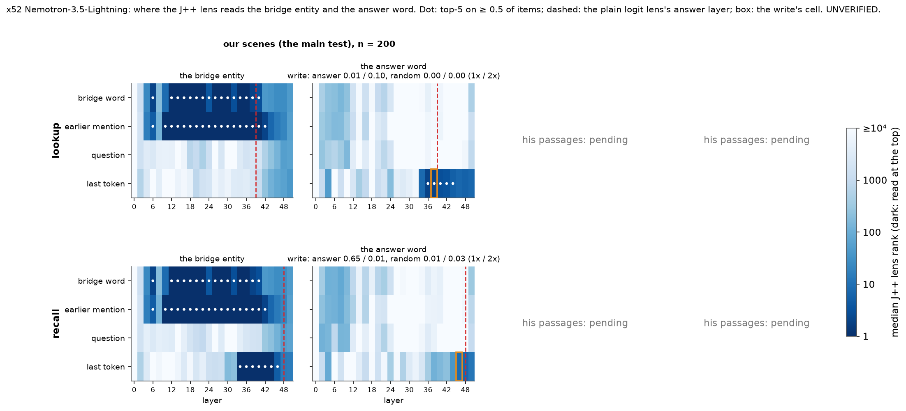
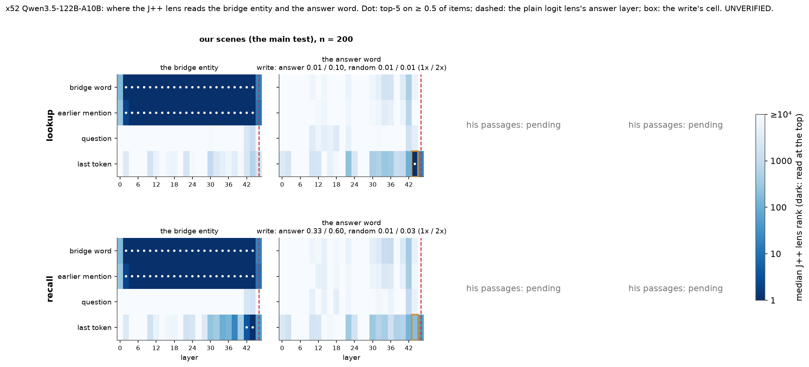

# x52 (batch 52 B): where can the lens read the answer, and can it write it? (UNVERIFIED)

Prediction: rule fixed in advance in jobs/c3/batch52.yaml (B); no prediction. Cluster bootstrap over the bridge entities (10000, seed 0).

Rules (Dan, jobs/c3/batch52.yaml brief B, verbatim):

- “Readable”: the answer word in the lens top-5 on ≥ 0.5 of items at some layer before the answer layer.
- “Usable”: writing its directions changes the answer on ≥ 0.3 of items with the random control ≤ 0.10.
- Report the four combinations per reader, per dataset.

As computed: the answer word = 51.12's (x51_answer: main the number word's one-letter-token variants, z2 the first token of the answer word's variants), its rank = 1 + tokens with a strictly higher J++ lens logit over the full vocabulary (best variant), on O; the answer layer = per item the first layer at which the plain logit lens's top token at the last token is the answer as read, the reader's lower median; 'before' = cached layers strictly below it; any token group counts; the write at the readable-most cell before the answer layer, 'changes the answer' = the top token becomes S's answer (the written word), at gain 1 or 2 with that gain's random control <= 0.10; point estimates decide (EPS 1e-9).

| model | dataset | reader | n | answer layer | readable (first cell; best before) | write cell | ans1 / ans2 | rand1 / rand2 | freq1 / freq2 | whole | usable | combination |
|---|---|---|---|---|---|---|---|---|---|---|---|---|
| nemotron-3.5-lightning | main | lookup | 200 | L39 (never 0) | **True** (['T', 36]; best T L38 0.91) | ['T', 38] | 0.01 [0.00, 0.02] / 0.10 [0.05, 0.14] | 0.00 [0.00, 0.00] / 0.00 [0.00, 0.00] | 0.00 [0.00, 0.00] / 0.01 [0.00, 0.02] | 0.93 [0.88, 0.98] | **False** | **readable, not usable** |
| nemotron-3.5-lightning | main | recall | 200 | L48 (never 0) | **False** (None; best T L46 0.41) | ['T', 46] | 0.65 [0.57, 0.74] / 0.01 [0.00, 0.03] | 0.01 [0.00, 0.02] / 0.03 [0.00, 0.07] | 0.01 [0.00, 0.03] / 0.00 [0.00, 0.00] | 1.00 [1.00, 1.00] | **True** | **usable, not readable** |
| nemotron-3.5-lightning | z2 | - | - | read pending | | | | | | | | |
| qwen3.5-122b-a10b | main | lookup | 200 | L46 (never 0) | **True** (['T', 44]; best T L44 0.95) | ['T', 44] | 0.01 [0.00, 0.03] / 0.10 [0.07, 0.13] | 0.01 [0.00, 0.02] / 0.01 [0.00, 0.02] | 0.01 [0.00, 0.02] / 0.01 [0.00, 0.02] | 0.10 [0.06, 0.14] | **False** | **readable, not usable** |
| qwen3.5-122b-a10b | main | recall | 200 | L46 (never 0) | **False** (None; best T L44 0.03) | ['T', 44] | 0.33 [0.22, 0.48] / 0.60 [0.51, 0.68] | 0.01 [0.00, 0.04] / 0.03 [0.01, 0.04] | 0.03 [0.00, 0.06] / 0.03 [0.01, 0.05] | 0.74 [0.65, 0.83] | **True** | **usable, not readable** |
| qwen3.5-122b-a10b | z2 | - | - | read pending | | | | | | | | |

## nemotron-3.5-lightning, our scenes (the main test): answer word in the J++ top-5 (share of items)

Read run nem35l_x52_read_main; groups: B = the bridge word (X0's position, 51.10's P1); E = the bridge entity's last mention before the bridge word (its locker sentence), where there is one; Q = the question's 'pick' token (51.10's P2); T = the appended space token (51.10's P3).

### lookup: answer layer L39 (quartiles [38.0, 39.0, 41.0]; never 0 of 200; 51.10's settle layer L46)

| group | n | L0 | L2 | L4 | L6 | L8 | L10 | L12 | L14 | L16 | L18 | L20 | L22 | L24 | L26 | L28 | L30 | L32 | L34 | L36 | L38 | L40 | L42 | L44 | L46 | L48 | L50 |
|---|---|---|---|---|---|---|---|---|---|---|---|---|---|---|---|---|---|---|---|---|---|---|---|---|---|---|---|
| bridge word | n 200 | 0.00 | 0.00 | 0.00 | 0.00 | 0.00 | 0.00 | 0.00 | 0.00 | 0.00 | 0.00 | 0.00 | 0.00 | 0.00 | 0.00 | 0.00 | 0.00 | 0.00 | 0.00 | 0.00 | 0.00 | 0.00 | 0.00 | 0.00 | 0.00 | 0.00 | 0.00 |
| earlier mention | n 85 | 0.00 | 0.00 | 0.00 | 0.00 | 0.00 | 0.00 | 0.00 | 0.00 | 0.00 | 0.00 | 0.00 | 0.00 | 0.00 | 0.00 | 0.00 | 0.00 | 0.00 | 0.00 | 0.00 | 0.00 | 0.00 | 0.00 | 0.00 | 0.00 | 0.00 | 0.00 |
| question | n 200 | 0.00 | 0.00 | 0.00 | 0.00 | 0.00 | 0.00 | 0.00 | 0.00 | 0.00 | 0.00 | 0.00 | 0.00 | 0.00 | 0.00 | 0.00 | 0.00 | 0.00 | 0.00 | 0.00 | 0.00 | 0.00 | 0.00 | 0.00 | 0.00 | 0.00 | 0.00 |
| last token | n 200 | 0.00 | 0.00 | 0.00 | 0.00 | 0.00 | 0.00 | 0.00 | 0.00 | 0.00 | 0.00 | 0.00 | 0.00 | 0.00 | 0.00 | 0.00 | 0.00 | 0.00 | 0.44 | 0.82 | 0.91 | 0.86 | 0.69 | 0.50 | 0.47 | 0.47 | 0.48 |

Bridge entity in the top-5:

| group | n | L0 | L2 | L4 | L6 | L8 | L10 | L12 | L14 | L16 | L18 | L20 | L22 | L24 | L26 | L28 | L30 | L32 | L34 | L36 | L38 | L40 | L42 | L44 | L46 | L48 | L50 |
|---|---|---|---|---|---|---|---|---|---|---|---|---|---|---|---|---|---|---|---|---|---|---|---|---|---|---|---|
| bridge word | n 200 | 0.00 | 0.00 | 0.32 | 0.56 | 0.01 | 0.47 | 0.97 | 0.97 | 0.99 | 0.96 | 0.79 | 0.60 | 0.55 | 0.98 | 0.88 | 0.98 | 0.59 | 0.74 | 0.92 | 0.65 | 0.57 | 0.32 | 0.23 | 0.14 | 0.17 | 0.01 |
| earlier mention | n 85 | 0.00 | 0.00 | 0.35 | 0.51 | 0.02 | 0.85 | 0.93 | 1.00 | 1.00 | 1.00 | 1.00 | 0.95 | 0.88 | 0.99 | 0.95 | 0.98 | 0.93 | 0.95 | 1.00 | 0.91 | 0.76 | 0.62 | 0.39 | 0.14 | 0.16 | 0.01 |
| question | n 200 | 0.00 | 0.00 | 0.00 | 0.00 | 0.00 | 0.00 | 0.00 | 0.00 | 0.00 | 0.00 | 0.00 | 0.00 | 0.00 | 0.00 | 0.00 | 0.00 | 0.00 | 0.00 | 0.00 | 0.00 | 0.00 | 0.00 | 0.00 | 0.00 | 0.06 | 0.01 |
| last token | n 200 | 0.00 | 0.00 | 0.00 | 0.00 | 0.00 | 0.00 | 0.00 | 0.00 | 0.00 | 0.00 | 0.00 | 0.00 | 0.00 | 0.00 | 0.00 | 0.00 | 0.00 | 0.03 | 0.01 | 0.03 | 0.03 | 0.07 | 0.09 | 0.04 | 0.04 | 0.00 |

S's answer word on O in the top-5 (a same-type distractor; baseline):

| group | n | L0 | L2 | L4 | L6 | L8 | L10 | L12 | L14 | L16 | L18 | L20 | L22 | L24 | L26 | L28 | L30 | L32 | L34 | L36 | L38 | L40 | L42 | L44 | L46 | L48 | L50 |
|---|---|---|---|---|---|---|---|---|---|---|---|---|---|---|---|---|---|---|---|---|---|---|---|---|---|---|---|
| bridge word | n 200 | 0.00 | 0.00 | 0.00 | 0.00 | 0.00 | 0.00 | 0.00 | 0.00 | 0.00 | 0.00 | 0.00 | 0.00 | 0.00 | 0.00 | 0.00 | 0.00 | 0.00 | 0.00 | 0.00 | 0.00 | 0.00 | 0.00 | 0.00 | 0.00 | 0.00 | 0.00 |
| earlier mention | n 85 | 0.00 | 0.00 | 0.00 | 0.00 | 0.00 | 0.00 | 0.00 | 0.00 | 0.00 | 0.00 | 0.00 | 0.00 | 0.00 | 0.00 | 0.00 | 0.00 | 0.00 | 0.00 | 0.00 | 0.00 | 0.00 | 0.00 | 0.00 | 0.00 | 0.00 | 0.00 |
| question | n 200 | 0.00 | 0.00 | 0.00 | 0.00 | 0.00 | 0.00 | 0.00 | 0.00 | 0.00 | 0.00 | 0.00 | 0.00 | 0.00 | 0.00 | 0.00 | 0.00 | 0.00 | 0.00 | 0.00 | 0.00 | 0.00 | 0.00 | 0.00 | 0.00 | 0.00 | 0.00 |
| last token | n 200 | 0.00 | 0.00 | 0.00 | 0.00 | 0.00 | 0.00 | 0.00 | 0.00 | 0.00 | 0.00 | 0.00 | 0.00 | 0.00 | 0.00 | 0.00 | 0.00 | 0.00 | 0.00 | 0.00 | 0.00 | 0.00 | 0.03 | 0.03 | 0.02 | 0.03 | 0.01 |

The answer word, whole-word variants only, in the top-5:

| group | n | L0 | L2 | L4 | L6 | L8 | L10 | L12 | L14 | L16 | L18 | L20 | L22 | L24 | L26 | L28 | L30 | L32 | L34 | L36 | L38 | L40 | L42 | L44 | L46 | L48 | L50 |
|---|---|---|---|---|---|---|---|---|---|---|---|---|---|---|---|---|---|---|---|---|---|---|---|---|---|---|---|
| bridge word | n 200 | 0.00 | 0.00 | 0.00 | 0.00 | 0.00 | 0.00 | 0.00 | 0.00 | 0.00 | 0.00 | 0.00 | 0.00 | 0.00 | 0.00 | 0.00 | 0.00 | 0.00 | 0.00 | 0.00 | 0.00 | 0.00 | 0.00 | 0.00 | 0.00 | 0.00 | 0.00 |
| earlier mention | n 85 | 0.00 | 0.00 | 0.00 | 0.00 | 0.00 | 0.00 | 0.00 | 0.00 | 0.00 | 0.00 | 0.00 | 0.00 | 0.00 | 0.00 | 0.00 | 0.00 | 0.00 | 0.00 | 0.00 | 0.00 | 0.00 | 0.00 | 0.00 | 0.00 | 0.00 | 0.00 |
| question | n 200 | 0.00 | 0.00 | 0.00 | 0.00 | 0.00 | 0.00 | 0.00 | 0.00 | 0.00 | 0.00 | 0.00 | 0.00 | 0.00 | 0.00 | 0.00 | 0.00 | 0.00 | 0.00 | 0.00 | 0.00 | 0.00 | 0.00 | 0.00 | 0.00 | 0.00 | 0.00 |
| last token | n 200 | 0.00 | 0.00 | 0.00 | 0.00 | 0.00 | 0.00 | 0.00 | 0.00 | 0.00 | 0.00 | 0.00 | 0.00 | 0.00 | 0.00 | 0.00 | 0.00 | 0.00 | 0.44 | 0.82 | 0.91 | 0.86 | 0.69 | 0.50 | 0.47 | 0.47 | 0.48 |

- the rule on the whole-word variants alone: True (first ['T', 36]); on S's answer word (the distractor, not the answer): False (first None)

### recall: answer layer L48 (quartiles [48.0, 48.0, 49.0]; never 0 of 200; 51.10's settle layer L48)

| group | n | L0 | L2 | L4 | L6 | L8 | L10 | L12 | L14 | L16 | L18 | L20 | L22 | L24 | L26 | L28 | L30 | L32 | L34 | L36 | L38 | L40 | L42 | L44 | L46 | L48 | L50 |
|---|---|---|---|---|---|---|---|---|---|---|---|---|---|---|---|---|---|---|---|---|---|---|---|---|---|---|---|
| bridge word | n 200 | 0.00 | 0.00 | 0.00 | 0.01 | 0.00 | 0.00 | 0.00 | 0.00 | 0.00 | 0.00 | 0.00 | 0.00 | 0.00 | 0.00 | 0.00 | 0.00 | 0.00 | 0.00 | 0.00 | 0.00 | 0.00 | 0.00 | 0.00 | 0.00 | 0.00 | 0.00 |
| earlier mention | n 85 | 0.00 | 0.00 | 0.00 | 0.00 | 0.00 | 0.00 | 0.00 | 0.00 | 0.00 | 0.00 | 0.00 | 0.00 | 0.00 | 0.00 | 0.00 | 0.00 | 0.00 | 0.00 | 0.00 | 0.00 | 0.00 | 0.00 | 0.00 | 0.00 | 0.00 | 0.00 |
| question | n 200 | 0.00 | 0.00 | 0.00 | 0.00 | 0.00 | 0.00 | 0.00 | 0.00 | 0.00 | 0.00 | 0.00 | 0.00 | 0.00 | 0.00 | 0.00 | 0.00 | 0.00 | 0.00 | 0.00 | 0.00 | 0.00 | 0.00 | 0.00 | 0.00 | 0.00 | 0.00 |
| last token | n 200 | 0.00 | 0.00 | 0.00 | 0.00 | 0.00 | 0.00 | 0.00 | 0.00 | 0.00 | 0.00 | 0.00 | 0.00 | 0.01 | 0.00 | 0.00 | 0.00 | 0.00 | 0.00 | 0.00 | 0.04 | 0.09 | 0.10 | 0.02 | 0.41 | 0.42 | 0.06 |

Bridge entity in the top-5:

| group | n | L0 | L2 | L4 | L6 | L8 | L10 | L12 | L14 | L16 | L18 | L20 | L22 | L24 | L26 | L28 | L30 | L32 | L34 | L36 | L38 | L40 | L42 | L44 | L46 | L48 | L50 |
|---|---|---|---|---|---|---|---|---|---|---|---|---|---|---|---|---|---|---|---|---|---|---|---|---|---|---|---|
| bridge word | n 200 | 0.00 | 0.00 | 0.32 | 0.56 | 0.01 | 0.47 | 0.97 | 0.97 | 0.99 | 0.96 | 0.79 | 0.60 | 0.55 | 0.98 | 0.88 | 0.98 | 0.59 | 0.74 | 0.92 | 0.65 | 0.57 | 0.32 | 0.23 | 0.14 | 0.17 | 0.01 |
| earlier mention | n 85 | 0.00 | 0.00 | 0.35 | 0.51 | 0.02 | 0.85 | 0.93 | 1.00 | 1.00 | 1.00 | 1.00 | 0.95 | 0.88 | 0.99 | 0.95 | 0.98 | 0.93 | 0.95 | 1.00 | 0.91 | 0.76 | 0.62 | 0.39 | 0.14 | 0.16 | 0.01 |
| question | n 200 | 0.00 | 0.00 | 0.00 | 0.00 | 0.00 | 0.00 | 0.00 | 0.00 | 0.00 | 0.00 | 0.00 | 0.00 | 0.00 | 0.00 | 0.00 | 0.00 | 0.00 | 0.00 | 0.00 | 0.00 | 0.00 | 0.01 | 0.01 | 0.04 | 0.10 | 0.01 |
| last token | n 200 | 0.00 | 0.00 | 0.00 | 0.00 | 0.00 | 0.00 | 0.00 | 0.00 | 0.00 | 0.01 | 0.01 | 0.00 | 0.01 | 0.03 | 0.02 | 0.06 | 0.07 | 0.96 | 0.96 | 0.88 | 0.80 | 0.82 | 0.82 | 0.52 | 0.25 | 0.01 |

S's answer word on O in the top-5 (a same-type distractor; baseline):

| group | n | L0 | L2 | L4 | L6 | L8 | L10 | L12 | L14 | L16 | L18 | L20 | L22 | L24 | L26 | L28 | L30 | L32 | L34 | L36 | L38 | L40 | L42 | L44 | L46 | L48 | L50 |
|---|---|---|---|---|---|---|---|---|---|---|---|---|---|---|---|---|---|---|---|---|---|---|---|---|---|---|---|
| bridge word | n 200 | 0.00 | 0.00 | 0.00 | 0.00 | 0.00 | 0.00 | 0.00 | 0.00 | 0.00 | 0.00 | 0.00 | 0.00 | 0.01 | 0.00 | 0.00 | 0.00 | 0.00 | 0.00 | 0.00 | 0.00 | 0.00 | 0.00 | 0.00 | 0.00 | 0.00 | 0.00 |
| earlier mention | n 85 | 0.00 | 0.00 | 0.00 | 0.00 | 0.00 | 0.00 | 0.00 | 0.00 | 0.00 | 0.00 | 0.00 | 0.00 | 0.00 | 0.00 | 0.00 | 0.00 | 0.00 | 0.00 | 0.00 | 0.00 | 0.00 | 0.01 | 0.00 | 0.00 | 0.01 | 0.00 |
| question | n 200 | 0.00 | 0.00 | 0.00 | 0.00 | 0.00 | 0.00 | 0.00 | 0.00 | 0.00 | 0.00 | 0.00 | 0.00 | 0.00 | 0.00 | 0.00 | 0.00 | 0.00 | 0.00 | 0.00 | 0.00 | 0.00 | 0.00 | 0.00 | 0.00 | 0.00 | 0.00 |
| last token | n 200 | 0.00 | 0.00 | 0.00 | 0.00 | 0.00 | 0.00 | 0.00 | 0.00 | 0.00 | 0.00 | 0.00 | 0.00 | 0.01 | 0.00 | 0.00 | 0.00 | 0.00 | 0.00 | 0.00 | 0.01 | 0.00 | 0.00 | 0.00 | 0.01 | 0.01 | 0.01 |

The answer word, whole-word variants only, in the top-5:

| group | n | L0 | L2 | L4 | L6 | L8 | L10 | L12 | L14 | L16 | L18 | L20 | L22 | L24 | L26 | L28 | L30 | L32 | L34 | L36 | L38 | L40 | L42 | L44 | L46 | L48 | L50 |
|---|---|---|---|---|---|---|---|---|---|---|---|---|---|---|---|---|---|---|---|---|---|---|---|---|---|---|---|
| bridge word | n 200 | 0.00 | 0.00 | 0.00 | 0.01 | 0.00 | 0.00 | 0.00 | 0.00 | 0.00 | 0.00 | 0.00 | 0.00 | 0.00 | 0.00 | 0.00 | 0.00 | 0.00 | 0.00 | 0.00 | 0.00 | 0.00 | 0.00 | 0.00 | 0.00 | 0.00 | 0.00 |
| earlier mention | n 85 | 0.00 | 0.00 | 0.00 | 0.00 | 0.00 | 0.00 | 0.00 | 0.00 | 0.00 | 0.00 | 0.00 | 0.00 | 0.00 | 0.00 | 0.00 | 0.00 | 0.00 | 0.00 | 0.00 | 0.00 | 0.00 | 0.00 | 0.00 | 0.00 | 0.00 | 0.00 |
| question | n 200 | 0.00 | 0.00 | 0.00 | 0.00 | 0.00 | 0.00 | 0.00 | 0.00 | 0.00 | 0.00 | 0.00 | 0.00 | 0.00 | 0.00 | 0.00 | 0.00 | 0.00 | 0.00 | 0.00 | 0.00 | 0.00 | 0.00 | 0.00 | 0.00 | 0.00 | 0.00 |
| last token | n 200 | 0.00 | 0.00 | 0.00 | 0.00 | 0.00 | 0.00 | 0.00 | 0.00 | 0.00 | 0.00 | 0.00 | 0.00 | 0.01 | 0.00 | 0.00 | 0.00 | 0.00 | 0.00 | 0.00 | 0.04 | 0.09 | 0.10 | 0.02 | 0.41 | 0.42 | 0.06 |

- the rule on the whole-word variants alone: False (first None); on S's answer word (the distractor, not the answer): False (first None)

Write (switch to the written answer; changed away from O's answer):

| reader | cell | n | none | whole | ans1 | ans2 | rand1 | rand2 | freq1 | freq2 | s median | size from B |
|---|---|---|---|---|---|---|---|---|---|---|---|---|
| lookup | ['T', 38] | 200 | 0.00 [0.00, 0.00]; 0.01 | 0.93 [0.88, 0.98]; 0.94 | 0.01 [0.00, 0.02]; 0.01 | 0.10 [0.05, 0.14]; 0.10 | 0.00 [0.00, 0.00]; 0.01 | 0.00 [0.00, 0.00]; 0.01 | 0.00 [0.00, 0.00]; 0.01 | 0.01 [0.00, 0.02]; 0.06 | 114.87 | 0 |
| recall | ['T', 46] | 200 | 0.01 [0.00, 0.02]; 0.01 | 1.00 [1.00, 1.00]; 1.00 | 0.65 [0.57, 0.74]; 0.83 | 0.01 [0.00, 0.03]; 1.00 | 0.01 [0.00, 0.02]; 0.07 | 0.03 [0.00, 0.07]; 0.17 | 0.01 [0.00, 0.03]; 0.23 | 0.00 [0.00, 0.00]; 0.99 | 267.84 | 0 |

## qwen3.5-122b-a10b, our scenes (the main test): answer word in the J++ top-5 (share of items)

Read run qwen35_122b_x52_read_main; groups: B = the bridge word (X0's position, 51.10's P1); E = the bridge entity's last mention before the bridge word (its locker sentence), where there is one; Q = the question's 'pick' token (51.10's P2); T = the appended space token (51.10's P3).

### lookup: answer layer L46 (quartiles [46.0, 46.0, 46.0]; never 0 of 200; 51.10's settle layer L46)

| group | n | L0 | L2 | L4 | L6 | L8 | L10 | L12 | L14 | L16 | L18 | L20 | L22 | L24 | L26 | L28 | L30 | L32 | L34 | L36 | L38 | L40 | L42 | L44 | L46 |
|---|---|---|---|---|---|---|---|---|---|---|---|---|---|---|---|---|---|---|---|---|---|---|---|---|---|
| bridge word | n 200 | 0.00 | 0.00 | 0.00 | 0.00 | 0.00 | 0.00 | 0.00 | 0.00 | 0.00 | 0.00 | 0.00 | 0.00 | 0.00 | 0.00 | 0.00 | 0.00 | 0.00 | 0.00 | 0.00 | 0.00 | 0.00 | 0.00 | 0.00 | 0.00 |
| earlier mention | n 85 | 0.00 | 0.00 | 0.00 | 0.00 | 0.00 | 0.00 | 0.00 | 0.00 | 0.00 | 0.00 | 0.00 | 0.00 | 0.00 | 0.00 | 0.00 | 0.00 | 0.00 | 0.00 | 0.00 | 0.00 | 0.00 | 0.00 | 0.00 | 0.00 |
| question | n 200 | 0.00 | 0.00 | 0.00 | 0.00 | 0.00 | 0.00 | 0.00 | 0.00 | 0.00 | 0.00 | 0.00 | 0.00 | 0.00 | 0.00 | 0.00 | 0.00 | 0.00 | 0.00 | 0.00 | 0.00 | 0.00 | 0.00 | 0.00 | 0.00 |
| last token | n 200 | 0.00 | 0.00 | 0.00 | 0.00 | 0.00 | 0.00 | 0.00 | 0.00 | 0.00 | 0.00 | 0.00 | 0.00 | 0.00 | 0.00 | 0.00 | 0.00 | 0.00 | 0.00 | 0.00 | 0.00 | 0.00 | 0.01 | 0.95 | 0.00 |

Bridge entity in the top-5:

| group | n | L0 | L2 | L4 | L6 | L8 | L10 | L12 | L14 | L16 | L18 | L20 | L22 | L24 | L26 | L28 | L30 | L32 | L34 | L36 | L38 | L40 | L42 | L44 | L46 |
|---|---|---|---|---|---|---|---|---|---|---|---|---|---|---|---|---|---|---|---|---|---|---|---|---|---|
| bridge word | n 200 | 0.16 | 0.83 | 1.00 | 1.00 | 0.98 | 1.00 | 1.00 | 1.00 | 1.00 | 1.00 | 1.00 | 1.00 | 1.00 | 1.00 | 0.99 | 1.00 | 1.00 | 1.00 | 1.00 | 1.00 | 0.99 | 0.96 | 1.00 | 0.33 |
| earlier mention | n 85 | 0.16 | 0.82 | 1.00 | 1.00 | 1.00 | 1.00 | 1.00 | 1.00 | 1.00 | 1.00 | 1.00 | 1.00 | 1.00 | 1.00 | 1.00 | 1.00 | 1.00 | 1.00 | 1.00 | 1.00 | 1.00 | 0.99 | 1.00 | 0.38 |
| question | n 200 | 0.00 | 0.00 | 0.01 | 0.01 | 0.00 | 0.00 | 0.01 | 0.01 | 0.01 | 0.00 | 0.00 | 0.00 | 0.00 | 0.00 | 0.00 | 0.00 | 0.00 | 0.00 | 0.00 | 0.00 | 0.00 | 0.00 | 0.00 | 0.00 |
| last token | n 200 | 0.00 | 0.00 | 0.00 | 0.00 | 0.00 | 0.00 | 0.00 | 0.00 | 0.00 | 0.00 | 0.00 | 0.00 | 0.00 | 0.00 | 0.00 | 0.00 | 0.00 | 0.00 | 0.00 | 0.01 | 0.00 | 0.00 | 0.02 | 0.00 |

S's answer word on O in the top-5 (a same-type distractor; baseline):

| group | n | L0 | L2 | L4 | L6 | L8 | L10 | L12 | L14 | L16 | L18 | L20 | L22 | L24 | L26 | L28 | L30 | L32 | L34 | L36 | L38 | L40 | L42 | L44 | L46 |
|---|---|---|---|---|---|---|---|---|---|---|---|---|---|---|---|---|---|---|---|---|---|---|---|---|---|
| bridge word | n 200 | 0.00 | 0.00 | 0.00 | 0.00 | 0.00 | 0.00 | 0.00 | 0.00 | 0.00 | 0.00 | 0.00 | 0.00 | 0.00 | 0.00 | 0.00 | 0.00 | 0.00 | 0.00 | 0.00 | 0.00 | 0.00 | 0.00 | 0.00 | 0.00 |
| earlier mention | n 85 | 0.00 | 0.00 | 0.00 | 0.00 | 0.00 | 0.00 | 0.00 | 0.00 | 0.00 | 0.00 | 0.00 | 0.00 | 0.00 | 0.00 | 0.00 | 0.00 | 0.00 | 0.00 | 0.00 | 0.00 | 0.00 | 0.00 | 0.00 | 0.00 |
| question | n 200 | 0.00 | 0.00 | 0.00 | 0.00 | 0.00 | 0.00 | 0.00 | 0.00 | 0.00 | 0.00 | 0.00 | 0.00 | 0.00 | 0.00 | 0.00 | 0.00 | 0.00 | 0.00 | 0.00 | 0.00 | 0.00 | 0.00 | 0.00 | 0.00 |
| last token | n 200 | 0.00 | 0.00 | 0.00 | 0.00 | 0.00 | 0.00 | 0.00 | 0.00 | 0.00 | 0.00 | 0.00 | 0.00 | 0.00 | 0.00 | 0.00 | 0.00 | 0.00 | 0.00 | 0.00 | 0.00 | 0.00 | 0.01 | 0.03 | 0.00 |

The answer word, whole-word variants only, in the top-5:

| group | n | L0 | L2 | L4 | L6 | L8 | L10 | L12 | L14 | L16 | L18 | L20 | L22 | L24 | L26 | L28 | L30 | L32 | L34 | L36 | L38 | L40 | L42 | L44 | L46 |
|---|---|---|---|---|---|---|---|---|---|---|---|---|---|---|---|---|---|---|---|---|---|---|---|---|---|
| bridge word | n 200 | 0.00 | 0.00 | 0.00 | 0.00 | 0.00 | 0.00 | 0.00 | 0.00 | 0.00 | 0.00 | 0.00 | 0.00 | 0.00 | 0.00 | 0.00 | 0.00 | 0.00 | 0.00 | 0.00 | 0.00 | 0.00 | 0.00 | 0.00 | 0.00 |
| earlier mention | n 85 | 0.00 | 0.00 | 0.00 | 0.00 | 0.00 | 0.00 | 0.00 | 0.00 | 0.00 | 0.00 | 0.00 | 0.00 | 0.00 | 0.00 | 0.00 | 0.00 | 0.00 | 0.00 | 0.00 | 0.00 | 0.00 | 0.00 | 0.00 | 0.00 |
| question | n 200 | 0.00 | 0.00 | 0.00 | 0.00 | 0.00 | 0.00 | 0.00 | 0.00 | 0.00 | 0.00 | 0.00 | 0.00 | 0.00 | 0.00 | 0.00 | 0.00 | 0.00 | 0.00 | 0.00 | 0.00 | 0.00 | 0.00 | 0.00 | 0.00 |
| last token | n 200 | 0.00 | 0.00 | 0.00 | 0.00 | 0.00 | 0.00 | 0.00 | 0.00 | 0.00 | 0.00 | 0.00 | 0.00 | 0.00 | 0.00 | 0.00 | 0.00 | 0.00 | 0.00 | 0.00 | 0.00 | 0.00 | 0.01 | 0.95 | 0.00 |

- the rule on the whole-word variants alone: True (first ['T', 44]); on S's answer word (the distractor, not the answer): False (first None)

### recall: answer layer L46 (quartiles [46.0, 46.0, 46.0]; never 0 of 200; 51.10's settle layer L46)

| group | n | L0 | L2 | L4 | L6 | L8 | L10 | L12 | L14 | L16 | L18 | L20 | L22 | L24 | L26 | L28 | L30 | L32 | L34 | L36 | L38 | L40 | L42 | L44 | L46 |
|---|---|---|---|---|---|---|---|---|---|---|---|---|---|---|---|---|---|---|---|---|---|---|---|---|---|
| bridge word | n 200 | 0.00 | 0.00 | 0.00 | 0.00 | 0.00 | 0.00 | 0.00 | 0.00 | 0.00 | 0.00 | 0.00 | 0.00 | 0.00 | 0.00 | 0.00 | 0.00 | 0.00 | 0.00 | 0.00 | 0.00 | 0.00 | 0.01 | 0.00 | 0.00 |
| earlier mention | n 85 | 0.00 | 0.00 | 0.00 | 0.00 | 0.00 | 0.00 | 0.00 | 0.00 | 0.00 | 0.00 | 0.00 | 0.00 | 0.00 | 0.00 | 0.00 | 0.00 | 0.00 | 0.00 | 0.00 | 0.00 | 0.00 | 0.00 | 0.00 | 0.00 |
| question | n 200 | 0.00 | 0.00 | 0.00 | 0.00 | 0.00 | 0.00 | 0.00 | 0.00 | 0.00 | 0.00 | 0.00 | 0.00 | 0.00 | 0.00 | 0.00 | 0.00 | 0.00 | 0.00 | 0.00 | 0.00 | 0.00 | 0.00 | 0.00 | 0.00 |
| last token | n 200 | 0.00 | 0.00 | 0.00 | 0.00 | 0.00 | 0.00 | 0.00 | 0.00 | 0.00 | 0.00 | 0.00 | 0.00 | 0.00 | 0.00 | 0.00 | 0.00 | 0.00 | 0.00 | 0.00 | 0.00 | 0.00 | 0.00 | 0.03 | 0.00 |

Bridge entity in the top-5:

| group | n | L0 | L2 | L4 | L6 | L8 | L10 | L12 | L14 | L16 | L18 | L20 | L22 | L24 | L26 | L28 | L30 | L32 | L34 | L36 | L38 | L40 | L42 | L44 | L46 |
|---|---|---|---|---|---|---|---|---|---|---|---|---|---|---|---|---|---|---|---|---|---|---|---|---|---|
| bridge word | n 200 | 0.16 | 0.83 | 1.00 | 1.00 | 0.98 | 1.00 | 1.00 | 1.00 | 1.00 | 1.00 | 1.00 | 1.00 | 1.00 | 1.00 | 0.99 | 1.00 | 1.00 | 1.00 | 1.00 | 1.00 | 0.99 | 0.96 | 1.00 | 0.33 |
| earlier mention | n 85 | 0.16 | 0.82 | 1.00 | 1.00 | 1.00 | 1.00 | 1.00 | 1.00 | 1.00 | 1.00 | 1.00 | 1.00 | 1.00 | 1.00 | 1.00 | 1.00 | 1.00 | 1.00 | 1.00 | 1.00 | 1.00 | 0.99 | 1.00 | 0.38 |
| question | n 200 | 0.00 | 0.00 | 0.01 | 0.00 | 0.00 | 0.00 | 0.00 | 0.00 | 0.00 | 0.00 | 0.00 | 0.00 | 0.00 | 0.00 | 0.00 | 0.00 | 0.00 | 0.00 | 0.00 | 0.00 | 0.00 | 0.00 | 0.00 | 0.00 |
| last token | n 200 | 0.00 | 0.00 | 0.00 | 0.00 | 0.00 | 0.00 | 0.00 | 0.00 | 0.00 | 0.00 | 0.00 | 0.00 | 0.00 | 0.00 | 0.01 | 0.01 | 0.01 | 0.05 | 0.14 | 0.24 | 0.03 | 0.55 | 0.92 | 0.00 |

S's answer word on O in the top-5 (a same-type distractor; baseline):

| group | n | L0 | L2 | L4 | L6 | L8 | L10 | L12 | L14 | L16 | L18 | L20 | L22 | L24 | L26 | L28 | L30 | L32 | L34 | L36 | L38 | L40 | L42 | L44 | L46 |
|---|---|---|---|---|---|---|---|---|---|---|---|---|---|---|---|---|---|---|---|---|---|---|---|---|---|
| bridge word | n 200 | 0.00 | 0.00 | 0.00 | 0.00 | 0.00 | 0.00 | 0.00 | 0.00 | 0.00 | 0.00 | 0.00 | 0.00 | 0.00 | 0.00 | 0.00 | 0.00 | 0.00 | 0.00 | 0.00 | 0.00 | 0.00 | 0.00 | 0.00 | 0.00 |
| earlier mention | n 85 | 0.00 | 0.00 | 0.00 | 0.00 | 0.00 | 0.00 | 0.00 | 0.00 | 0.00 | 0.00 | 0.00 | 0.00 | 0.00 | 0.00 | 0.00 | 0.00 | 0.00 | 0.00 | 0.00 | 0.00 | 0.00 | 0.00 | 0.00 | 0.00 |
| question | n 200 | 0.00 | 0.00 | 0.00 | 0.00 | 0.00 | 0.00 | 0.00 | 0.00 | 0.00 | 0.00 | 0.00 | 0.00 | 0.00 | 0.00 | 0.00 | 0.00 | 0.00 | 0.00 | 0.00 | 0.00 | 0.00 | 0.00 | 0.00 | 0.00 |
| last token | n 200 | 0.00 | 0.00 | 0.00 | 0.00 | 0.00 | 0.00 | 0.00 | 0.00 | 0.00 | 0.00 | 0.00 | 0.00 | 0.00 | 0.00 | 0.00 | 0.00 | 0.00 | 0.00 | 0.00 | 0.00 | 0.00 | 0.00 | 0.00 | 0.00 |

The answer word, whole-word variants only, in the top-5:

| group | n | L0 | L2 | L4 | L6 | L8 | L10 | L12 | L14 | L16 | L18 | L20 | L22 | L24 | L26 | L28 | L30 | L32 | L34 | L36 | L38 | L40 | L42 | L44 | L46 |
|---|---|---|---|---|---|---|---|---|---|---|---|---|---|---|---|---|---|---|---|---|---|---|---|---|---|
| bridge word | n 200 | 0.00 | 0.00 | 0.00 | 0.00 | 0.00 | 0.00 | 0.00 | 0.00 | 0.00 | 0.00 | 0.00 | 0.00 | 0.00 | 0.00 | 0.00 | 0.00 | 0.00 | 0.00 | 0.00 | 0.00 | 0.00 | 0.01 | 0.00 | 0.00 |
| earlier mention | n 85 | 0.00 | 0.00 | 0.00 | 0.00 | 0.00 | 0.00 | 0.00 | 0.00 | 0.00 | 0.00 | 0.00 | 0.00 | 0.00 | 0.00 | 0.00 | 0.00 | 0.00 | 0.00 | 0.00 | 0.00 | 0.00 | 0.00 | 0.00 | 0.00 |
| question | n 200 | 0.00 | 0.00 | 0.00 | 0.00 | 0.00 | 0.00 | 0.00 | 0.00 | 0.00 | 0.00 | 0.00 | 0.00 | 0.00 | 0.00 | 0.00 | 0.00 | 0.00 | 0.00 | 0.00 | 0.00 | 0.00 | 0.00 | 0.00 | 0.00 |
| last token | n 200 | 0.00 | 0.00 | 0.00 | 0.00 | 0.00 | 0.00 | 0.00 | 0.00 | 0.00 | 0.00 | 0.00 | 0.00 | 0.00 | 0.00 | 0.00 | 0.00 | 0.00 | 0.00 | 0.00 | 0.00 | 0.00 | 0.00 | 0.03 | 0.00 |

- the rule on the whole-word variants alone: False (first None); on S's answer word (the distractor, not the answer): False (first None)

Write (switch to the written answer; changed away from O's answer):

| reader | cell | n | none | whole | ans1 | ans2 | rand1 | rand2 | freq1 | freq2 | s median | size from B |
|---|---|---|---|---|---|---|---|---|---|---|---|---|
| lookup | ['T', 44] | 200 | 0.01 [0.00, 0.02]; 0.01 | 0.10 [0.06, 0.14]; 0.10 | 0.01 [0.00, 0.03]; 0.01 | 0.10 [0.07, 0.13]; 0.11 | 0.01 [0.00, 0.02]; 0.01 | 0.01 [0.00, 0.02]; 0.01 | 0.01 [0.00, 0.02]; 0.01 | 0.01 [0.00, 0.02]; 0.14 | 4.77 | 0 |
| recall | ['T', 44] | 200 | 0.01 [0.00, 0.04]; 0.03 | 0.74 [0.65, 0.83]; 0.77 | 0.33 [0.22, 0.48]; 0.39 | 0.60 [0.51, 0.68]; 0.87 | 0.01 [0.00, 0.04]; 0.04 | 0.03 [0.01, 0.04]; 0.07 | 0.03 [0.00, 0.06]; 0.08 | 0.03 [0.01, 0.05]; 0.71 | 5.50 | 0 |

Arms: none = O unedited; whole = Δ = h_S - h_O added at the cell (the whole state patched; the upper bound, beside); ans1 = s u: u the unit sum of the J++ lens directions of S's answer word's tokens, s = ||Δ|| at the cell; ans2 = 2 s u; rand1 = s u R^T (R: X0's random basis at the layer, seed 888 + layer): a random part of the same size; rand2 = 2 s u R^T; freq1 = s u_F: F per answer token one unrelated letter token, BPE id within a factor 2, closest J++ readout norm; freq2 = 2 s u_F.
